# GitHub Releases — Portalab

> Release notes for the GitLab and GitHub release pages. The **first `# vX.Y.Z` block** of this file is what
> the release pipeline posts (`release:gitlab` / `release:github`), and `npm run release` refuses to run
> unless that block is the version about to be released. Write the new block at the top, in English,
> **before** `npm run release:full`; `npm run release:notes` shows what will be posted. The version that
> block announces is the one released when it is above the current one (a major or minor release is chosen
> by writing its notes); otherwise the commits decide (`feat` → minor, `fix` → patch).
>
> Every release after v1.0.0 lists the GitLab issues it closes, sorted by kind: `npm run release:issues`
> prints them (security, fixed, new, documentation and tooling, improved) — rewrite each title in English,
> as a member or an administrator would read it. The GitLab instance is private: no issue number, each line
> starts with its kind's tag instead (`security`, `bug`, `feat`, `doc`, `improvement`). The release script
> refuses notes without a `### Closed issues` part (v1.0.0, the first public release, is the exception).
>
> Images are absolute links pinned to the tag (`https://raw.githubusercontent.com/sharkhunterr/portalab/vX.Y.Z/assets/screenshots/<name>.jpg`):
> release pages do not resolve relative paths.
>
> Template:
>
> ```markdown
> # vX.Y.Z
>
> ## Portalab vX.Y.Z — <short title>
>
> <one or two sentences: what this release brings>
>
> <a screenshot of the headline feature, when there is one>
>
> ### Highlights
> - **<feature>** — what a member or an administrator can now do.
>
> ### Closed issues
>
> #### Security
> - `security` <what was exposed, what is closed now>
>
> #### Fixed
> - `bug` <the symptom as users saw it — what happens now>
>
> #### New
> - `feat` <what members or administrators can now do>
>
> #### Documentation and tooling
> - `doc` …
>
> #### Improved
> - `improvement` …
>
> ### Upgrading
> - `docker compose pull && docker compose up -d` (the migrations run before Portalab restarts); anything else to do.
>
> ---
> ```

---

# v1.4.0

## Portalab v1.4.0 — two-step verification, and a portal hardened and checked at every release

**Members can protect their account with a code from an authenticator app**, and are told when something
changes on their account. Signing in now works on a portal reached in plain HTTP from the LAN (the setup
wizard no longer stops at « Authentication required »). Behind the scenes, every release is now scanned,
fuzzed and signed before it is published.

### Highlights

- **Two-step verification** — in *My account*, a member turns it on with their password, scans a QR code
  with any authenticator app (Aegis, Google Authenticator, 2FAS, Bitwarden…) and gets ten single-use recovery
  codes. Signing in then asks for the password, then a code. An administrator can turn it off for a member
  who lost their phone and their codes. Accounts of the single sign-on keep their provider's own.
- **Told about your account's security** — a notice (and an e-mail when enabled) when the password is
  changed or set by an administrator, a single sign-on account is linked, the account is blocked by the
  intrusion guard, or two-step verification is turned on or off.
- **E-mails that say what they are about** — each notification e-mail now shows its details (who, what,
  when, the amounts…) instead of the same title and button for everything.
- **Checked before it ships** — each image is scanned (Trivy, OWASP ZAP), the API fuzzed from its contract,
  and the image published is the one that was checked. It comes with its SBOM and is signed: verify it with
  `cosign verify --key cosign.pub sharkhunterr/portalab:1.4.0` (see *Checking the image you run*).

### Closed issues

#### Security

- `security` Two-step verification (TOTP) for local accounts, with recovery codes
- `security` Members are told about their account's security events: password changed or set, single
  sign-on linked, account blocked, two-step verification turned on or off
- `security` Common and leaked passwords are refused (offline list of the 100,000 most used), as is a
  password holding the login or the name
- `security` Sign-ins are audited; CSRF and single sign-on failures are logged; API answers are never cached
  and the browser's cache is cleared at sign-out; backup archives cannot ask for excessive key-derivation work
- `security` A single sign-on links an existing account by e-mail only when the provider vouches for that
  e-mail (a setting allows providers that never say), and the provider's issuer is checked
- `security` A plugin's database queries run on its own connections, signed in as its own role: it can no
  longer step out of its schema
- `security` Fixes found by fuzzing the API: a crafted log line could slow the server (ReDoS), a news
  source could be pointed at an internal address after its check (DNS rebinding), malformed input could
  answer « internal error » instead of a clear refusal
- `security` The database container runs read-only, without privileges it does not need
- `security` Every release is scanned (Bandit, Semgrep, Trivy image and configuration, OWASP ZAP, API
  fuzzing), published with its SBOM, signed with cosign, and rescanned every week
- `security` An OWASP ASVS 5.0 level 2 review of the portal, published in the documentation

#### Fixed

- `bug` Signing in did nothing on a portal reached in plain HTTP from the LAN, and the setup wizard stopped
  at « Authentication required »; it now works, keeping the secure cookies over HTTPS
- `bug` The « services degraded » banner appeared without having been asked for; it is now an automation
  template, off unless an administrator turns it on
- `bug` The XP and coins of a review showed as « Plays (other kinds) »; they now show as « Reviews »

#### New

- `feat` Notification e-mails show what each one is about, with its details

#### Improved

- `improvement` Pages load faster: no more database queries repeated in a loop (the slowest page went from
  over a second to about a tenth), and a first visit downloads half as much
- `improvement` Dead code removed and stricter code checks, now blocking in the release pipeline

### Upgrading

- `docker compose pull && docker compose up -d` (the migrations run before Portalab restarts). This release
  adds the tables of two-step verification.
- The reference `docker-compose.yml` now runs the database container read-only with fewer privileges: take
  the new file to benefit from it (your `.env` and `appdata/` stay as they are).

---

# v1.3.0

## Portalab v1.3.0 — choose what a backup brings into a new portal

**Importing a backup is no longer all or nothing.** A new portal's arrival wizard now shows the archive's
parts to tick: keep the services, automations, marketplace, e-mail settings and gamification, and leave the
members out, for instance. What a part needs comes with it, and the Admin's account always comes.

### Highlights

- **What to bring, part by part** — after checking the archive, the wizard lists its parts as cards: site and
  settings, members, services, e-mail and notifications, media, statistics, automations and workflows,
  content, gamification, marketplace, look, plugins, AI assistant, service status, and the technical history
  when it was saved. Each says what it holds. Everything is ticked; untick what this portal should not take.
- **Linked parts follow** — ticking the marketplace ticks the gamification (its currency), and the card says
  why; media and automations bring the services. Each module's settings follow its part: the e-mail server
  comes with *E-mail and notifications*. Nothing is left pointing at something that did not come.
- **Without the members** — the Admin's account is the only one brought. What the members made (automations,
  pages, articles, products, decisions) is handed to the Admin; what was theirs (balances, XP, achievements,
  purchases, play history) stays out, and the gamification starts with everyone at zero.

### Closed issues

#### New

- `feat` Choose what a backup brings into a new portal: parts to tick, what each needs brought with it, the
  Admin's account always, the other members only when chosen

### Upgrading

- `docker compose pull && docker compose up -d` (the migrations run before Portalab restarts). No migration
  in this release. Every part ticked imports the whole portal, as before; older archives work as they are.

---

# v1.2.0

## Portalab v1.2.0 — play streaks you can see, audiobooks that count

**Play streaks get a page of their own.** Members see how far their streak has gone, the road to the next
multiplier and their last two weeks at a glance. Administrators follow every member's streak from the
gamification overview. Audiobooks listened to in Grimmory now count as one sitting, and finishing one earns
its reward. Book requests show their cover in the automatic newsletters. And installing Portalab now takes
one `docker compose up -d`, on Unraid too.

### Highlights

- **A streak card on the progression page** — a flame that burns hotter with each tier, and whether today
  already counts or is still to play before midnight. Below it, a progress bar cut at each tier (×1.5, ×2…)
  lights up as the days go by. A strip of the last 14 days shows each day as counted, covered by a freeze,
  missed, or still to play today. The card also shows the member's record and the freezes they hold.
- **Every member's streak for the administrators** — the gamification overview lists each member's
  streak, the longest first. Each row shows the multiplier and progress towards the tiers, whether today
  counts, the last 14 days, the record and the freezes held. A member's name filters the overview to them.
- **Installed with one command, on Unraid too** — the Compose file creates its folder and its secrets on
  the first start, migrates the database and starts Portalab. Everything lives in one folder (`appdata/`).
  On Unraid, paste it as a Docker Compose Manager stack: Portalab shows in the Docker tab with its icon and
  WebUI.

### Closed issues

#### Fixed

- `bug` An audiobook listened to in Grimmory showed up as many short « interrupted session » lines; a
  sitting is now one line, like a film
- `bug` Finishing an audiobook (in Grimmory or in Portalab's player) was not detected; it now earns the
  rewards the administrator set for a finished audiobook, from the administrator's « finished » threshold
- `bug` Automatic newsletters showed requested books without a cover or details; they now show the book's
  cover and its description, year, genres and rating from Hardcover, linked to its sheet
- `bug` Automatic newsletters could not show the poster of a requested film or series not yet in the
  library; it now shows
- `bug` On a first install, the migrations could start while the database was still being created, and
  fail; they now wait for it

#### New

- `feat` A play streak card on the progression page: the road to the tiers, the last 14 days, the record
  and the freezes held
- `feat` Every member's play streak in the gamification overview
- `feat` A Compose file that needs no preparation: one `docker compose up -d` creates the folders and the
  secrets, migrates and starts Portalab, and stops with a clear message instead of replacing a lost secret

#### Documentation and tooling

- `doc` A frontend test no longer fails on a slow CI runner
- `doc` Installing on Unraid with Docker Compose Manager, and an `.env` example listing every Compose variable

### Upgrading

- `docker compose pull && docker compose up -d` with the new Compose file: the migrations now run on their
  own (media). The upgrade merges past Grimmory audiobook pieces into one play per sitting. The XP those
  pieces earned stays earned. A book whose last sitting reached its end gets its finish reward at the next
  reading of Grimmory's history.
- **The Compose file changed.** Portalab's files, the database and the secrets now live in one folder
  (`appdata/`) instead of Docker volumes and a `secrets/` folder. Move them once before switching to the new
  file, as described in
  [Coming from the Compose file of Portalab 1.1 or earlier](https://github.com/sharkhunterr/portalab/blob/v1.2.0/docs/getting-started.md#coming-from-the-compose-file-of-portalab-11-or-earlier).
  Until then, your current Compose file keeps working with 1.2.0.

---

# v1.1.0

## Portalab v1.1.0 — every book, saga and game to ask for, newsletters that write themselves

**The biggest update since launch.** Members can now find and ask for any book, audiobook or game — not only
films and series — with a full sheet even when the library doesn't have it yet. Every saga, book series and
game franchise gets its own page. Members review what they watched and report a problem in two clicks.
Newsletters write themselves and land in inboxes in Portalab's own look, each member gets a news feed of
their own, quests move to the Games page with a monthly media bingo, and booster openings get a whole new
range of scenes, in video and over the whole screen.

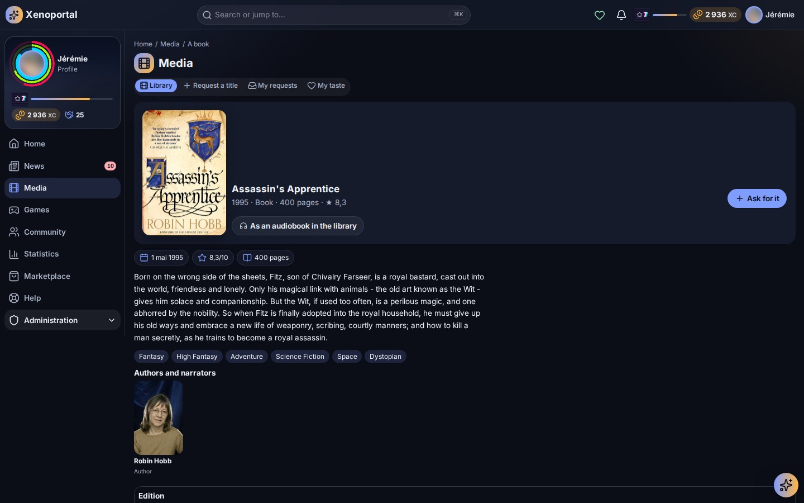

### Highlights

- **Ask for any title, not just films and series** — books, audiobooks, comics and games are asked for the
  way films are: the same « Request a title », the same « My requests » with each cover, the same queue
  and figures for the administrators. A request opens in a window over the page you are on, and Portalab
  says at once when the library already has the title or another member asked for it. When a book or a game
  arrives, the request turns « Available » by itself. Administrators choose which kinds members may ask for
  in the new *Title requests* module.

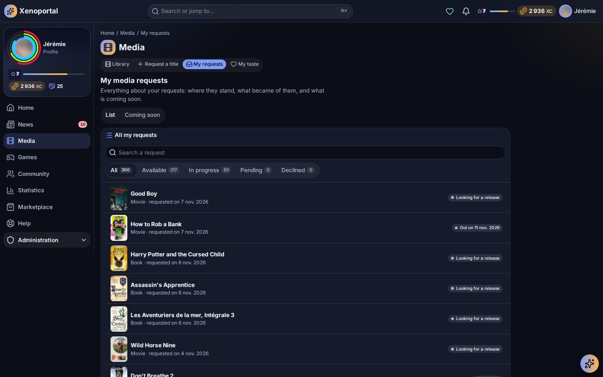

- **A sheet for every book and game, in the library or not** — with Hardcover, an author's page lists their
  whole bibliography and a book series every volume, owned or missing, in the member's language and in the
  editions the administrator prefers. A missing book opens on a sheet laid out like a library title:
  description, series, editions, authors — and « Ask for it ». A book held only as an audiobook stays
  available to ask for as a book. Search suggests the books and games to ask for next to the library's.
  The new IGDB connector brings a game franchise's games and a missing game's sheet.
- **Sagas, series and franchises** — a film's saga, a book series and a game franchise are told the same way
  on every title's page: the title's place in it (« Volume 2 ») and its other titles on a rail. Each one has
  its own page with every title in order, including the films of a saga still to ask for.

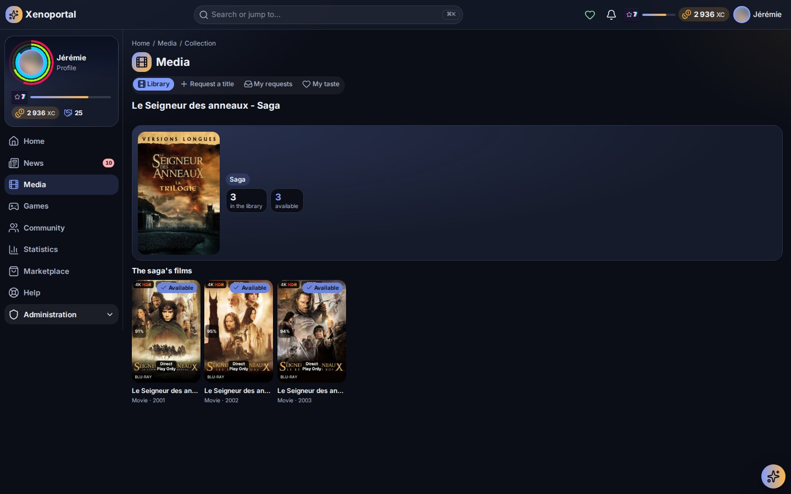

- **Reviews and « Report a problem »** — a title's page has one bar of small actions: I like it, not for me,
  later, my review, follow, report. Members rate what they watched, read, listened to or played from 1 to 5
  with a few words if they want, and the average shows on the title. « Report a problem » opens a ticket of
  the type the administrator chose, tied to the title: its poster shows in the ticket lists, and the team
  sees each media server's files and streams. A title with open reports is flagged on its poster everywhere.

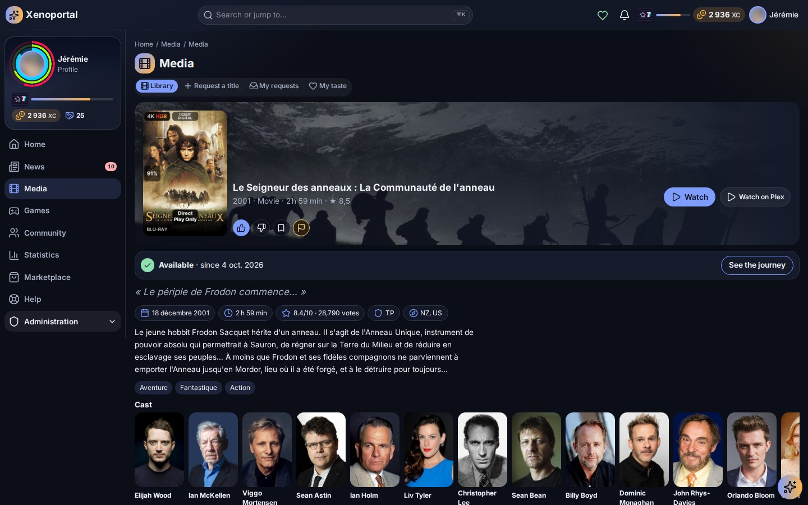

- **The month's media bingo** — one card for every member, drawn from what the library can fill (a genre, an
  era, a country, a series…). A full card gives a booster of its genre. Retro games played through RomM now
  earn their minutes like films and series, and live TV can have a reward rule of its own.
- **A smoother shop** — the marketplace now shows its products a page at a time, and a switch holds the
  animated previews still while browsing (they still play in a product's window).

- **Automatic newsletters** — editions that write themselves from what arrived, what was watched and what
  is coming, built on visual templates. Each one has its own name, e-mail subject, contents and charts, and
  each can be switched on or off. Preview the real e-mail without sending it, then publish it as a news
  item, send it by e-mail, or both. Members are subscribed by default and can unsubscribe from each one.

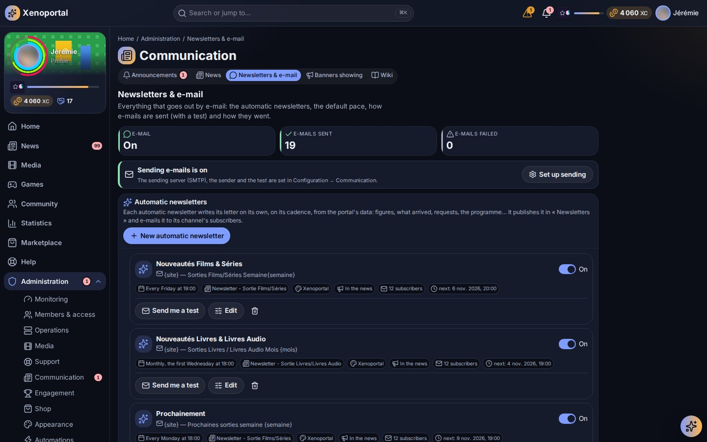

- **E-mails in Portalab's look** — every e-mail keeps its art direction, Gmail included. It is sent under a
  sender name rather than a bare address. Through the API, the administrator can turn off e-mails to
  members while keeping their own.
- **Headlines and My feed** — the administrator's front page plus each member's own feed of followed
  channels. Administrators set up the RSS sources. Each channel gets its own colour, unread items are
  badged, older items come in pages and YouTube videos play in place. My feed also comes as a dashboard widget.


- **Quests and achievements** — new goals on using the portal, plays, requests, games and support. They
  have conditions per step, translated texts and a clear done state, with the time left until the next
  reset. Quests now appear on the Games page, with filters, a progress bar and a reminder in Today's games.


- **Boosters and cards** — a full booster range: eighteen genres, three rarities, fourteen editions and four
  themes, each with its own opening scene, in video or over the whole screen. New scenes include Impact,
  Sumi, Géode, a manga universe and Apothéose. Genre frames sit next to the edition frames, and the frame
  seen at the opening is the one the card keeps. Identical boosters are stacked with a count.


- **A welcome that sets the portal up** — new members link their media accounts, then pick how far they play
  on a four-notch gauge: just the media, passive, collector or keen. They tick what they want on their home
  and how they want to be told. Their dashboard is made with it, from the one the administrator prepared for
  their play profile. Two new widgets, My reserve and My Mediacards, come with it.
- **A clearer member menu** — arranged by intent: News, Media, Games, Community, Shop, Help, Statistics and
  Me.
- **Community projects and the reserve** — a project page shows who backed it, what is still needed and a
  timeline. Unread badges mark what arrived in the reserve, and every pack still to open is listed.
- **For administrators** — set a member's password from their card (your own password asked first, the
  member signed out everywhere), and suggest feed sources members follow in one click.
- **The reader** — a PDF or comic page always fits the screen, with whole page or full width for comics.
- **Quick access widget** — pick the services it shows and their order. Each one is coloured by its state,
  and the widget adapts to its size.

### Closed issues

#### Fixed

- `bug` Plays were no longer rewarded after Plex restarted: Plex reused session keys, and plays from its history
  were taken for live ones. The missed plays have been rewarded since
- `bug` A finished season was dated by the episode that triggered it; it is now dated by its last episode
- `bug` A card booster bought from the shop opened in the default scene instead of its product's
- `bug` Refreshing a page full of images showed « Error » instead of the portal
- `bug` Backing a community project showed as « Other » in the journals
- `bug` The calendar shows today's content without a click
- `bug` The goal bar of a project uses the theme's colours
- `bug` Goals: texts are translated, the done state is readable, and the time left and next reset are shown
- `bug` The e-mail (SMTP) settings are gathered in one clear form
- `bug` The SMTP form no longer appears twice, and the misleading « Delivered » count is gone
- `bug` E-mails keep Portalab's art direction in Gmail
- `bug` Newsletters page: the live preview is on demand, and the misleading « Newsletter » digest block is
  gone
- `bug` A newsletter's subtitle follows its content
- `bug` My feed: a newly added source no longer floods the unread badge with its past items
- `bug` Mediacards: every pack still to open is listed, not only the last 20
- `bug` Reader: a PDF page no longer overflows the screen, and comics get whole page or full width
- `bug` A book's page no longer shows its progress twice
- `bug` An author's page: « Absent » no longer sits against the « Ask for it » button
- `bug` The header search shows its spinner while it searches
- `bug` An author's books are shown in the member's language, and a book the library holds in parts is no longer
  shown as missing
- `bug` A library audiobook is shown as an audiobook, not a book, on an author's or a series' page
- `bug` A book held only as an audiobook can still be asked for as a book
- `bug` A book held as an audiobook can be asked for as a book from an author's or a series' page
- `bug` Book and game requests show their cover and link to their sheet in « My requests »
- `bug` News: smaller cards on a phone, two to a row
- `bug` An audiobook skipped a chapter ahead and counted it as listened time; only what is heard counts now
- `bug` The accessibility checks (keyboard journey, component gallery) pass again

#### New

- `feat` Automatic newsletters: editions that write themselves, built on templates
- `feat` See an edition's real e-mail without sending it to members
- `feat` Turn off e-mails to members while administrators keep theirs, through the API for now
- `feat` E-mails in Portalab's art direction, and a Portalab newsletter template
- `feat` An edition's contents can each be switched on and off
- `feat` An edition's statistics as charts, each to switch on
- `feat` Each automatic newsletter has a name and an e-mail subject
- `feat` Members are subscribed to each automatic newsletter by default and can unsubscribe one by one
- `feat` Automatic newsletters shown as cards with a switch, Test / Edit / Delete, and editing in a window
- `feat` Each automatic newsletter has its own template, chosen visually, and each template says who uses it
- `feat` Publish an automatic newsletter as a news item, send it by e-mail, or both
- `feat` Testing an automatic newsletter also publishes it as news when that option is on
- `feat` A published newsletter is an ordinary news item, no longer duplicated in the Newsletters tab
- `feat` E-mails go out under a sender name instead of the bare address
- `feat` My feed: a dashboard widget, and YouTube videos played in place
- `feat` My feed: news pages, and an icon for each source type (YouTube, podcast…)
- `feat` Unread badges on My feed's news and on what arrives in the reserve
- `feat` An unread news badge on « Headlines »
- `feat` A colour for each news channel
- `feat` Quick access widget: choose and order the services, coloured by state, adapting to its size
- `feat` Mediacards boosters: a scene for each genre and rarity, with five new genre scenes in video
- `feat` Booster scenes for the 14 Mediacards editions
- `feat` Identical boosters are stacked in the reserve and on the cards page, with a count badge
- `feat` Projects and reserve: badges, the form in a window, a new look for « My reserve »
- `feat` A project's page shows who backed it, what is still needed and a horizontal timeline
- `feat` New goals on using the portal, plays, requests, games and support
- `feat` Goals editor: conditions per step, progress actions, a Discovery type and more icons
- `feat` Quests on the Games page
- `feat` Filters on the quests page
- `feat` Quests show a done / total progress bar instead of « 29 to do »
- `feat` The welcome sets the portal up: media accounts, a four-notch play gauge, a home made to the member's
  tastes from the administrator's dashboard for their play profile, notifications and e-mails; new My
  reserve and My Mediacards widgets
- `feat` A quest reminder in Today's games
- `feat` Booster scenes can play video: MP4 or WebM with transparency, looping backdrops, and an effect played over
  the card
- `feat` A card's reveal can take the whole screen: the rarity first, then the card turning
- `feat` Impact: a booster opening in the style of an animated trading-card game, drawn as a comic
- `feat` Sumi: a booster scene in ink and gold, like Japanese lacquerware
- `feat` Géode: a booster scene inside a geode, made for video
- `feat` A manga universe of booster scenes: Shōnen, Magical girl, Ninja and Mecha
- `feat` Genre frames for media cards, next to the edition frames: eighteen frames, one for each main genre
- `feat` The full booster range: eighteen genre boosters, each with its own video scene, plus rarity and theme
  boosters (Japan, Anime, Kaijū and robots, Samurai and ninjas). The frame seen at the opening is the one the
  card keeps
- `feat` Set a member's password from the administration
- `feat` My feed: sources suggested by the administrator (RSS, YouTube…), added in one click
- `feat` Sagas, book series and game franchises told the same way, each with its own page
- `feat` Hardcover: an author's bibliography and the missing volumes of a series
- `feat` Asking for titles no service handles (books, games…): a module to switch on, with « me too »
- `feat` A missing book's sheet from Hardcover: description, series, editions, and asking for it
- `feat` Hardcover: the service's preferred edition languages
- `feat` A missing book's sheet looks like a library title's page
- `feat` Search: books, audiobooks and games to ask for among the results
- `feat` One way to ask: « Request a title » and « My requests » for every kind of media, one admin page
- `feat` Ask for a book or a game in a window, without leaving the page
- `feat` Book and game requests are requests like films': same lists, same queue, same statistics
- `feat` Marketplace: a switch to hold the animated previews still
- `feat` Marketplace: products a page at a time instead of « Show more »
- `feat` Retro games played through RomM count like films and series: the administrator's XP rules, quests and
  statistics, and a game's estimated length on its page
- `feat` « Report a problem » on a title's page: a ticket tied to the media, its technical sheet for the team,
  and the open reports flagged on its poster
- `feat` Members' reviews: a rating from 1 to 5 and an optional comment on what they watched, read or played
- `feat` The month's media bingo on the Games page, the same card for everyone, a full card earning a booster
- `feat` Plays are caught up from the moment an account was linked, not only from the last 48 hours
- `feat` A film or episode stopped in the last two minutes before its end credits counts as finished, and
  earlier plays have been reviewed

#### Documentation and tooling

- `doc` The guided tours, the member guide (the wiki) and the documentation follow the new menu and every new
  feature, with four new tours: the news, games and quests, my reserve, community projects
- `doc` The release pipeline's lint and built-in pack checks pass again

#### Improved

- `improvement` News: Headlines (administrators) and My feed (members), with follows, configurable RSS sources and
  unread items
- `improvement` The member menu is arranged by intent: News, Media, Games, Community, Shop, Help, Statistics and Me

### Upgrading

- Migrations run with `docker compose run --rm migrate` (cards, games, marketplace, media, news, support
  and the new `requests` schema). The upgrade
  queues one review of the past 30 days of plays. That review grants the finish bonuses missed under the
  old end-credits rule, without counting any watch minute twice.
- A visual pack may now weigh up to 40 MB.
- Optional: to let members ask for books and games, add a Hardcover service (and IGDB for games) under
  *Services*, then switch on the kinds of titles under *Title requests*.
- Optional: set a sender name under *Communication → E-mail*. Without one, e-mails go out under the site's
  name.

---

# v1.0.0

## Portalab v1.0.0 — the front door of your homelab

**Portalab is the portal your friends and family open instead of a dozen apps.** One catalog for every media
service, requests that explain themselves, a player, a reader and a radio in the browser, statistics of
everything they watched, read and heard, news, a wiki and support — and, for those who want it, a whole
game on top: levels, quests, mini-games, collectible cards cut from your own library and a shop to spend
what they earn. One Docker image, one PostgreSQL database, your server. Every feature is set by the
administrator.

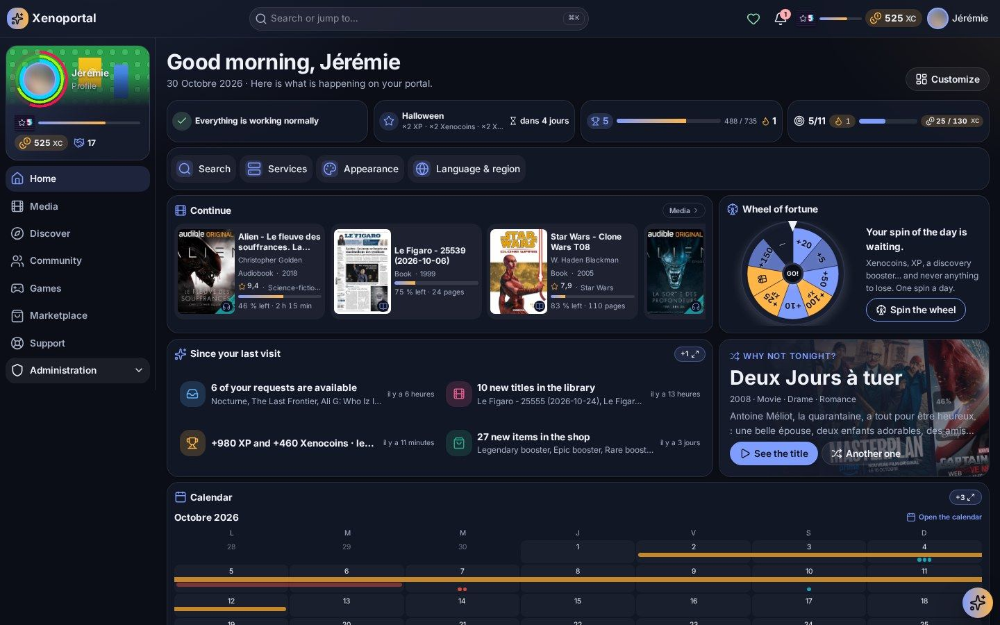

### A home page that shows everything at a glance

Portalab opens on **a dashboard each member builds**: what to continue, what arrived since the last visit,
a title for tonight, whether every service is up, the wheel of the day, the calendar, the radio, requests,
quests, statistics… Add, arrange and resize widgets, with a layout of its own on the phone — or keep the
one the administrator prepared.

### Everything on the media server, in one place

- **One catalog** for Plex, Jellyfin, Sonarr, Radarr, Grimmory and RomM: films, series, music, books,
  comics, audiobooks and retro games — one page per title, available, coming, requested or leaving soon.
- **Ask from Portalab** — search any film or series and request it in one click, within your quota
  (Overseerr / Jellyseerr).
- **"Why is my film still not on Plex?" — answered.** Every request is followed from the ask to the
  screen: approved, released, searched, downloading (with the torrent's real state), imported, available —
  each step in plain words, and the assistant can explain it.
- **Watch, read and listen in the browser** — video with subtitles and Chromecast, EPUB/PDF/comics reader,
  audiobook player that remembers where you stopped.


- **The radio** — SUB/WAVE live, what plays, ask the DJ for a song; the player follows you across pages.

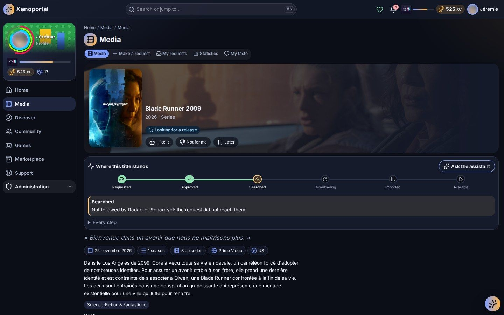

### Statistics of everything you watch, read and hear

Time spent, plays, favourite titles, hours and weekdays, genres, cast, decades, devices and quality — films,
series, live TV, music, books, audiobooks, radio and games, each tab shown only when a service of yours
feeds it. Yours or the whole server's, over any period, plus a yearly recap.

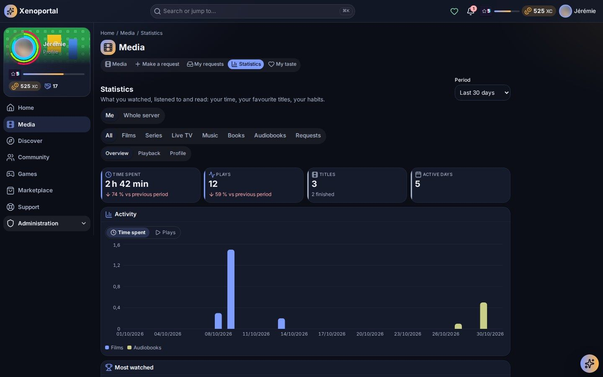

### A game — for those who want to play

Optional for every member: play it all, play without the cards, or don't play.

- **XP, levels, coins and contribution** from watching, reading and listening, from requests, and from
  taking part (news, wiki, tickets, feedback, events); quests, achievements, streaks, leaderboards and
  seasonal campaigns.
- **Mini-games** from your own library — the daily wheel, the title of the day, the blurred scene, the cast,
  the hidden synopsis, higher or lower, the timeline — alone or in a party.
- **Mediacards** — collect your favourite films and series as trading cards cut from your library, opened
  from boosters in a scene of their own.
- **The marketplace** — spend what you earn (never real money) on interfaces, palettes, frames, name
  styles, badges, effects, and on features: statistics tabs, extra requests, radio requests, widgets,
  access to content. Community projects funded together.

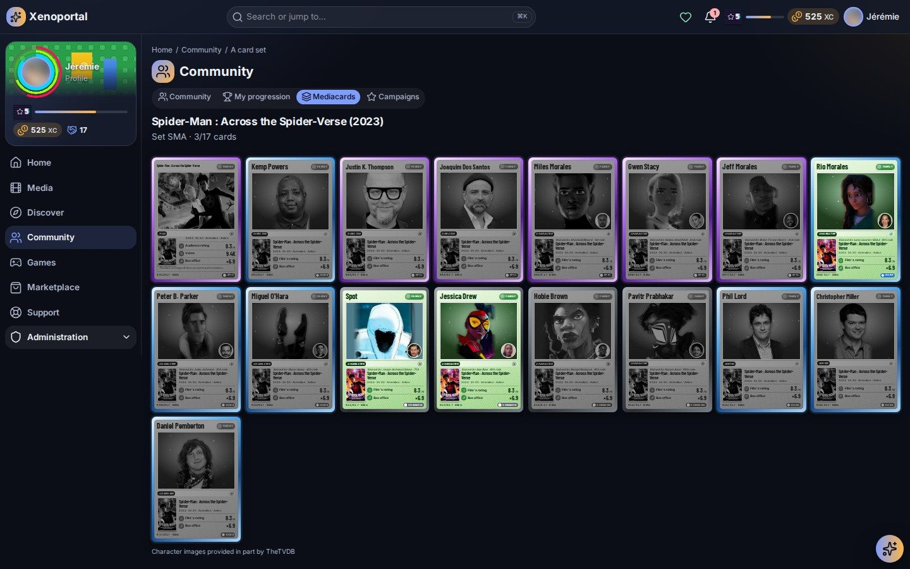

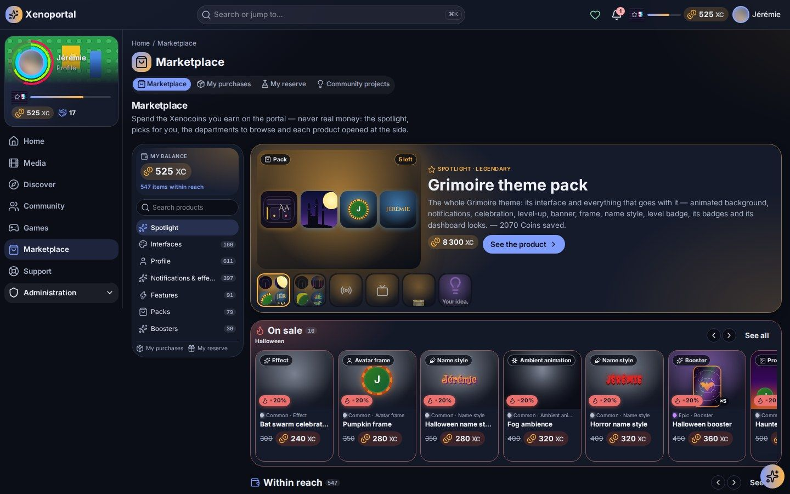

### Community, content and help

- **News** with an editorial workflow and **newsletters by e-mail**; an **internal wiki**, versioned; a
  **calendar**; events and proposals voted by the community; profiles and an activity feed.
- **Terms of use** published in versions and accepted by every member.
- **Support tickets**, **feedback** (bug reports, suggestions, surveys and review forms with the team's
  answers), **service status** for every connected service and **incidents** that say what broke and when
  it was fixed.

### Yours to shape

- **Full personalisation** — interface, palette, light or dark, profile, language, notification
  preferences per topic, in the portal and by e-mail; **guided tours** of every part.
- **Global search** across media, people, wiki, news, tickets and products — exact or by meaning.
- **An AI assistant** (Ollama or any OpenAI-compatible server, MCP tools) acting only with the member's own
  rights.
- **For administrators** — every module, reward, price, quota, theme, page and permission is set from the
  administration; themes and sandboxed visual packs, automations, plugins, backups, audit, alerts.

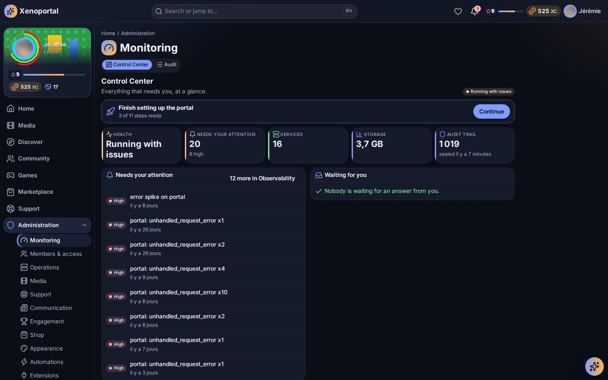

### Connects to your stack

Plex · Jellyfin / Emby · Tautulli · Overseerr / Jellyseerr · Sonarr · Radarr · qBittorrent · Deluge ·
Maintainerr · Grimmory · RomM · SUB/WAVE · TMDB · TheTVDB · fanart.tv · SearXNG · Ollama and
OpenAI-compatible servers · Authentik and any OpenID Connect provider · Unraid · Glances.

### Ready for the internet

Audited and scanned (Semgrep, Bandit, Trivy, Gitleaks, Nuclei, OWASP ZAP) before this release:
reverse-proxy aware (`TRUSTED_PROXIES`), first setup from the local network only, throttled sign-in and an
intrusion guard, default-deny permissions on every route, single sign-on with accounts linked by the
server, strict Content-Security-Policy, sandboxed visual packs, encrypted secrets and backups.

### Getting started

```bash
docker pull sharkhunterr/portalab:v1.0.0
```

Follow the [quick start](https://github.com/sharkhunterr/portalab#quick-start): create the secrets,
`docker compose up -d postgres`, `docker compose run --rm migrate`, `docker compose up -d portalab worker`,
then open the portal from your local network to set it up. The
[documentation](https://github.com/sharkhunterr/portalab/tree/main/docs) covers members, administrators and
going on the internet.

---
