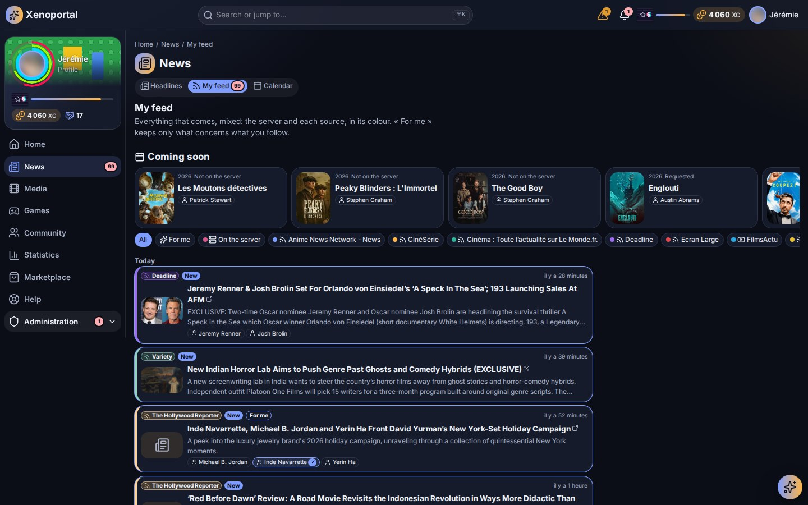
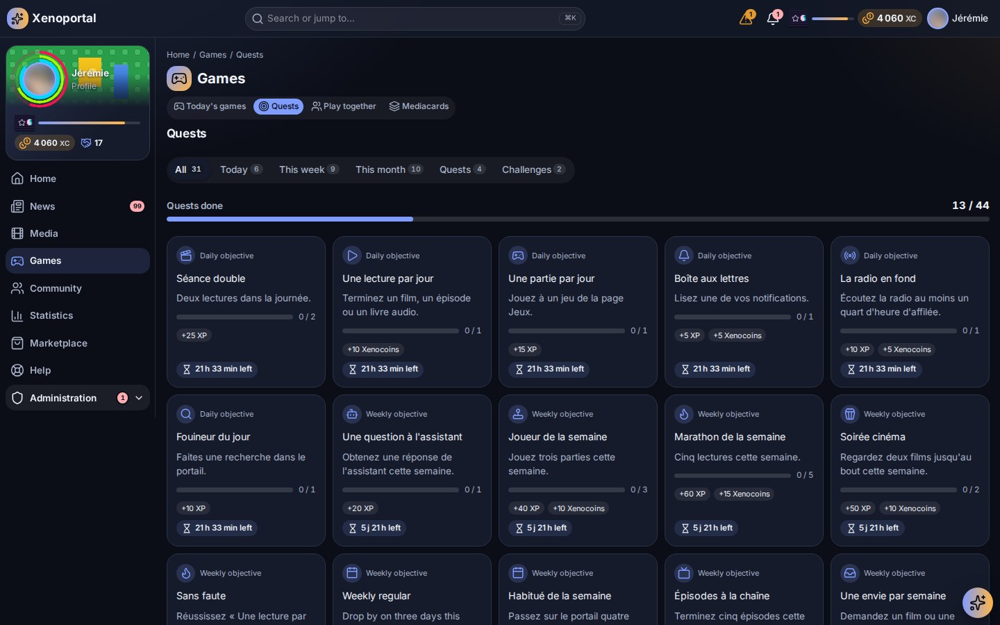
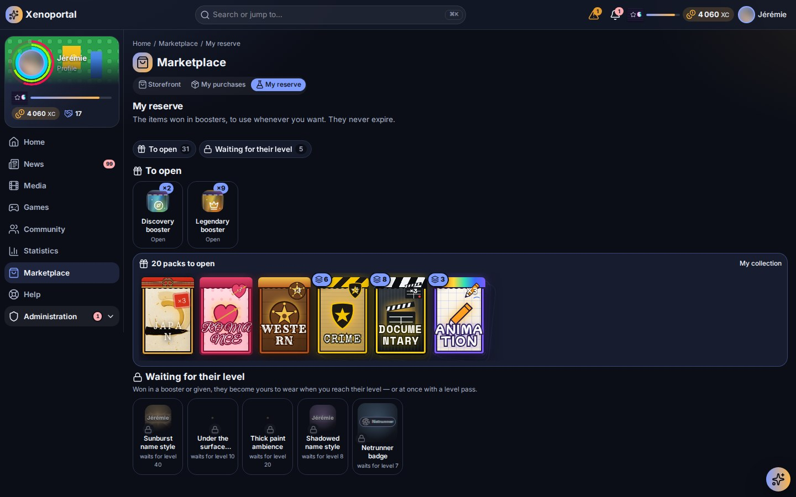
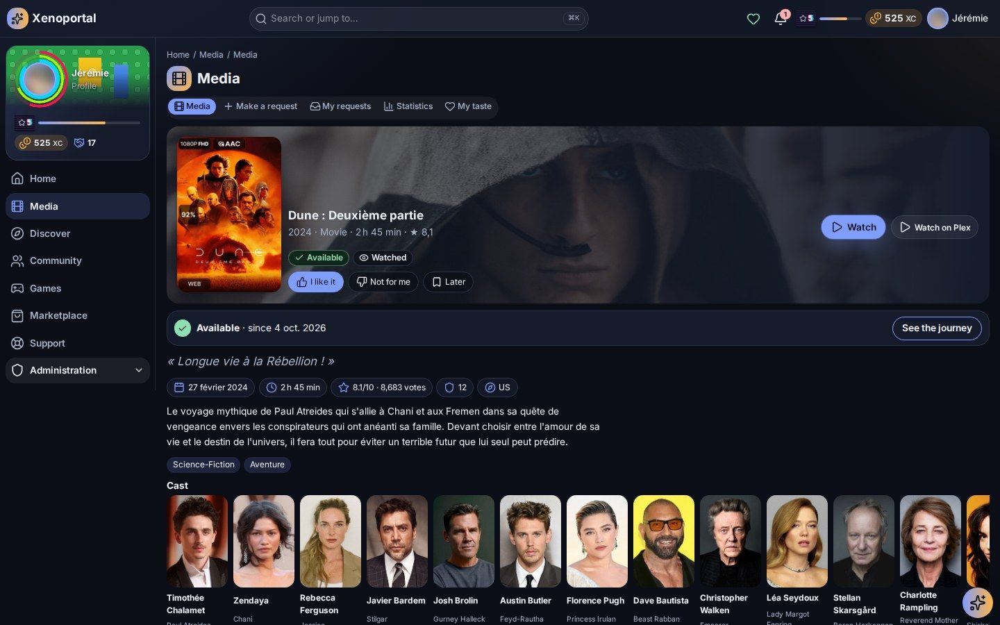

# GitHub Releases — Portalab

> Release notes for the GitLab and GitHub release pages. The **first `# vX.Y.Z` block** of this file is what
> the release pipeline posts (`release:gitlab` / `release:github`), and `npm run release` refuses to run
> unless that block is the version about to be released. Write the new block at the top, in English,
> **before** `npm run release:full`; `npm run release:notes` shows what will be posted. The version that
> block announces is the one released when it is above the current one (a major or minor release is chosen
> by writing its notes); otherwise the commits decide (`feat` → minor, `fix` → patch).
>
> Every release after v1.0.0 lists the GitLab issues it closes, sorted by kind: `npm run release:issues`
> prints them (security, fixed, new, documentation and tooling, improved) — rewrite each title in English,
> as a member or an administrator would read it, keeping its `#123`. The release script refuses notes
> without a `### Closed issues` part (v1.0.0, the first public release, is the exception).
>
> Images are absolute links pinned to the tag (`https://raw.githubusercontent.com/sharkhunterr/portalab/vX.Y.Z/assets/screenshots/<name>.jpg`):
> release pages do not resolve relative paths.
>
> Template:
>
> ```markdown
> # vX.Y.Z
>
> ## Portalab vX.Y.Z — <short title>
>
> <one or two sentences: what this release brings>
>
> <a screenshot of the headline feature, when there is one>
>
> ### Highlights
> - **<feature>** — what a member or an administrator can now do.
>
> ### Closed issues
>
> #### Security
> - <what was exposed, what is closed now> (#123)
>
> #### Fixed
> - <the symptom as users saw it — what happens now> (#124)
>
> #### New
> - <what members or administrators can now do> (#125)
>
> #### Documentation and tooling
> - … (#126)
>
> #### Improved
> - … (#127)
>
> ### Upgrading
> - Migrations run with `docker compose run --rm migrate`; anything else to do.
>
> ---
> ```

---

# v1.1.0

## Portalab v1.1.0 — newsletters that write themselves, a feed of your own

Newsletters now write themselves from what happened on the server and land in members' inboxes in
Portalab's own look. Each member gets a news feed of the channels they follow. Quests are richer and easier
to follow, and booster openings have new scenes, in video and over the whole screen. Plays are rewarded
reliably again.

### Highlights

- **Automatic newsletters** — editions that write themselves from what arrived, what was watched and what
  is coming, built on visual templates. Each one has its own name, e-mail subject, contents and charts, and
  each can be switched on or off. Preview the real e-mail without sending it, then publish it as a news
  item, send it by e-mail, or both. Members are subscribed by default and can unsubscribe from each one.


- **E-mails in Portalab's look** — every e-mail keeps its art direction, Gmail included. It is sent under a
  sender name rather than a bare address. The administrator can turn off e-mails to members while keeping
  their own.
- **Headlines and My feed** — the administrator's front page plus each member's own feed of followed
  channels. You can set up RSS sources, give each channel its own colour, see unread badges, page through
  older items and play YouTube videos in place. My feed also comes as a dashboard widget.



- **Quests and achievements** — new goals on using the portal, plays, requests, games and support. They
  have conditions per step, translated texts and a clear done state, with the time left until the next
  reset. Quests now appear on the Games page, with filters, a progress bar and a reminder in Today's games.



- **Boosters and cards** — a full booster range: eighteen genres, three rarities, fourteen editions and four
  themes, each with its own opening scene, in video or over the whole screen. New scenes include Impact,
  Sumi, Géode, a manga universe and Apothéose. Genre frames sit next to the edition frames, and the frame
  seen at the opening is the one the card keeps. Identical boosters are stacked with a count.



- **A clearer member menu** — arranged by intent: News, Media, Games, Community, Shop, Help, Statistics and
  Me.
- **Community projects and the reserve** — a project page shows who backed it, what is still needed and a
  timeline. Unread badges mark what arrived in the reserve.
- **Quick access widget** — pick the services it shows and their order. Each one is coloured by its state,
  and the widget adapts to its size.

### Closed issues

#### Fixed

- Plays were no longer rewarded after Plex restarted: Plex reused session keys, and plays from its history
  were taken for live ones. The missed plays have been rewarded since (#340)
- A finished season was dated by the episode that triggered it; it is now dated by its last episode (#343)
- A card booster bought from the shop opened in the default scene instead of its product's (#293)
- Refreshing a page full of images showed « Error » instead of the portal (#305)
- Backing a community project showed as « Other » in the journals (#314)
- The calendar shows today's content without a click (#302)
- The goal bar of a project uses the theme's colours (#306)
- Goals: texts are translated, the done state is readable, and the time left and next reset are shown (#307)
- The e-mail (SMTP) settings are gathered in one clear form (#319)
- The SMTP form no longer appears twice, and the misleading « Delivered » count is gone (#321)
- E-mails keep Portalab's art direction in Gmail (#322)
- Newsletters page: the live preview is on demand, and the misleading « Newsletter » digest block is
  gone (#327)
- A newsletter's subtitle follows its content (#337)

#### New

- Automatic newsletters: editions that write themselves, built on templates (#316)
- See an edition's real e-mail without sending it to members (#317)
- Turn off e-mails to members while administrators keep theirs (#318)
- E-mails in Portalab's art direction, and a Portalab newsletter template (#320)
- An edition's contents can each be switched on and off (#323)
- An edition's statistics as charts, each to switch on (#324)
- Each automatic newsletter has a name and an e-mail subject (#325)
- Members are subscribed to each automatic newsletter by default and can unsubscribe one by one (#326)
- Automatic newsletters shown as cards with a switch, Test / Edit / Delete, and editing in a window (#328)
- Each automatic newsletter has its own template, chosen visually, and each template says who uses it (#329)
- Publish an automatic newsletter as a news item, send it by e-mail, or both (#332)
- Testing an automatic newsletter also publishes it as news when that option is on (#334)
- A published newsletter is an ordinary news item, no longer duplicated in the Newsletters tab (#335)
- E-mails go out under a sender name instead of the bare address (#339)
- My feed: a dashboard widget, and YouTube videos played in place (#315)
- My feed: news pages, and an icon for each source type (YouTube, podcast…) (#301)
- Unread badges on My feed's news and on what arrives in the reserve (#300)
- An unread news badge on « Headlines » (#336)
- A colour for each news channel (#338)
- Quick access widget: choose and order the services, coloured by state, adapting to its size (#333)
- Mediacards boosters: a scene for each genre and rarity, with five new genre scenes in video (#291)
- Booster scenes for the 14 Mediacards editions (#292)
- Identical boosters are stacked in the reserve and on the cards page, with a count badge (#297)
- Projects and reserve: badges, the form in a window, a new look for « My reserve » (#303)
- A project's page shows who backed it, what is still needed and a horizontal timeline (#304)
- New goals on using the portal, plays, requests, games and support (#308)
- Goals editor: conditions per step, progress actions, a Discovery type and more icons (#309)
- Quests on the Games page (#310)
- Filters on the quests page (#311)
- Quests show a done / total progress bar instead of « 29 to do » (#312)
- A quest reminder in Today's games (#313)
- Booster scenes can play video: MP4 or WebM with transparency, looping backdrops, and an effect played over
  the card (#287)
- A card's reveal can take the whole screen: the rarity first, then the card turning (#290)
- Impact: a booster opening in the style of an animated trading-card game, drawn as a comic (#285)
- Sumi: a booster scene in ink and gold, like Japanese lacquerware (#286)
- Géode: a booster scene inside a geode, made for video (#288)
- A manga universe of booster scenes: Shōnen, Magical girl, Ninja and Mecha (#289)
- Genre frames for media cards, next to the edition frames: eighteen frames, one for each main genre (#295)
- The full booster range: eighteen genre boosters, each with its own video scene, plus rarity and theme
  boosters (Japan, Anime, Kaijū and robots, Samurai and ninjas). The frame seen at the opening is the one the
  card keeps (#296)
- Plays are caught up from the moment an account was linked, not only from the last 48 hours (#341)
- A film or episode stopped in the last two minutes before its end credits counts as finished, and
  earlier plays have been reviewed (#342)

#### Improved

- News: Headlines (administrators) and My feed (members), with follows, configurable RSS sources and
  unread items (#299)
- The member menu is arranged by intent: News, Media, Games, Community, Shop, Help, Statistics and Me (#298)

### Upgrading

- Migrations run with `docker compose run --rm migrate` (cards, marketplace, media and news). The upgrade
  queues one review of the past 30 days of plays. That review grants the finish bonuses missed under the
  old end-credits rule, without counting any watch minute twice.
- A visual pack may now weigh up to 40 MB.
- Optional: set a sender name under *Communication → E-mail*. Without one, e-mails go out under the site's
  name.

---

# v1.0.0

## Portalab v1.0.0 — the front door of your homelab

**Portalab is the portal your friends and family open instead of a dozen apps.** One catalog for every media
service, requests that explain themselves, a player, a reader and a radio in the browser, statistics of
everything they watched, read and heard, news, a wiki and support — and, for those who want it, a whole
game on top: levels, quests, mini-games, collectible cards cut from your own library and a shop to spend
what they earn. One Docker image, one PostgreSQL database, your server. Every feature is set by the
administrator.


### A home page that shows everything at a glance

Portalab opens on **a dashboard each member builds**: what to continue, what arrived since the last visit,
a title for tonight, whether every service is up, the wheel of the day, the calendar, the radio, requests,
quests, statistics… Add, arrange and resize widgets, with a layout of its own on the phone — or keep the
one the administrator prepared.

### Everything on the media server, in one place

- **One catalog** for Plex, Jellyfin, Sonarr, Radarr, Grimmory and RomM: films, series, music, books,
  comics, audiobooks and retro games — one page per title, available, coming, requested or leaving soon.
- **Ask from Portalab** — search any film or series and request it in one click, within your quota
  (Overseerr / Jellyseerr).
- **"Why is my film still not on Plex?" — answered.** Every request is followed from the ask to the
  screen: approved, released, searched, downloading (with the torrent's real state), imported, available —
  each step in plain words, and the assistant can explain it.
- **Watch, read and listen in the browser** — video with subtitles and Chromecast, EPUB/PDF/comics reader,
  audiobook player that remembers where you stopped.


- **The radio** — SUB/WAVE live, what plays, ask the DJ for a song; the player follows you across pages.


### Statistics of everything you watch, read and hear

Time spent, plays, favourite titles, hours and weekdays, genres, cast, decades, devices and quality — films,
series, live TV, music, books, audiobooks, radio and games, each tab shown only when a service of yours
feeds it. Yours or the whole server's, over any period, plus a yearly recap.


### A game — for those who want to play

Optional for every member: play it all, play without the cards, or don't play.

- **XP, levels, coins and contribution** from watching, reading and listening, from requests, and from
  taking part (news, wiki, tickets, feedback, events); quests, achievements, streaks, leaderboards and
  seasonal campaigns.
- **Mini-games** from your own library — the daily wheel, the title of the day, the blurred scene, the cast,
  the hidden synopsis, higher or lower, the timeline — alone or in a party.
- **Mediacards** — collect your favourite films and series as trading cards cut from your library, opened
  from boosters in a scene of their own.
- **The marketplace** — spend what you earn (never real money) on interfaces, palettes, frames, name
  styles, badges, effects, and on features: statistics tabs, extra requests, radio requests, widgets,
  access to content. Community projects funded together.


### Community, content and help

- **News** with an editorial workflow and **newsletters by e-mail**; an **internal wiki**, versioned; a
  **calendar**; events and proposals voted by the community; profiles and an activity feed.
- **Terms of use** published in versions and accepted by every member.
- **Support tickets**, **feedback** (bug reports, suggestions, surveys and review forms with the team's
  answers), **service status** for every connected service and **incidents** that say what broke and when
  it was fixed.

### Yours to shape

- **Full personalisation** — interface, palette, light or dark, profile, language, notification
  preferences per topic, in the portal and by e-mail; **guided tours** of every part.
- **Global search** across media, people, wiki, news, tickets and products — exact or by meaning.
- **An AI assistant** (Ollama or any OpenAI-compatible server, MCP tools) acting only with the member's own
  rights.
- **For administrators** — every module, reward, price, quota, theme, page and permission is set from the
  administration; themes and sandboxed visual packs, automations, plugins, backups, audit, alerts.


### Connects to your stack

Plex · Jellyfin / Emby · Tautulli · Overseerr / Jellyseerr · Sonarr · Radarr · qBittorrent · Deluge ·
Maintainerr · Grimmory · RomM · SUB/WAVE · TMDB · TheTVDB · fanart.tv · SearXNG · Ollama and
OpenAI-compatible servers · Authentik and any OpenID Connect provider · Unraid · Glances.

### Ready for the internet

Audited and scanned (Semgrep, Bandit, Trivy, Gitleaks, Nuclei, OWASP ZAP) before this release:
reverse-proxy aware (`TRUSTED_PROXIES`), first setup from the local network only, throttled sign-in and an
intrusion guard, default-deny permissions on every route, single sign-on with accounts linked by the
server, strict Content-Security-Policy, sandboxed visual packs, encrypted secrets and backups.

### Getting started

```bash
docker pull sharkhunterr/portalab:v1.0.0
```

Follow the [quick start](https://github.com/sharkhunterr/portalab#quick-start): create the secrets,
`docker compose up -d postgres`, `docker compose run --rm migrate`, `docker compose up -d portalab worker`,
then open the portal from your local network to set it up. The
[documentation](https://github.com/sharkhunterr/portalab/tree/main/docs) covers members, administrators and
going on the internet.

---
