<p align="center">
  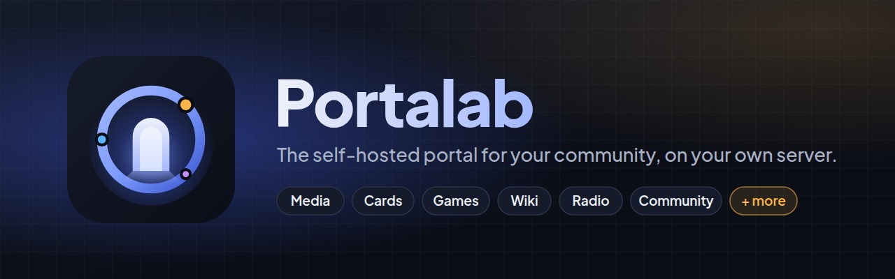
</p>

<p align="center">
  <a href="https://github.com/sharkhunterr/portalab/releases"></a>
  <a href="https://hub.docker.com/r/sharkhunterr/portalab"></a>
  
  
  
</p>

<h3 align="center">The front door of your homelab.<br>Watch, read, listen, ask, play and talk — in one place your members love to open.</h3>

<p align="center">
  <a href="#what-your-members-get">Features</a> ·
  <a href="#connects-to-your-stack">Integrations</a> ·
  <a href="#quick-start">Quick start</a> ·
  <a href="docs/README.md">Documentation</a> ·
  <a href="GITHUB_RELEASES.md">Release notes</a>
</p>

<p align="center">
  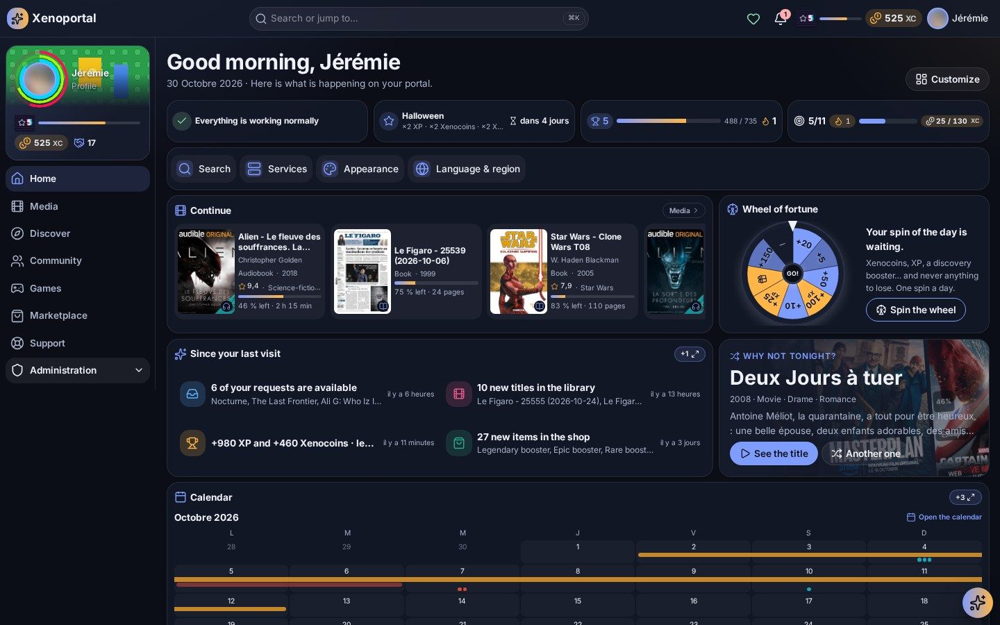
</p>

Your friends and family already use your Plex, your Seerr, your book library and your game shelf — through
a dozen apps and a group chat full of *"is my film there yet?"*. **Portalab puts all of it behind one
door**: one catalog for every service, requests that explain themselves, a player, a reader and a radio in
the browser, statistics of everything they watched, read and heard, a wiki, news and support — and, for
those who want it, a whole game on top: levels, quests, collectible cards cut from your own library and a
shop to spend what they earn.

It runs on your server from **one Docker image and a PostgreSQL database**. Nothing leaves your network
unless you connect it yourself, and **every feature is set by the administrator** — turned on, tuned,
priced or switched off.

---

## What your members get

### A home page that shows everything at a glance

<table>
  <tr>
    <td width="70%"></td>
    <td width="30%">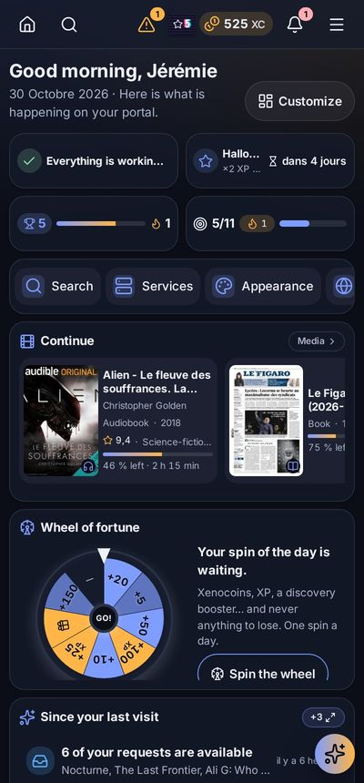</td>
  </tr>
</table>

Portalab opens on **a dashboard each member builds for themselves**: what to continue, what arrived since
the last visit, a title for tonight, whether every service is up, the wheel of the day, the calendar,
the radio, requests, quests, statistics, the leaderboard… **Add, arrange and resize widgets** — on the
desktop and on the phone, each with its own layout — or keep the one the administrator prepared. It is the
front page of your homelab: one look, and members know what is new, what works and what to watch next.

### Everything on the media server, in one place

<table>
  <tr>
    <td width="50%">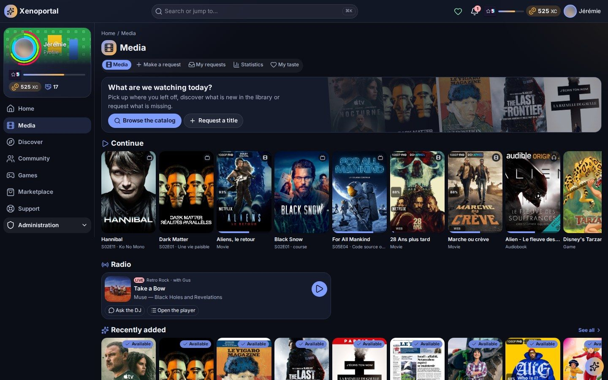</td>
    <td width="50%">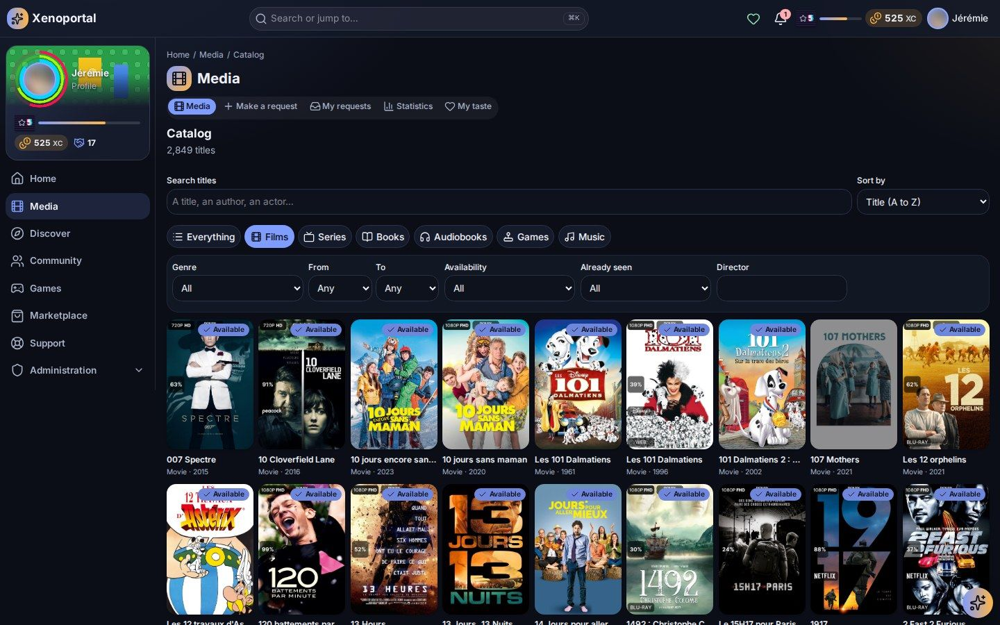</td>
  </tr>
</table>

- **One catalog for every service.** Films, series, music, books, comics, audiobooks and retro games from
  Plex, Jellyfin, Sonarr, Radarr, Grimmory and RomM merge into **one page per title** — available, coming,
  requested or leaving soon (Maintainerr), with the cast, the artwork, the quality of each copy and the
  community's verdict.
- **Ask from Portalab.** Search any film or series, see if it is already there, and request it in one
  click within your quota (Overseerr / Jellyseerr behind the scenes).
- **Watch, read and listen without leaving the portal.** A video player with subtitles and Chromecast, a
  reader for EPUB, PDF and comics, an audiobook player that remembers where you stopped — on any device.
- **The radio.** The station's live stream (SUB/WAVE) in a player that follows you from page to page; see
  what plays, and ask the DJ for a song.
- **My taste.** Like, dislike or keep for later, and get recommendations drawn from what you actually watch.

### "Why is the film I asked for still not on Plex?" — answered

<p align="center">
  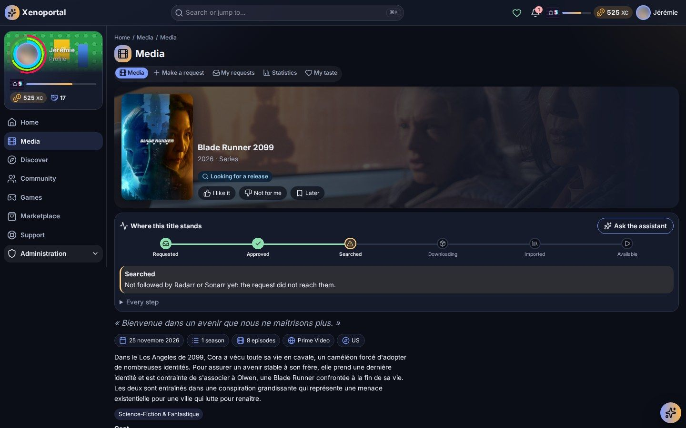
</p>

Every request is followed **from the ask to the screen**: approved, released or not yet, searched,
downloading (with the torrent's real progress and why it stalls), imported, available. Each step says what
it waits for in plain words — and the assistant can explain it too. *My requests* gathers them all, with
what became of them.

### Your statistics, beautifully

<table>
  <tr>
    <td width="66%">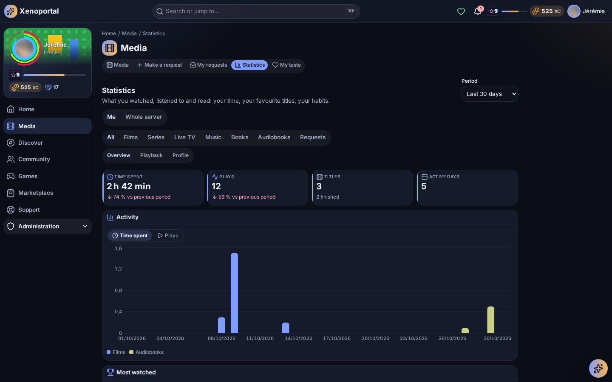</td>
    <td width="34%">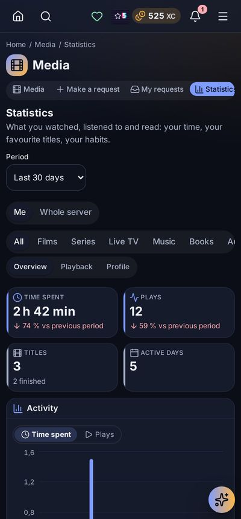</td>
  </tr>
</table>

Time spent, plays, favourite titles, habits by hour and weekday, genres, actors, decades, devices and
streaming quality — **films, series, live TV, music, books, audiobooks, the radio and games**, each tab
shown only when a service of yours feeds it. Yours, or the whole server's (anonymous for members), over
any period, plus a yearly recap.

### A game for those who want to play

<table>
  <tr>
    <td width="50%">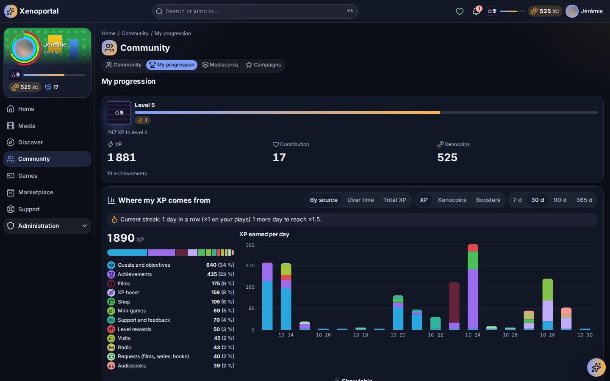</td>
    <td width="50%">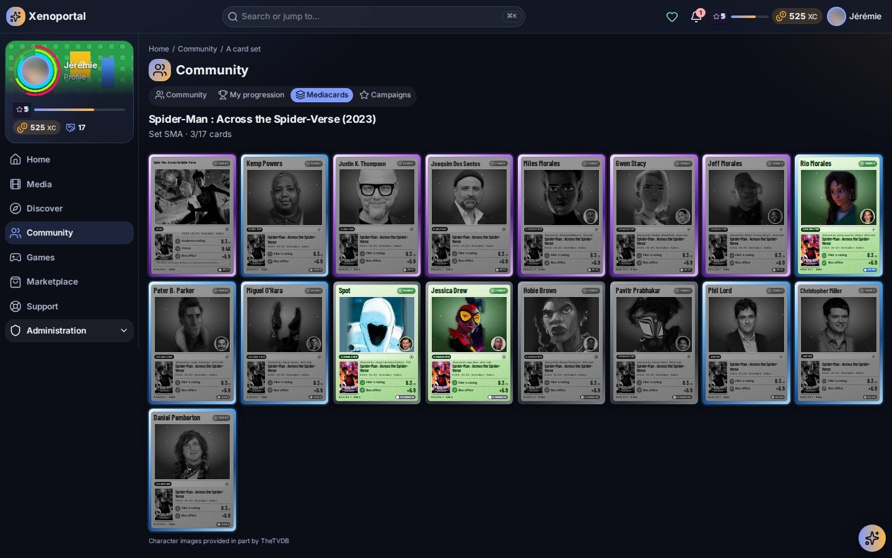</td>
  </tr>
  <tr>
    <td width="50%">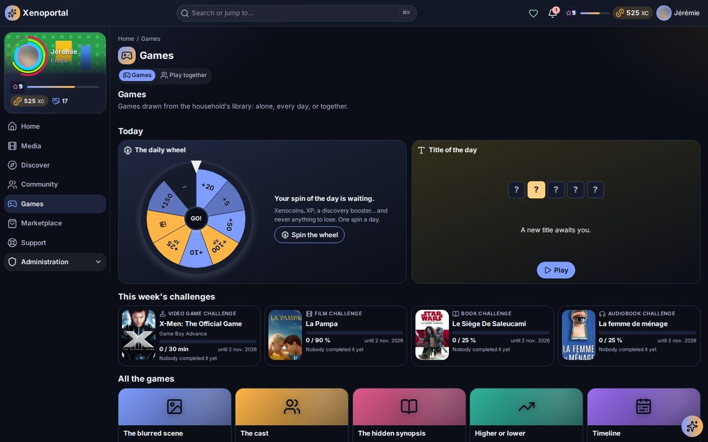</td>
    <td width="50%">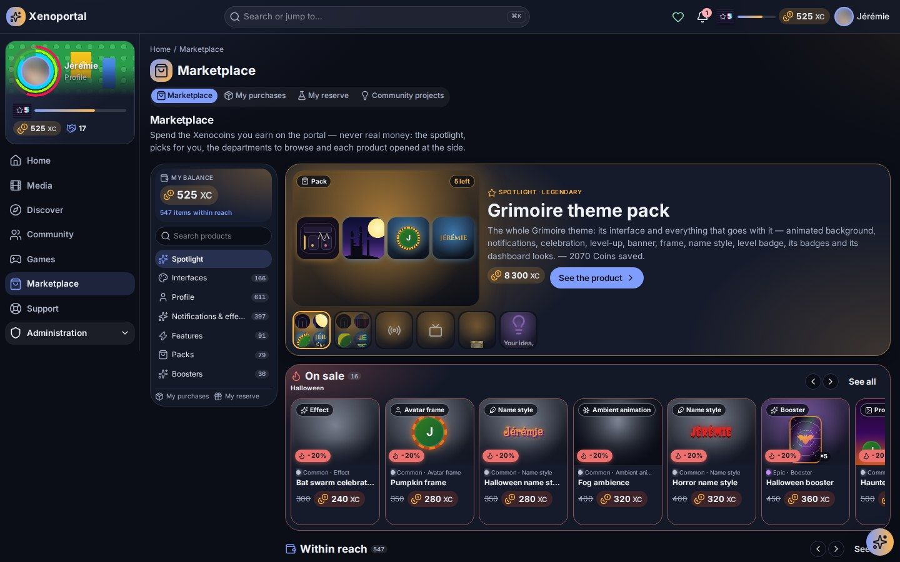</td>
  </tr>
</table>

Gamification is **optional for every member** — a four-notch gauge, from *Just the media* (no game, and an anonymous
profile) through *Passive* (XP, levels and quests as you watch) and *Collector* (the Mediacards) to *Keen* (the day's
mini-games, challenges and parties), and each member's home starts from the dashboard prepared for their notch.

- **XP, levels, coins and contribution** earned by watching, reading and listening, by asking for titles,
  and by taking part: news, wiki, tickets, feedback, events. Quests, achievements, streaks, leaderboards
  and seasonal campaigns.
- **Mini-games** drawn from your own library — the daily wheel, the title of the day, the blurred scene,
  the cast, the hidden synopsis, higher or lower, the timeline — alone or **together in a party**.
- **Mediacards** — collect your favourite films and series as trading cards cut from your own library:
  thousands of sets, rarities, boosters opened in a scene of their own.
- **The marketplace** — spend what you earn (never real money) on looks: interfaces, palettes, frames,
  name styles, badges, effects, sounds; and on features: statistics tabs, extra requests, radio requests,
  widgets, access to content. Members also fund **community projects** together.

### A community that lives on its own

<table>
  <tr>
    <td width="50%">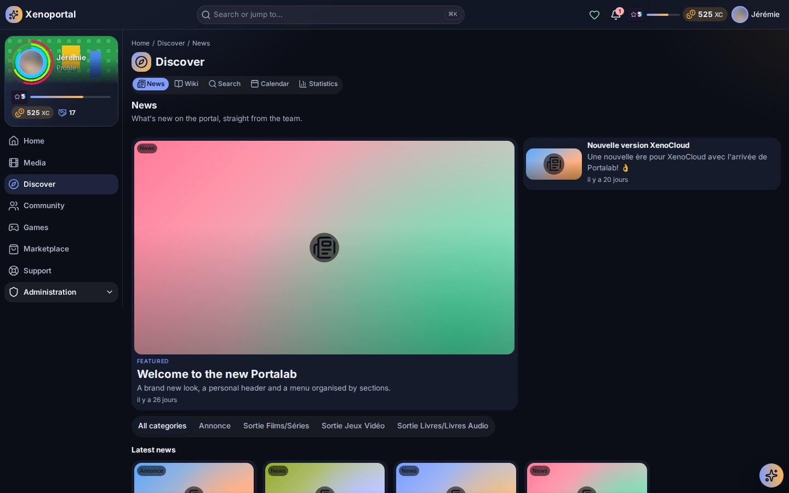</td>
    <td width="50%">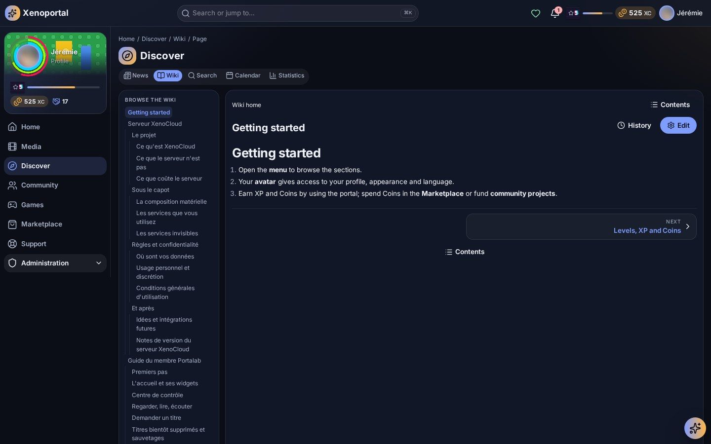</td>
  </tr>
</table>

- **News** with an editorial workflow, and **newsletters by e-mail** (what arrived, what is coming) at
  the rhythm each member chooses.
- **An internal wiki**, versioned, for the server's guides and rules.
- **A calendar** of releases, events, campaigns and maintenance; **events and proposals** the community
  votes on; member profiles and an activity feed.
- **Terms of use** published in versions, accepted by every member.

### Help, and the truth about what is down

<table>
  <tr>
    <td width="50%">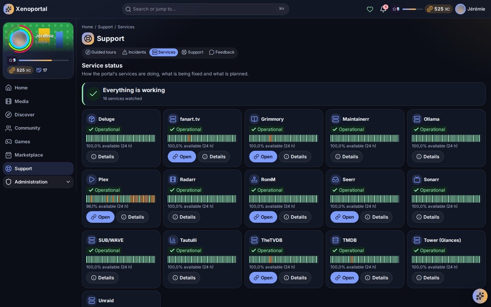</td>
    <td width="50%">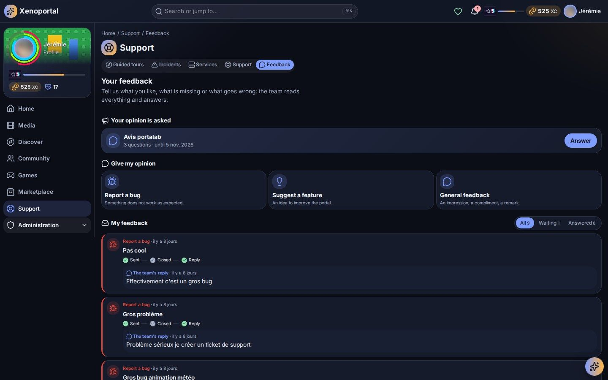</td>
  </tr>
</table>

- **Support tickets** with attachments and replies; **feedback** — report a bug, suggest a feature, answer
  the team's surveys and review forms.
- **Service status** for every connected service, and **incidents** that say what broke, since when and
  when it was fixed — no more "is Plex down or is it me?".

### Make it yours

<table>
  <tr>
    <td width="50%">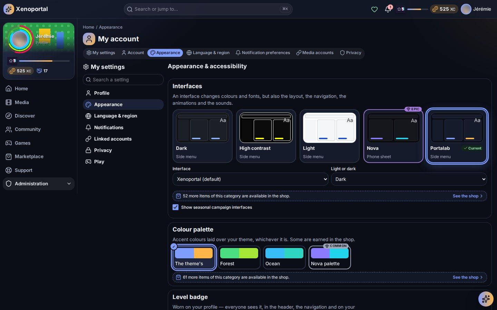</td>
    <td width="50%">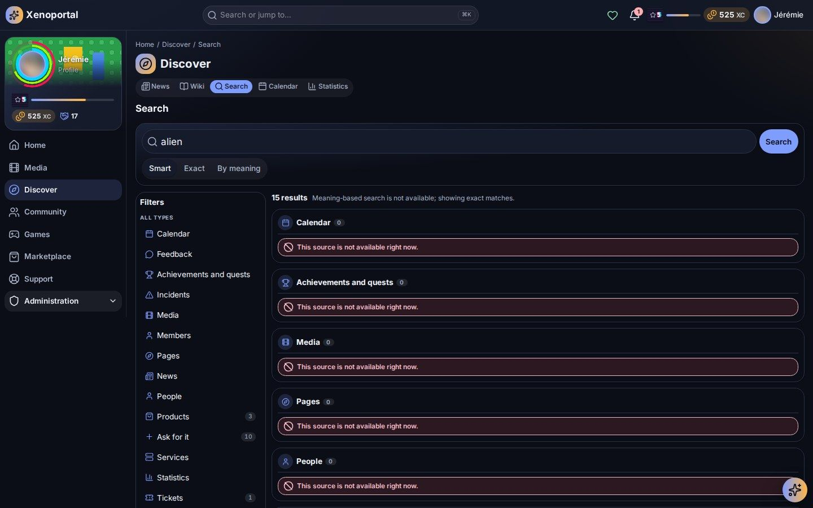</td>
  </tr>
</table>

- **Full personalisation** — interface and palette, light or dark, profile (avatar, frame, name style),
  language and region, and notification preferences per topic, in the portal and by e-mail.
- **Search everything** at once — titles, people, wiki pages, news, tickets, products — exact or by meaning.
- **An AI assistant** (Ollama or any OpenAI-compatible server) that answers about the server and acts only
  with the member's own rights, confirming anything sensitive.
- **Guided tours** that show each part of the portal, step by step.

<p align="center">
  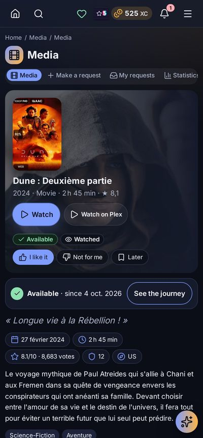
  &nbsp;
  
</p>

## Everything is in the administrator's hands

<table>
  <tr>
    <td width="50%">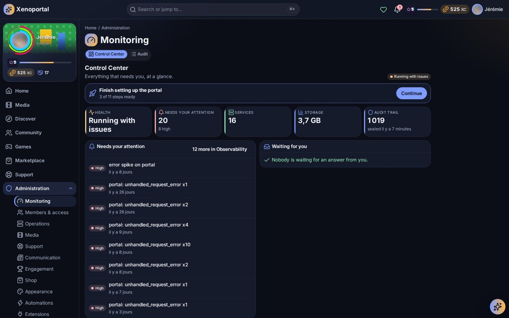</td>
    <td width="50%">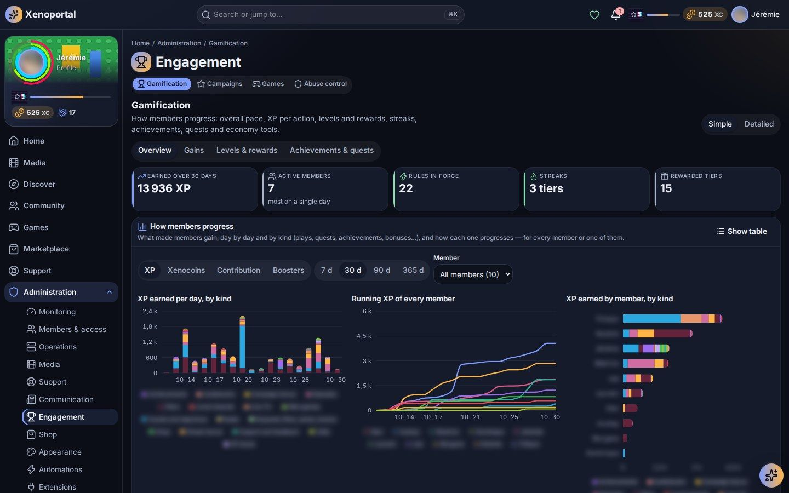</td>
  </tr>
</table>

Each module can be turned on or off. Rewards, levels, quests, achievements and campaigns; card sets and
boosters; shop products, prices and sales; request quotas; themes, palettes and visual packs (sandboxed);
the members' default dashboard; news, wiki, newsletters, terms and banners; roles and permissions, single
sign-on, privacy policies; automations, the assistant's models and tools; alerts, incidents, backups and
the audit log — all from the administration, nothing in config files.

## Connects to your stack

| Area | Services | What members get |
| --- | --- | --- |
| Media servers | **Plex**, **Jellyfin** / Emby | the catalog, live sessions, watching in the browser (Plex) |
| Watch history | **Tautulli** | every play, for statistics and progression |
| Requests | **Overseerr**, **Jellyseerr** | asking for titles, quotas, request status |
| Downloads | **Sonarr**, **Radarr**, **qBittorrent**, **Deluge** | the request journey, the download queue, calendars |
| Library cleanup | **Maintainerr** | "leaving soon" on titles |
| Books and audiobooks | **Grimmory** | reading and listening in the portal, reading history |
| Retro games | **RomM** | the games library and what was played |
| Radio | **SUB/WAVE** | the live station, now playing, asking the DJ |
| Metadata and art | **TMDB**, **TheTVDB**, **fanart.tv**, **SearXNG** | overviews, cast, artwork, card art |
| AI | **Ollama**, OpenAI-compatible servers, MCP | the assistant |
| Sign-in | **Authentik**, any OpenID Connect provider | single sign-on, accounts linked automatically |
| Infrastructure | **Unraid**, **Glances** | server health on the status page |

Every integration is a connector; plugins can add more without touching the core. Details in
[docs/admin/services.md](docs/admin/services.md).

## Quick start

Portalab ships as one image (`serve`, `worker` and `migrate` entrypoints) next to PostgreSQL 16. The
Compose file needs no preparation: on the first start it creates its folders and generates its secrets.

```bash
mkdir portalab && cd portalab
curl -fsSLO https://raw.githubusercontent.com/sharkhunterr/portalab/main/portalab/deploy/docker-compose.yml
docker compose up -d
```

Open `http://<server>:8080` **from your local network**: the arrival wizard creates the administrator,
sets the portal up and can bring a backup in. Then connect your services in *Administration › Services*.
The full walk-through is in [docs/getting-started.md](docs/getting-started.md).

- Everything is kept in `appdata/` next to the file: Portalab's files, the database and the secrets. Keep
  `appdata/secrets/portalab/secret_key` safe: it encrypts the credentials of your services.
- The port, the folder, the image and the reverse proxy are set in a `.env` file:
  [`portalab/deploy/.env.example`](portalab/deploy/.env.example) lists them.
- **On Unraid**, paste the file as a stack of the Docker Compose Manager plugin, with
  `PORTALAB_APPDATA=/mnt/user/appdata/portalab` in its ENV file: see
  [On Unraid](docs/getting-started.md#on-unraid).
- Upgrade with `docker compose pull && docker compose up -d`: the migrations run before Portalab restarts.

The image is published as [`sharkhunterr/portalab`](https://hub.docker.com/r/sharkhunterr/portalab)
(`latest` and one tag per release).

## Configuration

Only the bootstrap lives in the environment; everything else is set in the administration and kept in the
database (and in its backups).

| Variable | Default | Purpose |
| --- | --- | --- |
| `DATABASE_URL_FILE` | — | file holding the PostgreSQL URL |
| `SECRET_KEY_FILE` | — | file holding the key that encrypts secrets (32+ bytes) |
| `DATA_DIR` | `/var/lib/portalab` | images, cards, visual packs, plugins, backups |
| `BIND_HOST` / `BIND_PORT` | `0.0.0.0` / `8080` | where the API listens |
| `LOG_LEVEL` | `INFO` | `DEBUG` … `CRITICAL` (JSON logs) |
| `TRUSTED_PROXIES` | `127.0.0.1` | the reverse proxies whose `X-Forwarded-For` is believed |
| `HEALTH_NETWORKS` | local networks | who may call `/healthz`, `/readyz`, `/metrics` |
| `SETUP_NETWORKS` | local networks | where a new (or reset) portal may be set up from |

More in [docs/configuration.md](docs/configuration.md).

## On the internet

Put Portalab behind a reverse proxy that terminates TLS (Nginx Proxy Manager, Traefik, Caddy…), declare
that proxy in `TRUSTED_PROXIES`, and keep the first setup on your local network. Single sign-on through
Authentik (or any OpenID Connect provider) links members' accounts automatically. Portalab was audited for
the internet and scanned with Semgrep, Bandit, Trivy, Gitleaks, Nuclei and OWASP ZAP: default-deny
permissions on every route, throttled sign-in and an intrusion guard, a strict Content-Security-Policy,
sandboxed visual packs, encrypted secrets and backups. The checklist is in
[`portalab/docs/internet-exposure.md`](portalab/docs/internet-exposure.md).

## Documentation

| For | Read |
| --- | --- |
| Installing and running it | [Getting started](docs/getting-started.md) · [Configuration](docs/configuration.md) · [Operations](docs/admin/operations.md) |
| Members | [Media](docs/members/media.md) · [Statistics](docs/members/statistics.md) · [Gamification](docs/members/gamification.md) · [Community](docs/members/community.md) · [Support](docs/members/support.md) · [Personalisation](docs/members/personalization.md) · [Assistant and search](docs/members/assistant.md) |
| Administrators | [Services](docs/admin/services.md) · [Members and roles](docs/admin/members-and-roles.md) · [Gamification and economy](docs/admin/gamification-and-economy.md) · [Content](docs/admin/content.md) · [Customisation](docs/admin/customization.md) · [AI and automations](docs/admin/ai-and-automations.md) |
| Developers | [Module guides](portalab/docs/) · [Plugin authoring](portalab/docs/plugin-authoring.md) · [Visual packs](portalab/docs/visual-packs.md) |

## Architecture

| Part | Stack |
| --- | --- |
| API and worker | Python 3.12, FastAPI, SQLAlchemy 2 (async), Alembic — one PostgreSQL schema per module, jobs and events through the database |
| Interface | React 19, TypeScript, Vite, TanStack Query, Radix UI, design tokens, Plus Jakarta Sans and Inter |
| Delivery | one Docker image (read-only, non-root, no capabilities), PostgreSQL 16 |

The code is organised in layers (`core ← capabilities ← modules | connectors ← app`) enforced by
import-linter; plugins and visual packs only see their SDKs. English and French are included.

## Development

```bash
# backend — Python 3.12 with uv; integration tests need a PostgreSQL (see portalab/CLAUDE.md)
cd portalab/backend && uv sync
uv run pytest -n auto --dist loadfile
uv run ruff check . && uv run mypy && uv run lint-imports --config importlinter.ini

# frontend — Node 22
cd portalab/frontend && npm ci
npm run lint && npm run typecheck && npm test && npm run build
```

## Releases

Releases are cut from the repository root:

```bash
npm ci                      # release tooling (standard-version)
npm run release:issues      # the GitLab issues closed since the last tag, by kind
npm run release:dry         # preview the next version
npm run release:full        # bump, CHANGELOG, tag, push — the tag pipeline does the rest
```

Before releasing, add the new version's notes at the top of [`GITHUB_RELEASES.md`](GITHUB_RELEASES.md)
(`# vX.Y.Z`, with its closed issues by kind): they become the GitLab and GitHub release pages, and the
release script refuses to run without them. The tag pipeline validates and tests both halves, builds the
image, publishes it to Docker Hub, mirrors the repository to GitHub and creates both releases (see
[`.gitlab-ci.yml`](.gitlab-ci.yml) for the CI/CD variables it expects). The screenshots are taken from a
running portal with `portalab/scripts/guide_shots.mjs assets/screenshots/shots.json` (read-only).

## Brand

Icon, favicon and banner are drawn from Portalab's own default theme — sources and palette in
[`assets/`](assets/README.md), rendered with `npm run assets`.

<p align="center">
  
</p>
