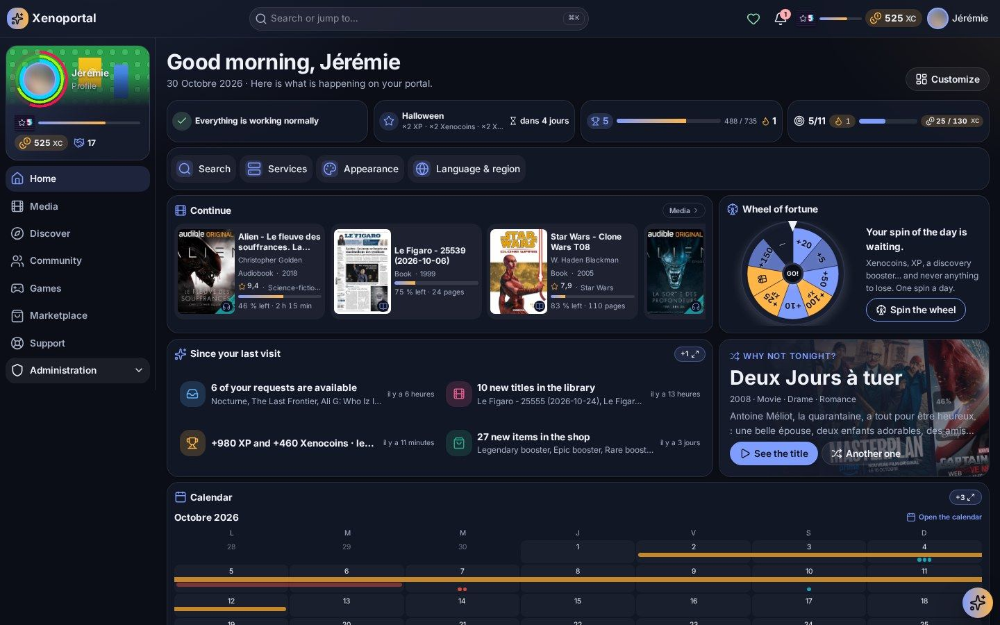

# Portalab documentation

Everything about installing, running, using and shaping Portalab — for members, administrators and
developers.

  

## Install and run

| Guide | What it covers |
| --- | --- |
| [Getting started](getting-started.md) | Docker Compose, secrets, the arrival wizard, upgrading, backups |
| [Configuration](configuration.md) | the few environment variables, reverse proxies, going on the internet |
| [Operations](admin/operations.md) | backups and imports, maintenance, observability, audit, security blocks, incidents and alerts |

## For members

| Guide | What it covers |
| --- | --- |
| [Media](members/media.md) | the library, a title's page, asking for a title and following the request, watching, reading and listening in the portal, the radio, my taste |
| [Statistics](members/statistics.md) | my media, my activity, my requests in figures and the community's — by category, period and tab — and the recap |
| [Gamification](members/gamification.md) | choosing to play, XP, levels and coins, quests, achievements, leaderboards, today's games, Mediacards and the booster range, the marketplace, my reserve, community projects |
| [Community](members/community.md) | profiles, the activity feed, events and proposals, Headlines and My feed, newsletters, the wiki, the calendar, terms of use |
| [Support](members/support.md) | tickets, feedback and surveys, service status and incidents, notifications |
| [Personalisation](members/personalization.md) | the dashboard and its widgets, appearance, profile, language, notifications, privacy, guided tours |
| [Assistant and search](members/assistant.md) | the AI assistant and the global search |

## For administrators

| Guide | What it covers |
| --- | --- |
| [Services](admin/services.md) | every integration — what it brings and what it needs — and the service status |
| [Members and roles](admin/members-and-roles.md) | members, roles and permissions, single sign-on, privacy policies, request quotas |
| [Gamification and economy](admin/gamification-and-economy.md) | rules and rewards, quests, achievements, levels, campaigns, games, card sets, shop products, projects |
| [Content](admin/content.md) | news desk and external sources, automatic newsletters, sending e-mails, wiki, terms of use, announcements and banners, moderation, support settings |
| [Customisation](admin/customization.md) | site identity, theme studio, palettes, visual packs, plugins, widgets and the default dashboard |
| [AI and automations](admin/ai-and-automations.md) | the assistant's models, tools and sensitive actions; automations, templates and approvals |

## For developers

The module guides (design, capabilities, contracts) live next to the code, in
[`portalab/docs/`](../portalab/docs/) — start with [connectors](../portalab/docs/connectors.md),
[plugin authoring](../portalab/docs/plugin-authoring.md), [visual packs](../portalab/docs/visual-packs.md)
and [internet exposure](../portalab/docs/internet-exposure.md).

The screenshots of this documentation come from a running portal, taken read-only with
`portalab/scripts/guide_shots.mjs` from [`assets/screenshots/shots.json`](../assets/screenshots/shots.json).
