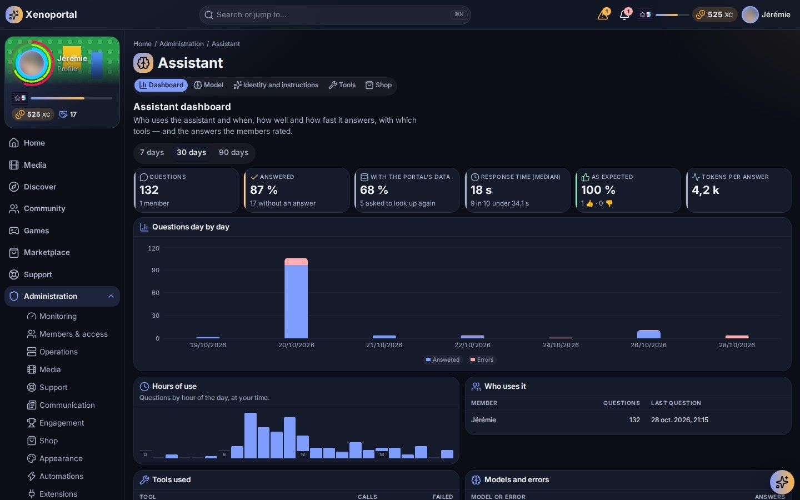

# Assistant and automations

Configure the assistant (its model server, identity, tools, MCP servers, sensitive actions and what the shop sells) and build automations from templates, with approvals and a full run history.

Both are optional. With the assistant off, unconfigured or failing, every classic feature keeps working; with automations off, nothing runs on its own.

## The assistant

The assistant answers members in the portal, looks things up with the portal's own tools and can prepare actions for them. It is a **bounded agent acting for the signed-in member**: it never holds more rights than that member, and everything it reads or does goes through the same checks as the member's own clicks. The members' side is described in [The assistant](../members/assistant.md).

Its pages are in the **Assistant** hub of Administration (`/admin/ai`): **Dashboard**, **Model**, **Identity and instructions**, **Tools** and **Shop**.

### Model

"Where the assistant thinks: its server and model, its credential, its limits."

- **Assistant enabled** is the kill switch.
- **Server**: the Ollama servers you added in **Administration → Services** appear here with their models (those already in memory answer at once). **Address typed by hand** accepts any OpenAI-compatible server (vLLM, LM Studio, a hosted API…): set the **Provider URL (OpenAI-compatible)** and, if needed, the **Provider access credential** (stored, never shown again; leave empty to keep it).
- **Model**: pick one that can use tools; a model without tools answers without the portal's data, and the page says so.
- **Model's reflection** for "thinking" models: **None** (answers at once, guesses more), **Low** (recommended: a small model understands the question and uses its tools), **Medium**, **High** (slower), or the model's default.
- **Test the provider** checks the connection and shows the response time.
- **Limits**: **Daily tokens per user**, **Messages per minute per user**, **Tool calls per answer**, **Provider timeout (seconds)**, **Conversation retention (days)**, **Confirmation window (minutes)**.
- **Navigate automatically to suggested pages**.

Optional semantic search: set *Embedding model* and *Embedding vector size* in Configuration (area Assistant) to let the portal's search use an OpenAI-compatible embedding model.

### Identity and instructions

- **Its name**: told to the model and shown at the top of its window ("Nova" to start with).
- **What it is for**: its role on this portal, in a sentence beginning "help…" or "guide…".
- **When it does not know**: what it does when its tools do not hold the answer. By default it says so, gives the wiki page's link, else offers a support ticket.
- **Questions offered to start with**: one per line, eight at most, shown as buttons when a conversation starts.

### Tools

"What the assistant may use to answer: the portal's tools and those of MCP servers", always with the member's own rights.

The portal's tools are grouped by domain (Help, Incidents, Maintenance, Shop, Media, Navigation, Announcements, Progression, Search, Services, Statistics, Support, Wiki, Extensions and others). **Offer …** switches each one on or off (**All on**, **All off**); a tool switched off is never offered to the model. Each shows its sensitivity:

| Sensitivity | Behaviour |
|---|---|
| **Read** | Runs when the member may. |
| **Write** | Runs when the member may; the service applies its own rules. |
| **Needs confirmation** | Never runs on its own: the assistant prepares a pending action with its exact parameters, which the member confirms or declines in the portal within the confirmation window (10 minutes by default). |
| **Never for the assistant** | Never offered to, nor runnable by, the assistant, even for the Admin. |

Sensitivity is not up to the tool: it follows the permission registry. A permission that requires confirmation makes the tool **Needs confirmation**; managing the assistant, roles and grants, the Admin transfer, security policies and the event store are **Never for the assistant**. The assistant cannot change its own configuration, and Support only lets it prepare ticket drafts, never submit them.

#### MCP servers

**MCP servers** connects outside tool servers (for example MCParr) over Streamable HTTP. "Only allow-listed tools are offered, each with a portal permission and a sensitivity."

1. **Add a server**: a **Name**, its **URL** and an optional **Access credential**.
2. The **Tools on the server** are listed once it answers.
3. **Allow a tool**: pick the **Server tool**, the **Portal permission** a member needs to use it, and its **Sensitivity** (needs confirmation by default).
4. **Save servers**.

The portal checks the permission before every call. A server that is down simply contributes no tools.

### Shop

"The assistant's capacities members can buy, and how far they go." Choose **What may be sold**:

- more tokens each day;
- recharges (tokens kept until spent);
- a longer memory and more look-ups;
- more reflection;
- a stronger model (on the same server; empty: not sold);
- reserved tools, kept for those who bought them.

Set the ceilings: the most tokens in a day with what was bought, the most held in recharges. The products themselves (price, duration, amount) are created in **Shop → Catalogue**, type **Assistant capacity** (see [Gamification and economy](gamification-and-economy.md#catalogue)).

### Dashboard

"Who uses the assistant and when, how well and how fast it answers, with which tools, and the answers the members rated." Key figures, hours of use, median response time, calls per tool, failures by cause (provider not answering, credential refused, model too slow, daily allowance used…), daily usage over 30 days, and **Answers rated « not as expected »** with the question, the answer and the member's comment, to improve its instructions and tools.

### Privacy

Conversations belong to their member: administrators cannot read them. Members can delete them, they are purged after the retention period and erased with the account. Audit and statistics record tool names, ids and timings, never prompts or answers. Secrets are masked in tool results and answers.

## Automations

Automations are rules: **When** a trigger happens, **If** conditions hold, **Then** run up to 10 actions in order. There are no loops, branches or scripts. Only administrators write them by default (setting *Let members create automations*).

The **Automations** hub (`/admin/automations`) has the list, **New automation**, **Run history**, **Templates** and **Approvals**.

### The list

Each automation shows its trigger in words ("When « … »", "Every day at …"), its state (**Draft**, **Active**, **Paused**, **Suspended**, **Archived**), its runs and failures over 7 days and its last run. Filter **Active**, **Drafts**, **Need attention** or **All**. Actions: **Pause**, **Resume**, **Run now** (with a confirmation, under the same safety rules), **Dry run**, **Archive**, **Re-enable** a suspended one.

### Templates

**Templates** are "ready-made automations: open one, adjust it, save it as a draft, then publish it."

| Template | What it does |
|---|---|
| **Campaign start announcement** | Announces a campaign to everyone when it starts. |
| **Campaign ending soon** | Reminds members a campaign ends soon. |
| **Incident for a service outage** | Declares an incident when a service becomes unavailable (approval-gated). |
| **Incident when a service stays down** | Declares an incident when a service has been unavailable for 10 minutes (adjustable). |
| **New ticket to support** | Tells the support team when a ticket is opened. |
| **Parity check: show a banner** / **Parity check over: take the banner down** | While a server checks its parity, a banner tells members it may be slower, then is taken down. |
| **Weekly digest** | Every Monday morning, invites members to read the news. |
| **Welcome on verification** | Welcomes members when their account is verified. |

A template that needs something this portal does not have is marked "Not available on this portal".

### Building an automation

**New automation** walks through the parts:

1. **When** (the trigger):
   - **Something happens**: an event of the portal (a playback finished, a service changed state, a campaign started, a ticket opened…), optionally narrowed with **Only when** filters on its fields;
   - **On a schedule**: every day, week or month at a time, in a time zone;
   - **Once**: at a given moment;
   - **After a delay**: minutes before or after a date carried by an event.
2. **If** (optional conditions), combined as **all of them** or **any of them**: the member is, the member has a role, the member's level is at least, a service is in a state, the kind of media, the media's genre, the title contains, a campaign is running, within hours, the member holds a permission, a field of the event. A condition that cannot be checked counts as not met.
3. **Then** (steps), in order:

   | Action | |
   |---|---|
   | **Send a notification** | to an audience, with a message template |
   | **Show a banner** / **Take a banner down** | announcements |
   | **Publish an article** | news |
   | **Open a support ticket** / **Declare an incident** | support |
   | **Give XP**, **Give Coins**, **Give contribution**, **Unlock an achievement** | the economy |
   | **Synchronize a service** / **Run a service action** | connected services |
   | **Ask the assistant** | a short text from the assistant, read-only |
   | **Ask for an approval** | wait for someone's go-ahead |
   | **Trigger another automation** | chaining |

   Insert **Variables of the event** into a field; they are replaced by the event's values when the automation runs. A step can **Go on with the next steps if this one fails**.
4. **Limits and repetition**: **Pause between two runs (minutes)**, a **Duplicate key** and its **Duplicate window** (two runs with the same key within the window run once), **At most per minute**.

**Try it** fills an example of the event and shows which conditions pass and what each step would do; nothing is executed. **Save draft** keeps it; every save is a new version, and only the published version runs. **Publish** asks for a confirmation when a step is sensitive.

### Safety

| Control | What it does |
|---|---|
| **Identity** | An automation runs as its author, with the author's rights, re-checked before every step. A suspended author or a missing right makes the run **Refused** and flags the automation for review. |
| **Approvals** | Destructive actions wait for an approver at each run; sensitive ones need a confirmation when publishing. |
| **The assistant's output** | Text from **Ask the assistant** may only feed non-sensitive steps that accept it, never a condition and never an approval. |
| **Loops** | An automation already in the chain, or a chain deeper than 3, is **Prevented**. |
| **Repeats** | One run per automation version and trigger event; duplicate keys and pauses. |
| **Storms** | Beyond the rate, runs are batched or recorded as **Throttled**, never dropped silently. |
| **Suspension** | Repeated failures suspend the automation, with a notification; re-enable it explicitly. |

### Approvals

**Approvals** lists "steps waiting for someone's go-ahead before they run", with their expiry. **Approve** or **Reject** each one. Approvers need the automation approval permission; requests expire after *Approval request validity*.

### Run history

**Run history** shows "every run of every automation, newest first". Each run has a status (**Success**, **Conditions not met**, **Refused**, **Prevented**, **Timed out**, **Suspended**, **Failed**, **Throttled**, **Awaiting approval**), whether it was triggered, scheduled or run by hand, the version, the **Conditions** trace (met, not met, could not be checked) and each step's outcome and duration. History keeps references only, never message bodies or secrets, for *Automation history retention* (90 days by default).

### Settings

In Configuration (area Automations): *Enable automations*, *Let members create automations*, *Actions per automation*, *Chaining depth*, *Executions per minute*, *Simultaneous runs*, *Action time limit*, *Run time limit*, *Minimum schedule interval*, *Failures before suspension*, *Failure rate before suspension*, *Approval request validity*, *Automation history retention*.

---

Next: [Members and roles](members-and-roles.md) · [Services](services.md) · [Operations](operations.md) · Members' view: [The assistant](../members/assistant.md)
