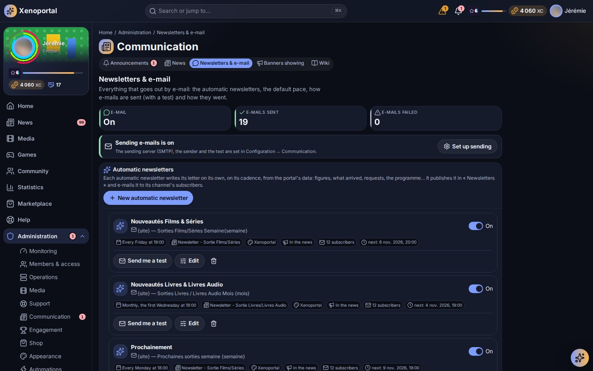
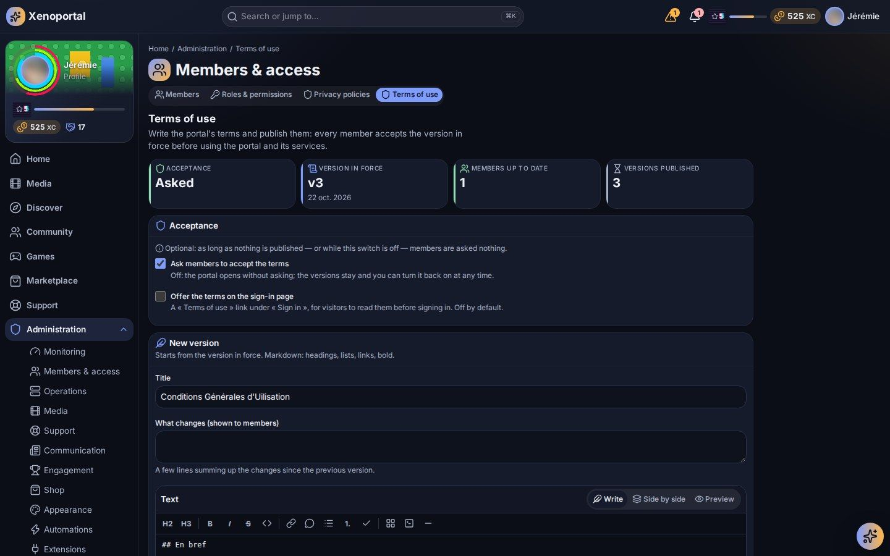

# Content and communication

Run the news desk and its outside sources, the wiki, newsletters and e-mail, the terms of use, announcements and banners, community moderation, and the support settings and feedback.

## Where things are

| Administration hub | Pages |
|---|---|
| **Communication** | **News** (the news desk, `/admin/news`), **Wiki** (`/admin/wiki`), **Announcements** (`/admin/announcements`), **Newsletters & e-mail** (`/admin/newsletters`), **Banners showing** (`/admin/banners`) |
| **Members & access** | **Terms of use** (`/admin/terms`) |
| **Support** | **Support settings** (`/admin/support`), **Moderation** (`/admin/community/moderation`) |
| **Operations** | **Maintenance** (`/admin/maintenance`) |
| **System** | **Configuration** (`/admin/configuration`), group **Communication**: sending e-mails |

## Who does what

Portalab ships base roles you assign in **Roles & permissions** (see [Members and roles](members-and-roles.md)):

| Role | Content rights by default |
|---|---|
| **Editor** | Write, edit and publish news; create, edit and publish wiki pages; read wiki history. |
| **Support** | Handle tickets, incidents and feedback; edit wiki pages and read their history. |
| **Moderator** | Moderate community proposals; create and edit community events. |
| **User** | Read news and the wiki. |

Deleting an article or a wiki page is a separate, sensitive permission that asks for a confirmation and is not given to any role by default.

## Writing: the Markdown everyone shares

News, wiki pages, event descriptions, proposals and the terms of use all use the same Markdown, rendered and sanitised by the server:

- CommonMark with tables, strikethrough and task lists, fenced code;
- callouts `> [!NOTE]`, `> [!TIP]`, `> [!IMPORTANT]`, `> [!WARNING]`, `> [!CAUTION]`;
- Mermaid diagrams in fenced `mermaid` blocks, drawn in strict mode (setting *Mermaid diagrams*);
- links to the web, `mailto:`, in-portal paths, and links to other content such as `[the guide](portalab://wiki/<page>)`, resolved for each reader (a page they may not open shows no link and no title);
- images uploaded to the portal. Images hosted elsewhere are blocked unless *Allow external images* is on.

Raw HTML is disabled. Saving text that looks like a password or a key shows a warning.

## The news desk

**News** ("Write, schedule and feature the portal's articles") has three tabs, **Articles**, **Channels** and **External sources**. The automatic newsletters are on **Newsletters & e-mail** (below).

### Headlines and My feed

Members read the news on two pages of the **News** section of their menu:

| Page | What it shows | What feeds it |
|---|---|---|
| **Headlines** (`/news`) | The team's articles, by channel; then **On the web** | The **Articles** you publish; the **External sources** |
| **My feed** (`/feed`) | One stream per member, each source in its colour, with a **For me** filter | What the library brings for what the member follows (people, series, genres), the **External sources**, and the member's own sources |

Both carry an unread badge in the members' menu. A member's follows and own sources are private: nobody else sees them. See [Community](../members/community.md#news) for the members' side.

### Writing an article

1. Select **New article**. The editor opens above the list with a live preview.
2. Fill in the **Title**, the **Summary** and the **Article**, and choose a **Channel**.
3. Tick **Featured (shown at the top once published)**, **Notify readers when published** and, for a newsletter channel, **E-mail it to the channel's subscribers when published** (sent once).
4. Select **Validate** and choose what should happen to it:
   - **Keep as a draft**: saved, visible to editors only;
   - **Publish now**: members see it right away;
   - **Schedule**: published by itself at the time you choose.

The list filters articles by state (Draft, Scheduled, Published, Archived). Each row offers **Edit**, publishing, **Feature** or **Stop featuring**, and **Archive** or **Restore**. A published article must be archived before it can be deleted. **See who read it** shows how many members read an article ("… of … members read it").

At most *Featured articles* (3 by default) are featured at once, by priority then recency. *Default article audience* sets who new articles are shown to; an article's audience is applied everywhere it appears (list, search, calendar, notifications).

### Channels

Channels are the news sections. Each has a **Name**, a **Description**, an **Icon** and can be switched off. **Newsletter: send by e-mail** makes it a newsletter channel: its articles can be e-mailed to subscribed members, and each member can unsubscribe from the channels they choose (in their notification preferences). Every newsletter e-mail carries an unsubscribe link.

Each channel has its own colour, the same on its articles' covers, its label and its filter chip on **Headlines**. You do not pick it: it is the theme's accent turned by a hue of the channel's own, spread by the channels' order so that neighbours never look alike.

### External sources

**External sources** are "RSS or Atom feeds of film, series, games sites… read on their cadence: their items show on « Headlines » (under « On the web ») and on the pages of the titles and people they name". They also show in every member's **My feed**, each source with its colour and its kind's icon.

1. **Add a source**, then type the **Feed or site address**: "A site's address will do: its feed is found." A YouTube channel's or playlist's address works too. **Preview** shows what it finds ("« … »: 12 items found").
2. Give it a **Name** and, optionally, a **Channel**: its items then also show when members filter **Headlines** on that channel.
3. Choose **Read every** (from 15 minutes to 24 hours), and optionally **Only items containing** and **Leave out items containing** ("Words separated by commas (empty: everything).").
4. **Source on**, then **Save**.

Each source shows when it was last read (or **Failing**, or **Never read**), its number of items, **Read now**, **Edit**, and the bin to remove it (select it again to confirm). **Latest items** lets you **Pin** an item at the top of **Headlines**, or **Hide** it. **Export (OPML)** and **Import (OPML)** move a list of sources at once.

Members can add their own sources in **My feed** (**My sources**); those are read for them alone.

**Suggested to the members** lists sources offered in every member's **My feed**, who follows one in a click. Type a feed's or a site's address (and a name, or leave it empty for the feed's own title), then **Suggest this source**: it is read once to find its feed. Unlike the sources above, a suggestion reaches only the members who choose it; a member who already follows it no longer sees it. The list is the `news.feeds.suggestions` setting, so it travels with the configuration export.

## Newsletters and e-mail

**Newsletters & e-mail** gathers "Everything that goes out by e-mail": whether sending e-mails is on (with **Set up sending**, which leads to the e-mail settings), the **Automatic newsletters**, the **Newsletters written**, the newsletter **Templates**, and the deliveries (**E-mails sent**, **E-mails failed**).

### Automatic newsletters

"Each automatic newsletter writes its letter on its own, on its cadence, from the portal's data: figures, what arrived, requests, the programme…" Create a newsletter channel first (**News → Channels**, **Newsletter: send by e-mail**).

Each automatic newsletter is a card: its name, when it goes out (*Every Monday at 8:00*), **In the news** when it is published there, its number of subscribers, the next run, and a switch to turn it **On** or **Off** in place, with **Send me a test**, **Edit** and **Delete** (the letters it already wrote stay in the history).

**New automatic newsletter** (or **Edit**) opens a window, in the order it is thought:

| Part | What you set |
|---|---|
| **Name and subject** | The **Name** ("To tell it apart here; members do not see it.") and the **E-mail subject**, also the letter's title in the portal. Click a variable to insert it: `{site}`, `{date}`, `{semaine}`, `{mois}`, `{année}`, `{période}`, `{numéro}`, `{chaîne}`; their English names — `{day}`, `{week}`, `{month}`, `{year}`, `{period}`, `{number}`, `{channel}` — work too. |
| **When** | The **Frequency** (**Every day**, **Every week** or **Every month**), the **Day**, the **Hour**, and the **Period** it tells (the last 24 h, 7, 14, 30 or 90 days). |
| **Its look** | Its template, chosen by sight: each one a card with its colours, its name and what it shows. |
| **What it tells** | The **Contents**, each switched on or off: **Message (good to know)**, **Statistics**, **Most watched**, **New movies**, **New series**, **New books**, **New audiobooks**, **New video games**, **New music**, **New requests**, **Out now**, **TV programme**, **Coming soon**, **Articles**. While the statistics are on, the **Statistics charts** to draw: **Key figures**, **Time watched per day**, **By kind**, **By day of the week**, **By hour**, **Most watched genres**. **Back to the default contents** resets them; a content the template has no section for takes its default display. A **Message shown on top** is optional ("A planned maintenance, important news…"). |
| **Where it goes** | The **Channel** and the **Language**, then **Publish in the portal’s news (the letter, and an article in its channel)** and/or **E-mail it to the subscribers** — at least one of them — and **On: it goes out by itself at the planned time**. |

Beside the form, the letter shows as members will get it, with the real data: switch **Live preview** on, or **Generate the preview** on demand.

A letter published in the news is an ordinary article of its channel, with the channel's colour; read in the portal, it shows whole. When there is nothing new to tell, nothing is written.

**Send me a test** sends the real e-mail to your own address only, never to the members ("Test sent to your address only (when e-mail delivery is on)."). When the newsletter publishes in the news, the test letter is published there too.

Members are subscribed to each automatic newsletter by default and unsubscribe from it one by one, in their notification preferences (**Newsletters by e-mail**); leaving a channel also leaves the newsletters published in it. Newsletters made before the self-writing editions (*New in the library*, *Recent releases*, *Upcoming releases*) are marked **Former format**.

### Newsletters written and templates

- **Newsletters written** lists every letter with its date, its period, how many members received it, and its state (**Preview**, **Draft**, **Published**, **E-mailed only**): **Read** it, **Send me a test**, **Send by e-mail** if it was not e-mailed yet, or delete it.
- **Templates**: "The look and the order of the sections. Each automatic newsletter picks its own; duplicate a built-in template to make yours." The built-in ones are **Classic**, **Midnight**, **Gazette** and **Portalab** (the portal's own look). Each template says who uses it (*Used by: …*); one in use cannot be deleted. Its editor sets the **Template name**, **Identifier**, **Name in the header**, **Tagline**, **Header**, **Font**, **Card corners (px)**, **Colours**, and the **Sections, in order** (each with its **Display**, **Columns**, **Number of titles**, an optional title, its kinds and **Show the overviews**), with a live preview on the real data of the last 7 days.

### Sending e-mails

E-mails are set up in one form, **Sending e-mails**, in **System → Configuration**, group **Communication** (the setup assistant offers it too): "Set it up in order, save, then send yourself a test."

- **Send e-mails**: off, no e-mail goes out — no notification, no newsletter, no test. You can set everything up before switching it on.
- **Sending server (SMTP)**: a **Provider** preset (**Gmail**, **Outlook / Microsoft 365**, **OVH**, **Brevo**, **Server on this machine**, or **Other / custom**, each with its tip), the **Server address**, the **Security** (**STARTTLS (port 587, recommended)**, **SSL/TLS (port 465)**, **None (port 25, local network)**) and the **Port**.
- **Account**: the **User** and the **Password** (never shown again once saved).
- **Sender and links**: the **Sender address** (the e-mails' "From"), the **Sender name** ("The name mail clients show instead of the address; empty, the site's name.") and the **Portal's public address** (for the e-mails' links and pictures; recipients must be able to reach it).
- **Save**, or **Save and send me a test**. The test goes to your own account's e-mail address only; a refused test says why.

Every e-mail — notifications, announcements, newsletters — goes out in Portalab's look (Gmail included), under the sender name.

**Switching the members' e-mails off.** To stop e-mail notifications for every member at once, call `PUT /api/v1/admin/notifications/members/email` with `{"enabled": false}` (`true` turns them back on). It switches the e-mail channel off in every member's own preferences and turns their e-mail digest off; the members who manage notifications (the administrators) keep theirs, required and locked channels stay as they are, and each member may switch theirs back on afterwards. The change is audited. There is no button for it in the administration yet.

The default rhythm of the notification digest, for members who chose none, is the *E-mail digest of notifications (default)* setting; it has nothing to do with the newsletters. The *Newsletters* setting switches the whole newsletter feature off: nothing is sent and its screens disappear.

## The wiki

The member guide and your own pages live in the wiki. Editors write pages from the wiki itself (**New page**, **Edit**, **History**); conflicting saves are detected and merged by the editor.

**Wiki** in Administration lists "every page, its place and state": **Publish**, **Archive** or **Back to draft**, and a **Broken links** view to fix links that lead nowhere. On a page, **The assistant may use this page** lets the assistant quote it (it only ever uses pages the asking member may read).

Settings: *Who sees page history* (editors only, or every reader), *Largest wiki page*.

## Terms of use

**Terms of use**: "Write the portal's terms and publish them: every member accepts the version in force before using the portal and its services."

- **Ask members to accept the terms**: off, the portal opens without asking; versions are kept and you can turn it back on at any time. As long as nothing is published, members are asked nothing.
- **Offer the terms on the sign-in page**: a "Terms of use" link under "Sign in", for visitors to read before signing in (off by default).
- **New version** starts from the version in force (a template is offered the first time). Fill in the **Title**, the **Text** (Markdown) and **What changes (shown to members)**, check the **Preview**, then **Publish**.
- **Members must accept this version again**: untick it only for a correction that changes nothing for members, such as a typo.

The page shows the **Version in force**, the **Versions published** with their acceptances, and how many members are up to date or still have to accept. A member who refuses is signed out until they accept.

## Announcements

**Announcements**: "Tell everyone now: by notification, by e-mail and/or with a banner."

1. Choose the **Kind of announcement**:

   | Kind | Effect |
   |---|---|
   | **Information** | Blue, normal priority. |
   | **Good news** | Green, normal priority. |
   | **Warning** | Orange, sent as an alert (high priority). |
   | **Urgent** | Red, critical priority: reaches even members who muted announcements, never held for a digest; its banner is kept by default. |

2. Write the **Title**, the **Message** and an optional **Link** (a page of the portal, such as `/news`).
3. Choose the **Channels**: **Notification** (each member's notification centre), **E-mail** (everyone, unless they turned announcement e-mails off) and/or **Banner** (at the top of every page until the chosen date). **Members can close it** decides whether the banner can be dismissed.
4. Check the **Banner preview**, then **Send to everyone**.

**Recent announcements** shows each one with its deliveries; **Take the banner down** ends a banner early. Automations can also show and take down banners (see [Assistant and automations](ai-and-automations.md)).

## Banners showing

**Banners showing** lists every banner shown across the portal right now, whatever put it there: an **Announcement**, an **Incident** (until it is resolved) or a **Maintenance** (from the day before until it ends), with a link to manage it.

**Maintenance** plans the interruptions of a service or of the whole portal: a title, details for members, a start and an end, and **Also announce it with a banner**. See [Services](services.md) for incidents and alerting.

## Community moderation

**Moderation** shows the proposals waiting for a decision before they become visible. **Approve** publishes one; **Reject** refuses it, with a **Reason** shared with the proposer. A project proposal, once approved, becomes a community project managed in **Shop → Community projects** (see [Gamification and economy](gamification-and-economy.md#community-projects)).

Moderators create, edit and cancel **community events** from the community's **Events** tab (**New event**): title, Markdown description, start and end or all day, reference time zone, and an audience (**Everyone**, **Members** or **Selected roles**).

Community settings (Configuration, area Community):

| Setting | What it does |
|---|---|
| *Moderate proposals* | Proposals need a moderator's approval before they become visible (on by default). |
| *Who may make proposals* | Roles allowed to submit proposals; empty: every active account. |
| *Recognitions per day*, *Delay between recognitions* | Limits on recognising contributions. |
| *Community feed events* | Kinds of activity shown in the feed (achievements, level-ups, quests, projects…). |
| *Community feed retention* | How long feed entries are kept (180 days by default). |
| *Default directory visibility* | Who sees a member in the directory by default. |
| *Community shelf size* | Items on each discovery shelf. |

The community has no messaging, comments or likes, by design.

## Support settings and feedback

**Support settings** defines "ticket types and their fields, the workflows tickets follow and the feedback forms". Each is a validated definition saved as a new version:

- **Ticket types**: their fields (text, long text, choices, number, yes/no, date, member), required or not, visible to the requester or to staff only. The base types are a bug, an access request, a service issue, a question and other. Every media's page shows **Report a problem** (a flag, in the palette's warning colour): under the title's poster, members pick what is wrong — it heads the ticket's title — fill the fields of the type that takes media reports if it has any, and send a ticket tied to the media, which the ticket shows with a link to its page. The base type **A problem with a media** takes them; tick **Media reports** on another type (one at a time) to use it instead. With no such type enabled, the button is not shown, and the general **Open a ticket** form never offers it (a report is made from the media's page). On that type, **Kinds of problem** lists what members pick from, in order: rename, add or remove kinds (no VF, sound out of sync…); **Back to the kinds offered** returns to the portal's own (subtitles, sound, picture, language, the file, something else). **Reports visible to every member** shows the open reports of that type on the media's page to every member (title and state, never who made them nor what they wrote) so a known problem is not reported twice; unticked, each member sees only their own. The team always sees them all, and a beating badge on the title's head counts the open ones. In the support queue, a ticket about a media opens on its poster, title, kind and year, with **Technical sheet**: unfolded, it asks the services there and then — each media server (Plex, Jellyfin) gives when the title was added and its files (path, size, container, length, bitrate) with their streams (video: resolution, codec, dynamic range; each audio track: language, codec, channels, default; subtitles: language, forced), and the download manager (Radarr, Sonarr) gives the quality, the size and its history: the release grabbed, its indexer, the download client and the torrent's hash, the import.
- **Workflows**: states and the transitions between them, who may make each (requester, assignee, staff), whether a comment is required and whether it reopens. Unreachable states and dead ends are refused.
- **Feedback forms**: the forms members fill in (general, bug report, feature request).

**Feedback review** (`/support/feedback`, "Members' feedback") collects what members suggest or report. Filter **To review**, **Read**, **Converted**, **Closed** or **All**; **Reply to the member**; and turn a feedback into a **ticket**, a **feature proposal**, a **community project** or a **reward** (Contribution points), or close it. Each conversion happens once per feedback. The ticket queue itself is described in [Support](../members/support.md).

---

Next: [Customization](customization.md) · [Members and roles](members-and-roles.md) · [Assistant and automations](ai-and-automations.md) · Members' view: [Community](../members/community.md)
