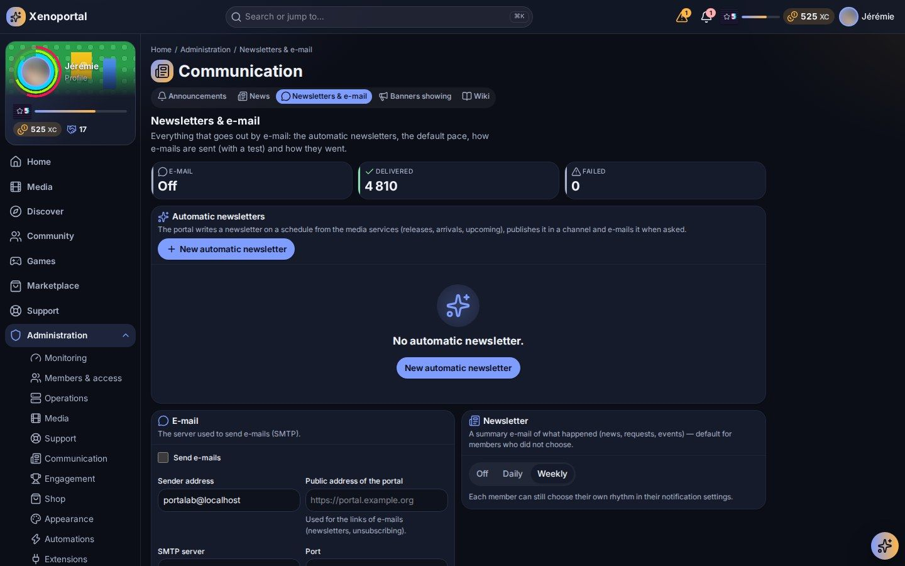

# Content and communication

Run the news desk, the wiki, newsletters and e-mail, the terms of use, announcements and banners, community moderation, and the support settings and feedback.

## Where things are

| Administration hub | Pages |
|---|---|
| **Communication** | **News** (the news desk, `/admin/news`), **Wiki** (`/admin/wiki`), **Announcements** (`/admin/announcements`), **Newsletters & e-mail** (`/admin/newsletters`), **Banners showing** (`/admin/banners`) |
| **Members & access** | **Terms of use** (`/admin/terms`) |
| **Support** | **Support settings** (`/admin/support`), **Moderation** (`/admin/community/moderation`) |
| **Operations** | **Maintenance** (`/admin/maintenance`) |

## Who does what

Portalab ships base roles you assign in **Roles & permissions** (see [Members and roles](members-and-roles.md)):

| Role | Content rights by default |
|---|---|
| **Editor** | Write, edit and publish news; create, edit and publish wiki pages; read wiki history. |
| **Support** | Handle tickets, incidents and feedback; edit wiki pages and read their history. |
| **Moderator** | Moderate community proposals; create and edit community events. |
| **User** | Read news and the wiki. |

Deleting an article or a wiki page is a separate, sensitive permission that asks for a confirmation and is not given to any role by default.

## Writing: the Markdown everyone shares

News, wiki pages, event descriptions, proposals and the terms of use all use the same Markdown, rendered and sanitised by the server:

- CommonMark with tables, strikethrough and task lists, fenced code;
- callouts `> [!NOTE]`, `> [!TIP]`, `> [!IMPORTANT]`, `> [!WARNING]`, `> [!CAUTION]`;
- Mermaid diagrams in fenced `mermaid` blocks, drawn in strict mode (setting *Mermaid diagrams*);
- links to the web, `mailto:`, in-portal paths, and links to other content such as `[the guide](portalab://wiki/<page>)`, resolved for each reader (a page they may not open shows no link and no title);
- images uploaded to the portal. Images hosted elsewhere are blocked unless *Allow external images* is on.

Raw HTML is disabled. Saving text that looks like a password or a key shows a warning.

## The news desk

**News** ("Write, schedule and feature the portal's articles") has two tabs, **Articles** and **Channels**.

### Writing an article

1. Select **New article**. The editor opens above the list with a live preview.
2. Fill in the **Title**, the **Summary** and the **Article**, and choose a **Channel**.
3. Tick **Featured (shown at the top once published)**, **Notify readers when published** and, for a newsletter channel, **E-mail it to the channel's subscribers when published** (sent once).
4. Select **Validate** and choose what should happen to it:
   - **Keep as a draft**: saved, visible to editors only;
   - **Publish now**: members see it right away;
   - **Schedule**: published by itself at the time you choose.

The list filters articles by state (Draft, Scheduled, Published, Archived). Each row offers **Edit**, publishing, **Feature** or **Stop featuring**, and **Archive** or **Restore**. A published article must be archived before it can be deleted. **See who read it** shows how many members read an article ("… of … members read it").

At most *Featured articles* (3 by default) are featured at once, by priority then recency. *Default article audience* sets who new articles are shown to; an article's audience is applied everywhere it appears (list, search, calendar, notifications).

### Channels

Channels are the news sections. Each has a **Name**, a **Description**, an **Icon** and can be switched off. **Newsletter: send by e-mail** makes it a newsletter channel: its articles can be e-mailed to subscribed members, and each member can unsubscribe from the channels they choose (in their notification preferences). Every newsletter e-mail carries an unsubscribe link.

## Newsletters and e-mail

**Newsletters & e-mail** gathers "everything that goes out by e-mail".

- **Automatic newsletters**: the portal writes a newsletter on a schedule from the media services, publishes it in a channel and e-mails it when asked. For each one choose a **Name**, a **Channel**, the **Content** (**New in the library**, **Recent releases** or **Upcoming releases**), the **Media kinds** (films, series, music, books, games; none ticked: all), the **Frequency** (every day, week or month), the **Day**, the **Hour**, the **Language**, and **Also send it by e-mail**. **Generate now** writes one at once; when there is nothing new, nothing is written. Create a channel first.
- **Newsletter (default digest)**: a summary e-mail of what happened (news, requests, events), **Off**, **Daily** or **Weekly**, for members who did not choose their own rhythm.
- **E-mail**: **Send e-mails**, the **SMTP server**, **Port**, **Encrypted connection (TLS)**, **SMTP user**, **Sender address** and the **Public address of the portal** (used for links in e-mails and unsubscribing). **Send me a test** checks the settings.
- **Deliveries**: how many e-mails were delivered and failed.

The *Newsletters* setting switches the whole feature off: nothing is sent and its screens disappear.

## The wiki

The member guide and your own pages live in the wiki. Editors write pages from the wiki itself (**New page**, **Edit**, **History**); conflicting saves are detected and merged by the editor.

**Wiki** in Administration lists "every page, its place and state": **Publish**, **Archive** or **Back to draft**, and a **Broken links** view to fix links that lead nowhere. On a page, **The assistant may use this page** lets the assistant quote it (it only ever uses pages the asking member may read).

Settings: *Who sees page history* (editors only, or every reader), *Largest wiki page*.

## Terms of use

**Terms of use**: "Write the portal's terms and publish them: every member accepts the version in force before using the portal and its services."

- **Ask members to accept the terms**: off, the portal opens without asking; versions are kept and you can turn it back on at any time. As long as nothing is published, members are asked nothing.
- **Offer the terms on the sign-in page**: a "Terms of use" link under "Sign in", for visitors to read before signing in (off by default).
- **New version** starts from the version in force (a template is offered the first time). Fill in the **Title**, the **Text** (Markdown) and **What changes (shown to members)**, check the **Preview**, then **Publish**.
- **Members must accept this version again**: untick it only for a correction that changes nothing for members, such as a typo.

The page shows the **Version in force**, the **Versions published** with their acceptances, and how many members are up to date or still have to accept. A member who refuses is signed out until they accept.

## Announcements

**Announcements**: "Tell everyone now: by notification, by e-mail and/or with a banner."

1. Choose the **Kind of announcement**:

   | Kind | Effect |
   |---|---|
   | **Information** | Blue, normal priority. |
   | **Good news** | Green, normal priority. |
   | **Warning** | Orange, sent as an alert (high priority). |
   | **Urgent** | Red, critical priority: reaches even members who muted announcements, never held for a digest; its banner is kept by default. |

2. Write the **Title**, the **Message** and an optional **Link** (a page of the portal, such as `/news`).
3. Choose the **Channels**: **Notification** (each member's notification centre), **E-mail** (everyone, unless they turned announcement e-mails off) and/or **Banner** (at the top of every page until the chosen date). **Members can close it** decides whether the banner can be dismissed.
4. Check the **Banner preview**, then **Send to everyone**.

**Recent announcements** shows each one with its deliveries; **Take the banner down** ends a banner early. Automations can also show and take down banners (see [Assistant and automations](ai-and-automations.md)).

## Banners showing

**Banners showing** lists every banner shown across the portal right now, whatever put it there: an **Announcement**, an **Incident** (until it is resolved) or a **Maintenance** (from the day before until it ends), with a link to manage it.

**Maintenance** plans the interruptions of a service or of the whole portal: a title, details for members, a start and an end, and **Also announce it with a banner**. See [Services](services.md) for incidents and alerting.

## Community moderation

**Moderation** shows the proposals waiting for a decision before they become visible. **Approve** publishes one; **Reject** refuses it, with a **Reason** shared with the proposer. A project proposal, once approved, becomes a community project managed in **Shop → Community projects** (see [Gamification and economy](gamification-and-economy.md#community-projects)).

Moderators create, edit and cancel **community events** from the community's **Events** tab (**New event**): title, Markdown description, start and end or all day, reference time zone, and an audience (**Everyone**, **Members** or **Selected roles**).

Community settings (Configuration, area Community):

| Setting | What it does |
|---|---|
| *Moderate proposals* | Proposals need a moderator's approval before they become visible (on by default). |
| *Who may make proposals* | Roles allowed to submit proposals; empty: every active account. |
| *Recognitions per day*, *Delay between recognitions* | Limits on recognising contributions. |
| *Community feed events* | Kinds of activity shown in the feed (achievements, level-ups, quests, projects…). |
| *Community feed retention* | How long feed entries are kept (180 days by default). |
| *Default directory visibility* | Who sees a member in the directory by default. |
| *Community shelf size* | Items on each discovery shelf. |

The community has no messaging, comments or likes, by design.

## Support settings and feedback

**Support settings** defines "ticket types and their fields, the workflows tickets follow and the feedback forms". Each is a validated definition saved as a new version:

- **Ticket types**: their fields (text, long text, choices, number, yes/no, date, member), required or not, visible to the requester or to staff only. The base types are a bug, an access request, a service issue, a question and other.
- **Workflows**: states and the transitions between them, who may make each (requester, assignee, staff), whether a comment is required and whether it reopens. Unreachable states and dead ends are refused.
- **Feedback forms**: the forms members fill in (general, bug report, feature request).

**Feedback review** (`/support/feedback`, "Members' feedback") collects what members suggest or report. Filter **To review**, **Read**, **Converted**, **Closed** or **All**; **Reply to the member**; and turn a feedback into a **ticket**, a **feature proposal**, a **community project** or a **reward** (Contribution points), or close it. Each conversion happens once per feedback. The ticket queue itself is described in [Support](../members/support.md).

---

Next: [Customization](customization.md) · [Members and roles](members-and-roles.md) · [Assistant and automations](ai-and-automations.md) · Members' view: [Community](../members/community.md)
