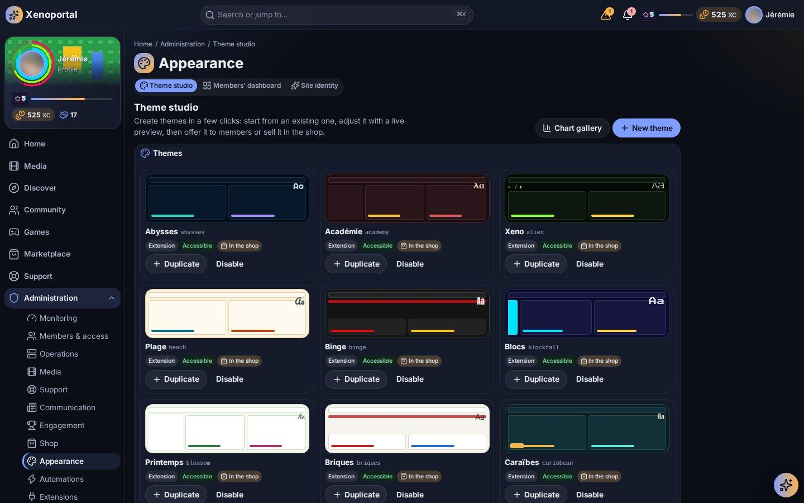

# Customization

Make the portal yours: its name and currency, its themes and palettes, visual packs, plugins, widgets and the members' default dashboard, statistics and charts, and the navigation.

## Where things are

| Administration hub | Pages |
|---|---|
| **Appearance** | **Theme studio** (`/admin/themes`), **Site identity** (`/admin/site`), **Members' dashboard** (`/admin/dashboard`) |
| **Extensions** | **Visual packs** (`/admin/visuals`), **Widgets** (`/admin/widgets`), **Plugins** (`/admin/plugins`), **Modules** (`/admin/modules`) |
| **System** | **Statistic definitions** (`/admin/statistics`), **Configuration** |

Members choose their own theme, palette, effects and layout in **Appearance**, among what you allow (see [Personalization](../members/personalization.md)).

## Site identity

**Site identity** puts "the site's name instead of « Portalab », its slogan, logo and icon, and its currency instead of « Coins »" wherever members read them: the header, the sign-in page, the browser tab, the home screen, the e-mails.

| Field | Notes |
|---|---|
| **Site name** | Empty: "Portalab". |
| **Short name** | Up to 12 characters, used on phones and on the home screen. |
| **Slogan** | Per language, under the name on the sign-in page. |
| **Logo** | Replaces the mark in the header and on the sign-in page. PNG, JPEG, WebP or GIF, up to 2 MiB (reduced to 512 px). |
| **Icon** | The browser tab's and the home screen's icon, made square (512 px). |
| **Currency** | Its name in the singular and the plural, per language ("1 Xenocoin", "120 Xenocoins"); a **Short name** of up to 8 characters for compact amounts ("120 XC"); an **Icon** shown in place of the coins wherever an amount appears (unless a member's theme has its own). |

The **Preview** shows what members will read, on a computer and on a phone, in the language you pick. **Restore Portalab's** brings the defaults back. Members see changes on their next page load.

## Theme studio

**Theme studio**: "Create themes in a few clicks: start from an existing one, adjust it with a live preview, then offer it to members or sell it in the shop."

The list shows every theme with its source (**Built-in**, **Created here**, **Extension**) and its state. **New theme** or **Duplicate** opens the editor:

| Section | Choices |
|---|---|
| **Identity** | **Name**, **Technical key** (cannot change later), **Base** (Dark or Light), **Font**. |
| **Colors** | Background, Cards, Text, Secondary text, Borders, Accent, Second accent, Text on accent, Focus ring. |
| **Layout** | **Menu on computers** (sidebar, top bar, rail, orbit), **Menu on tablets**, **Menu on phones** (bottom bar, drawer…), **Header style**, **Header position** (top or bottom), **Cards**, **Widget frame**, **Content width**, **Corners**. |
| **Motion & shape** | **Animations** and **Celebrations** profiles. |
| **Sounds** | A sound (or **Silent**) for notification, alert, success, reward, level up and interface events. |

The **Accessibility check** runs as you edit: a theme whose contrasts are too low cannot be saved until the colours are fixed. Members' own accessibility choices (reduced motion, high contrast, text size) always override a theme.

Then make it available:

- **Offer to members**: every member can choose it in Appearance;
- **Sell in the shop**: a product with a **Price (Coins)**, a **Rarity**, a **Description** and an optional **Poster effect**; once sold, only the members who bought it can choose it.

Built-in themes include **Portalab dark** (the default) and **Portalab light**, plus light, dark and high-contrast fallbacks that always stay available. The **Chart gallery** link shows every chart shape of the portal in the current theme with sample data.

Related settings (Configuration, area Appearance): *Default theme*, *Available themes*, *Campaign themes* (whether campaign overlays apply), *Reduce motion for everyone*, *Smallest text size* and *Largest text size*.

### Palettes and looks

A **palette** lays accent colours over any theme; members try and choose one in Appearance. Palettes, like ambiences, frames, name styles, badges, notification looks and celebrations, come from **visual packs** and are sold (or offered) through the shop.

## Visual packs

A visual pack brings looks from outside: an interface (possibly with its own navigation), profile designs, level-ups and celebrations, ambiences, notification looks, palettes, badges and titles, a booster scene, widgets with their looks and options. Each pack carries its own stylesheets, shaders and scripts; Portalab only draws them, in a sandbox, through fixed contracts.

**Visual packs** ("Looks imported from outside… Each version is analysed, tried in the sandbox, then validated with the economy you choose") is reserved to the Admin.

### Importing

Three **Sources**:

- the **Inbox**: drop folders or `.zip` files in the inbox folder on the server, then **Read the inbox**;
- **Upload a .zip** (40 MB at most);
- **From GitHub**: a repository's address; its latest release (or default branch) is imported. **Check for updates** compares versions and never installs on its own.

### The six steps

Each version goes through six steps; the next opens only when nothing blocks.

| Step | What happens |
|---|---|
| **Import** | Where the version comes from and what it holds, stored apart under its fingerprint, never changed. |
| **Analysis** | Format, looks and their conflicts, texts, economy, interfaces. Findings are **Blocking**, **Warning** or **Info**. |
| **Security** | What its stylesheets and scripts would try, and what Portalab refuses anyway. |
| **Test** | Every element drawn as members would see it: **Try** it on yourself (this page only), **Measure** it (compiled, frames per second, scripts started). |
| **Review** | The economy of each element (**Price (Coins)** or reward only, **Rarity**, **Level required**, **Copies**, sold in the shop or given to everyone for widgets), and the confirmations: scripts, a look taken over from another pack, the data each widget asks for, the boosters a scene dresses. |
| **Validation** | **Validate and publish**: the elements become shop products (or are offered) and the looks go live within moments. Or **Reject** with a reason. |

A pack's scripts run isolated: they can never reach the member's account, session or data, use the network, read the browser's storage or touch the page around them. A pack that holds JavaScript asks you to confirm you checked it.

### Managing packs

- A published version never changes: new content needs a new version.
- **Switch off** a pack: its products leave the shop, owners keep them ("currently unavailable") and wearers see the default look.
- **Roll back to this version**: back to an earlier validated version, with the economy decided then.
- **Remove**: archived while a member owns one of its products (it can be switched on again), removed for good otherwise. Unpublished versions can be purged.
- **Portalab's packs**: Portalab's own catalog ships as packs. **Switch on all of Portalab's** or **Switch off all but the socle** (the socle is always on).

Every action is in the audit log. Pack authors will find the format, element types and contracts in the [visual packs authors' guide](../../portalab/docs/visual-packs.md) and the [crafting guide](../../portalab/docs/visual-craft.md).

## Widgets

**Widgets** lists what the visual packs bring for the dashboard: **Widgets** (new ones), **Looks** for widgets and **Options** (another chart, a longer period…), each with the widget it is for, the data it reads and whether it is sold or offered. **Prices and offers** opens the pack's review. Widgets only receive the member's own data, within what that member may see, and only the data contracts you confirmed.

## The members' default dashboard

**Members' dashboard** composes "a new member's dashboard, and the one « Default » gives", with the members' own editor:

- **Add a widget**, drag it by its grip, resize it by its edges (keyboard: Enter on the grip, then arrows; Shift + arrows to resize), set it in its own window;
- arrange each **Screen to arrange** (computer, tablet, phone) separately, or let the smaller screens follow the computer's arrangement (**As on the computer**);
- choose each widget's lock:

  | Lock | Effect |
  |---|---|
  | **Free** | The member moves it, sets it or removes it. |
  | **Always there** | The member moves it and sets it, but cannot remove it. |
  | **Locked** | At this place, this size and with these settings for everyone. |

- **The other widgets** stay available for members to add, unless **Switched off for everyone**.

**Save** writes it all. "Always there" and "Locked" widgets reach every member at once; the rest applies to new members and to anyone who resets to Default. Widgets sold in the shop are marked as such.

Related settings (Configuration, area Dashboard): *Starter dashboard*, *Widget rules*, *Widget time limit*, and the *"Since last visit"* range, break, items and changes.

## Plugins and modules

**Plugins** ("Extensions installed on the portal and the ones you can add") adds features. The portal works fully without any.

- **Available packages**: packages placed in the `plugins/available` folder (**Read the folder**), or **Send a .zip** (20 MB at most). Nothing is ever downloaded automatically. Each shows its maturity: Experimental, Beta, Stable, Deprecated.
- **Install**, then the **Review**: its kind (declarative, or code), the permissions it declares, where it contributes, its events, the personal data it keeps, its own data schema and **What approving grants**. **I approve** before it can be enabled.
- **Enable** / **Disable**: disabling removes everything it contributed, never its data. Plugins that depend on it are disabled too, after a confirmation.
- **Stage the update**, then **Restart done: apply**; a failing update rolls back automatically. **Roll back** returns to the previous version.
- **Delete its data** (purge, with an export kept) is the only way to erase a plugin's data.
- **Settings, confinement and diagnostics**: its secret settings (never shown again), the capabilities it was granted (revocable), the outside hosts it may reach, its refused attempts and recent errors. A plugin's code runs either confined in a process of its own, or (older plugins) inside Portalab without confinement, which the page warns about.

A plugin that keeps failing is **Quarantined**: its contributions are removed, its data kept, and you are notified. Plugin pages are drawn by Portalab from declarations; plugin products can be sold in the shop.

**Modules** lists Portalab's own modules and lets you enable or disable them; a module others need cannot be disabled without disabling them too, and kernel modules cannot be disabled. New modules arrive with Portalab's releases.

Plugin authors: see the [plugin authoring guide](../../portalab/docs/plugin-authoring.md) and [extensibility](../../portalab/docs/extensibility.md).

## Statistic definitions

**Statistic definitions**: "What the portal counts: each statistic is a validated definition, activated and rebuilt on demand." Members choose among the statistics you define; they never write their own queries.

- **New statistic** opens its JSON definition: its scope (one member's own values, or community and global aggregates), the events it folds, filters, a measure (count, sum, average, minimum, maximum, distinct count), up to two breakdowns, its chart (line, bar, area, pie, number, table), an optional permission and an optional unlock (a level, an achievement, a product owned, a running campaign).
- **Save as a new version**, then **Activate**: its values are computed from the whole event history. **Rebuild** recomputes everything under the latest version (otherwise earlier days keep their values).
- Aggregates never show groups smaller than the privacy threshold (5 members by default).

Statistics can be sold in the shop (product type **Statistic**) and shown in widgets. See [Statistics](../members/statistics.md) for the members' side.

## Navigation

The menu is built from sections (Home, Media, Discover, Community, Games, Marketplace, Support…) and only shows what each member may open.

- Each theme chooses its menu per device (sidebar, top bar, rail, orbit, bottom bar, drawer); an interface from a visual pack can even bring a navigation of its own. If it fails, a built-in navigation takes over, and the Administration always keeps its own.
- In Configuration (group General): *Navigation layout* (groups, order and pinned entries) and *Let members reorder navigation*.
- Modules and plugins add their entries themselves; disabling one removes its entries.

## Configuration

**System → Configuration** shows "every setting of the portal, where its value comes from, changed in place", grouped (General, Members & access, Services, Media & player, Play & shop, Communication, AI assistant, Security & data) and by area. **Show the advanced settings and their technical keys** reveals the rest. See [Configuration](../configuration.md) for the server's own settings.

---

Next: [Gamification and economy](gamification-and-economy.md) · [Members and roles](members-and-roles.md) · [Operations](operations.md) · Members' view: [Personalization](../members/personalization.md)
