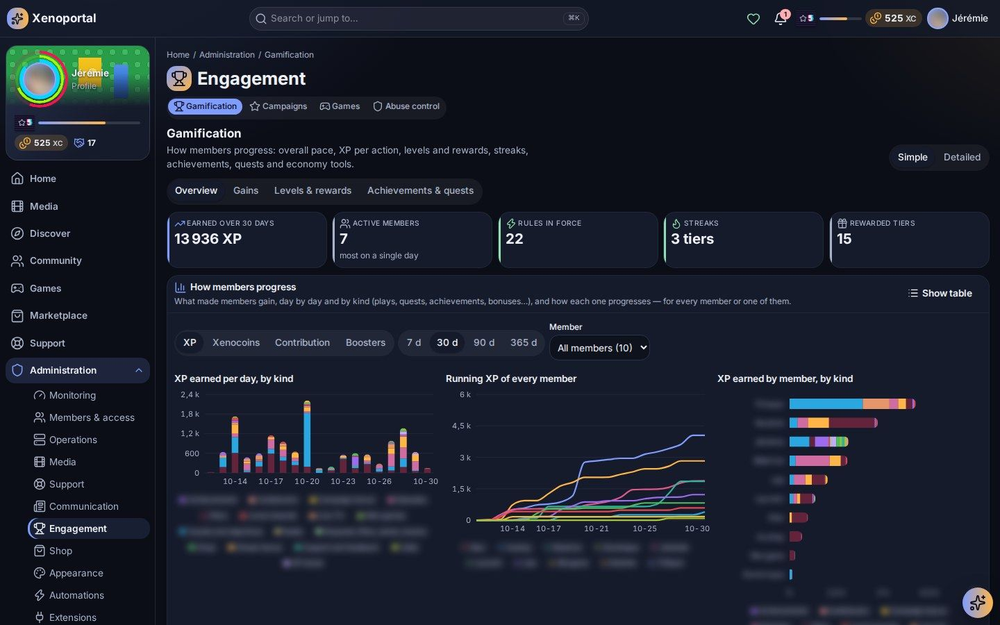
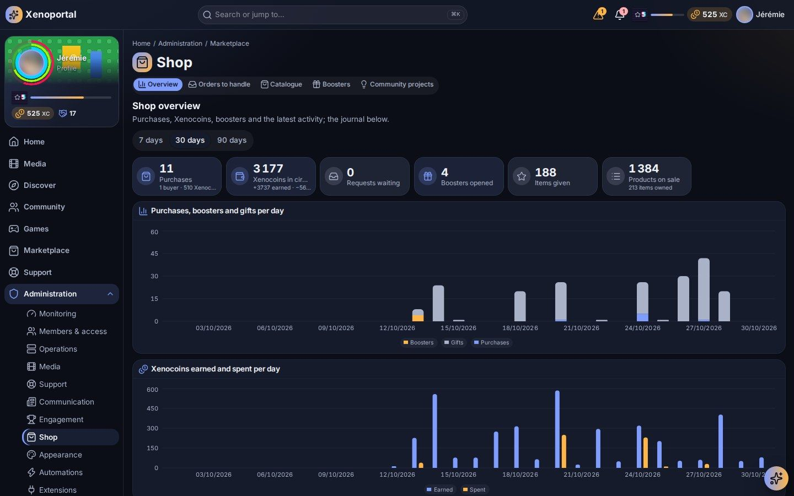

# Gamification and economy

Tune how members progress and what they can spend: gain rules, levels, streaks, achievements, quests, abuse control, campaigns, mini-games, Mediacards, the shop and community projects.

The whole game is optional and configurable. Each member chooses how far they play, from **Just the media** (no game at all) to **Keen** (see [Playing on the portal](../members/gamification.md#choosing-to-play)), and every value, rule and product below is yours to change. Coins are never bought with real money: there is no payment of any kind in Portalab, and no product can buy priority in the request queue.

## Where things are

| Administration hub | Pages |
|---|---|
| **Engagement** | **Gamification** (`/admin/gamification`), **Games** (`/admin/games`), **Campaigns** (`/admin/campaigns`), **Abuse control** (`/admin/gamification/abuse`) |
| **Shop** | **Overview** (`/admin/marketplace`), **Orders to handle**, **Catalogue**, **Boosters**, **Community projects** (`/admin/projects`) |
| **Members & access** | A member's card: **Progression** and **Economy** tabs |
| **System** | **Configuration**, group **Play & shop**: the remaining settings, by area (Progression, Campaigns, Shop…) |

The currency's name ("Coins" by default), its short name and icon are set in **Appearance → Site identity** (see [Customization](customization.md#site-identity)).

## Starting point: the setup assistant

The **Game** step of the setup assistant offers three starts:

- **The recommended install**: a complete game and shop, ready to play (gain rules, achievements, some fifty quests and objectives, campaigns, level steps, the shop's products — the whole Mediacards booster range included, with its scenes — and Portalab's visual packs);
- **The recommended install, adjusted**: the same start, then you change what you like in tabs (Gains and streak, Levels and unlocks, Achievements, Quests, Campaigns, Settings);
- **Set everything myself**: an empty game (the basic curve and discovery missions) built screen by screen.

## The three values

| Value | Earned from | Spent on |
|---|---|---|
| **XP** | gain rules, quests, achievements, level rewards, manual grants, automations | never; the level is computed from total XP |
| **Contribution** | gain rules, recognised contributions, manual grants | never; some products require a minimum |
| **Coins** | gain rules, quests, achievements, level rewards, manual grants, booster duplicates | shop products, community project funding |

Every change is a line in an append-only ledger (reward, manual reward, spent, refund, reserved, reservation used or released, correction). Nothing is ever rewritten: a mistake is corrected by a new operation. **Verify ledger**, on the Gamification overview, checks that every balance matches its history.

## The Gamification page

**Gamification** has two tuning modes, **Simple** (one overall pace, level rewards, streaks) and **Detailed** (also the XP of each action and the level formula), and four tabs.

### Overview

**How members progress**: key figures, what made members gain day by day and by kind (plays, quests, achievements, bonuses…), the rules in force, the rewarded tiers, the members progressing most and a **Detail by member**. The **Operations journal** lists every operation of a member or of everyone, with its source, the balance after and the level reached.

### Gains

- **Progression pace**: drag the curve (or the slider) to choose where a typical active member will be over time. The resulting **Overall multiplier** applies to every gain of the chosen values; the XP of each action is unchanged. The chart compares the current trend, the tuned trend and the most active members.
- **XP per action** (detailed mode): one rule per action. A rule has:
  - an **Action** (playback finished, season finished, request created or available, sign-in, ticket opened or resolved, feedback, project funding, shop purchase, radio, mini-games…) and optional **Conditions** on its attributes;
  - **What the action gives**: a fixed amount per action, plus optionally a part based on duration or another measured unit, with its own cap (for example 10 XP per play + 1 XP per minute watched, capped);
  - **Kinds of play** it applies to (none ticked: every kind);
  - **Content boosters**: 0 to 3 Mediacards boosters of the film or season concerned, once per member and content;
  - **Limits**: a **Delay between two gains** (minutes), a **Cap** per hour, day or week, a **Rule multiplier**.

  **Quick add** offers ready-made rules: finishing a film or an episode, a booster of a film watched to the end, a booster of a finished season, **Time spent playing** (a RomM game session: 1 XP a minute and 5 coins per full hour of a session), **Game played through its estimated length** (once per member and game, when their sessions add up to the game's main story length — HowLongToBeat through RomM; games without a known length never give it), a shop purchase, opening a support ticket, the mini-games' proposed rewards. Every save is a new draft version; **Publish version …** makes it effective from now on (older versions stay for the events they covered); **Retire** stops a rule. **Advanced: definition and simulation** shows the JSON definition and dry-runs sample events without writing anything.
- **Streaks**: **Enable streaks**, choose the **Actions that keep the streak going** (by default finishing a film or an episode), the **Multiplied values** and the **Tiers** (from day N, multiplier ×M). A day-by-day preview shows the effect. Members can protect a streak with a streak freeze.

All multipliers combine (rule, streak, boost, campaign) up to the **Maximum combined boost** setting (5 by default). Delays, caps and the anomaly guard apply after the multipliers.

### Levels & rewards

- **Level curve** (detailed mode): the total XP needed for a level is *base × (level − 1)^exponent*. **Base XP** is the XP needed for level 2 (100 by default), the **Exponent** sets how much harder each level gets (1.5 by default; 1 makes every level equal). **Publish curve** recomputes members' levels silently.
- **Level tiers and rewards**: what a member receives on reaching a level (XP, Coins, a little Contribution, a **Product offered** such as a sealed booster) and what the tier unlocks in the shop, with a tier name (Bronze, Silver, Gold…).

### Achievements & quests

**Achievements** unlock once, when all their criteria are met:

| Criterion | Example |
|---|---|
| **Number of actions** | watch 10 films |
| **Level reached** | reach level 5 |
| **Running total** | 1000 XP in total |
| **Statistic** | a statistic reaches a value |

Each achievement has a category, an icon, rewards (XP, Coins, Contribution) and up to four **Products given** from the shop (a look, or a sealed booster to open from the reserve). **Secret** keeps it invisible until unlocked. Ready-made **Card achievements** cover the collections: first booster, 25 boosters (Collector), a legendary pull, a complete collection, several series (Binge collector), ten collections (Archivist).

**Quests** come in four types:

| Type | Behaviour |
|---|---|
| **Objective** | Renews **Every day**, **Every week** or **Every month**. |
| **Quest** | Steps over counted actions, **Once** or renewed. |
| **Challenge** | Offered only between its **Starts** and **Ends** dates; only actions inside the window count. |
| **Discovery** | A first step for new members (a guided tour, a first request…), rewarded once. |

Steps are counted actions; **Done when** is **every step is done** or **any one step is done**. Completion happens once per member and period. An objective can be about any action members make: signing in, searching, reading notifications, the radio, plays, a title about to leave watched, a requested title watched by another member, the games, the assistant, feedback and bug reports, boosters opened, project contributions…

- **Only if**: each step (of a quest or an achievement) can say which events it counts, with conditions — an **Attribute**, a **Comparison** (=, ≠, one of, >, ≥, <, ≤) and a **Value**, the known values suggested (kinds of play, games, quests, achievements). For example "a film", "the blind test", "a quarter of an hour at least". For **one of**, separate the values with commas.
- **The progression's own actions**: quests and achievements may count **Quest or objective done**, **Achievement unlocked** and **Level reached** (a weekly "complete five objectives", for example). Reward rules never see them.
- More icons say what each objective is about.

Members find their quests in **Games → Quests**, filtered by period and with their time left, and a reminder under **Today's games** (see [Playing on the portal](../members/gamification.md#quests-and-objectives)). Quest and achievement texts are shown in the member's interface language when they have a translation.

## Abuse control

When a member receives more rewards than the thresholds allow, the rewards are **withheld** and an anomaly waits in **Abuse control**:

- **Too many grants in an hour** (setting *Rewards per hour before review*);
- **Too many Coins in a day** (setting *Coins per day before review*).

For each anomaly, give a **Decision reason** and choose **Approve** (the rewards are granted), **Reject** (they are dropped) or **Confirm abuse** (they are dropped and the window's rule rewards are reversed). Every decision is audited; *Open an incident on anomalies* also opens an incident.

## Manual grants and corrections

A member's balances and items are managed from their **member card** (**Economy** tab) or **Shop → Members**:

- give or take back **Coins, XP or Contribution**, with a reason (3 characters at least, kept in the journal);
- give an item of the shop (up to 50 copies at once) or take one back;
- **Cancel** an operation: what it gave is taken back, what it took is given back.

Grants at or above *Manual grant confirmation* need a confirmation. Revoking a product needs a ground: **Abuse (no refund)**, **Grant expired**, **Refund** or **Withdrawn for cause**; the member is notified.

## Leaderboards

Members see leaderboards by XP, Level, Contribution and Achievements, over periods from the week to all time. In Configuration (area Progression):

- *Leaderboards offered*: the metrics available;
- *Coins leaderboard*: also rank by Coins (off by default);
- *Leaderboard refresh*: minutes between two updates.

Members who chose to be private are never ranked by name, even for administrators; ranks count only the members the viewer may see.

## Campaigns

**Campaigns** (`/admin/campaigns`) runs seasonal events. **New campaign** opens the editor:

- **Name** (English and French), **Description**, **Starts**, **Ends**, **Time zone**, and **Once**, **Every year** or a custom repetition;
- **Bonuses**: multiply the gains of some actions during the campaign (for example ×2 XP for horror films and series). Choose the **Gains multiplied**, the **Multiplier**, the **Actions** (none ticked: every action), **Media kinds**, **Genres**, **Keywords** (the metadata provider's keywords, in English), **Title containing** or titles picked in the library;
- **Shop discounts**: a percentage off chosen products, categories, a season's items or **The whole shop** (the best discount applies, they do not add up).

Campaign achievements, quests and a theme overlay can be part of a campaign's definition; the form keeps them as they are. Each edit publishes a new version (a confirmation is asked while the campaign runs). **Simulate** runs a sample event through the campaign without writing anything and says whether each bonus **applies**, **does not apply**, is outside the audience or lacks attributes. **History** lists versions, occurrences, active intervals and manual overrides.

**Control (activate, deactivate, cancel)** overrides the schedule, with a reason and a confirmation: **Activate now** (until the end of the current occurrence), **Deactivate** (the campaign shows as paused until its next start), **Cancel campaign**; an ended campaign can be archived. Campaigns appear in members' calendars, on the **Campaigns** page and in the **Active campaigns** widget. To announce them, use the automation templates *Campaign start announcement* and *Campaign ending soon* (see [Assistant and automations](ai-and-automations.md#templates)).

Settings: *Campaign time zone*, *"Ending soon" notice* (hours), *Active campaigns warning*, *Schedule check interval*.

## Games

**Games** (`/admin/games`) sets up the games page: "what is open, the titles used, each game, the parties, the rewards and the wheel".

- **Games page open** switches the whole page on or off.
- **Titles the games use**: films and/or series, **Minimum votes** (a title known enough), **Only titles present in the library**.
- Each game: on or off, **Questions**, **Seconds**, **Choices**, and **A day** (games a member may start alone each day, each game its own count; 0: no limit; games played together do not count). **Title of the day** has **Tries**, **Minimum letters** and **Maximum letters**; **Memory** has **Pairs** and **With the member's own cards**.
- **The week's challenges**: a title drawn at random each week, or one you pick (**Draw again this week**, **Back to drawing at random**), with goals in minutes or percent.
- Parties: **Maximum players**, **Countdown**, **Reveal seconds**.
- **Daily wheel on** and **The wheel's segments**: label, gain (Coins, XP, a shop product or nothing), amount and weight.

What the games give is set with the other gain rules (**Gamification → Gains → XP per action**): taking part, a win, a minimum score, a place on the week's or month's board, a place in a party, a weekly challenge completed, each with optional daily caps. The Games page shows how many rules are active and how often each game was played over 30 days.

## Mediacards

Mediacards are generated automatically from the library: each film and series gets its set (the title, its makers, up to ten characters), refreshed as the library changes, with rarities ranked per country of production. Each work also keeps its **main genre** (its first genre that has a frame) and its **themes** (Japan, anime, kaiju, samurai, from its production and its keywords).

- **Versions**: besides foil, borderless and the fourteen era editions, each card may come in its main genre's **frame** — eighteen frames, from Action to Western (from 1 in 30 for a common to 1 in 5 for a legendary, never together with an edition's version or a borderless one) — and in a booster's **signature frame** (below). What members see at the opening is the version they keep.
- **Giving boosters**: a gain rule's **Content boosters** (0 to 3) gives boosters of the content concerned, once per member and content (presets *Booster of a film watched to the end* and *Booster of a finished season*). A member receives at most a limited number of content boosters a day. A content booster opens in its work's theme scene when one is bound to it, else in its kind's.
- **Selling boosters**: in **Shop → Catalogue**, a product of type **Mediacards booster** chooses:

  | Field | Effect |
  |---|---|
  | **Main genre** | Draws among that genre's works; the genre frame comes three times more often (at most 3 cards in 5). |
  | **Theme (Japan, anime, kaiju, samurai)** | Draws among that theme's works. |
  | **Edition (period)** | Draws among that era's works; the edition's version comes more often. |
  | **Colour (broad genre)**, **Films or series** | Narrow the draw further. |
  | **Cards per booster**, **Guaranteed rarity** | 3, 5, 8 or 10 cards; a rarity booster guarantees one card of that rarity. |
  | **Signature frame (the scene whose face is kept)** | One card in four that comes in its base frame takes the scene's frame and keeps it (in a rarity booster, the card it guarantees) — never over an edition, a genre frame, a borderless or an HD version. |

  The recommended install brings the whole range: eighteen genre boosters, three rarity boosters (**Rare**, **Epic**, **Legendary**), fourteen edition boosters and four theme boosters (**Japan**, **Anime**, **Kaiju and robots**, **Samurai and ninjas**), each bound to its own opening scene from the example visual packs Portalab ships.
- **Their look**: each Mediacards booster opens in the scene bound to it (a visual pack's **Review** step, **Booster scenes** → **One booster**, with **The booster's product key**); the others fall back on **Shop → Boosters → Mediacards boosters' scene**, "The wrapper and the opening of every Mediacards booster, bought or earned by watching; they never take the looks boosters' scene." A booster bought in the shop waits in the member's reserve and opens in its product's scene.
- **Character pictures** (Configuration): *Characters from the video* (stills taken from the film by the media server), *Face check for characters*, *Web search for characters* (a self-hosted SearXNG, off by default), *Cut-out characters*.

Identical sealed boosters are piled in members' reserves and on their Mediacards page, with their count on a badge. Members whose play gauge is below **Collector** (**Just the media** or **Passive**) never see them nor receive card boosters by watching.

## The shop

### Overview

Purchases, Coins earned and spent, boosters opened, items given, refunds, **Best sellers**, **Most advanced members**, the latest activity and the journal.

### Catalogue

**New product** creates a product. Its main fields:

| Field | Meaning |
|---|---|
| **Type** | Interface, palette, theme pack, avatar frame, name style, profile banner, film backdrop banner, animated profile background, badge, title, level badge, level-up, effect, notification style or animation, ambient animation, widget, widget option, statistic, request quota, radio requests, XP boost, streak freeze, rescue, level pass, special request, service access, project launch, assistant capacity, pack, booster, Mediacards booster, access, feature, plugin… |
| **Identifier**, **Name (English)**, **Name (French)** | Its key and names. |
| **Price (Coins)** | 0 for a free product. |
| **Rarity**, **Copies** | Copies empty: taken from the rarity's default (**Rarities and copies**), or unlimited. |
| **Minimum level**, **Minimum Contribution** | Conditions shown to members as met or not met. |
| **Most purchases per member** over **a period of (days)** | For products that can be bought again. |
| Refund | Whether and how long it can be refunded, at what percentage. |
| **Collection**, **Season**, **Featured in the shop** | How it is presented. |

Other conditions can require an achievement, a running campaign or a role. Each type has its own fields: the units of a request quota, the factor and hours of an XP boost, the days a freeze covers, the questions of a special request (**What the member is asked**, with **Handled within (days)**), the **Service** and **Access group** (the identity provider's group that opens the service) of a service access, the capacity of an assistant product (offered only if allowed in **Assistant → Shop**).

A product is a **Draft**, **Available**, **Unavailable** or **Archived** (hidden from new purchases, kept by its owners). Every change of price, conditions, refund, texts or payload is a new version; owners keep what they bought. Publishing and revising a published product ask for a confirmation and are audited.

Visual products mostly come from visual packs, whose review step sets their price, rarity, level and copies (see [Customization](customization.md#visual-packs)).

### Boosters

**New booster**, then **Tune** it:

- **What it holds**: looks, or items to keep (a reserve booster);
- **It draws**: the visual packs and shop packs it draws from, plus items added one by one;
- **Odds and refunds**: a weight per rarity (brought to 100 %) and the Coins a duplicate of that rarity gives back;
- **Rarity guaranteed**, number of cards, **Openings per member** (empty: no limit; offered boosters do not count);
- **Seasons**: a seasonal booster is on sale in its weeks only (Christmas, Halloween, Spring, Summer, Valentine's Day);
- **Opening scene**: the scene it opens with, from the visual packs.

A change makes a new version; past openings keep theirs. To offer a booster as a reward, give it from a level tier or an achievement.

These are the looks boosters. The Mediacards boosters (genre, rarity, edition and theme boosters) are products of the **Catalogue** (see [Mediacards](#mediacards)); the same page sets the **Mediacards boosters' scene** they all fall back on.

### Orders to handle

Some purchases are fulfilled by hand: a **special request** (a film in 4K, Dolby Atmos, languages…) or a **service access**. Each one has a deadline. **Start** it, then **Mark as done**, or **Decline and refund** (write why in the **Note for the member** first). For a service access, **Approve the access**, optionally with **Create the account automatically** in the identity provider. The member follows each step in **My purchases** and is notified.

### Community projects

**Community projects** (`/admin/projects`, "Community projects: validate, fund, deliver or cancel them.") shows the projects as cards in three tabs, **To decide**, **Running** and **Over**, and moves them through their lifecycle: **Promote to proposal**, **Open votes and funding**, **Close funding and validate**, **Approve for development**, **Move to beta**, **Release**, **Reject**, **Abandon**, each in its own window with an optional public reason ("shown to members in the project's history"). Decisions that move members' Coins (approval, rejection, abandonment, release) ask for a confirmation. Validation is your decision, informed by votes and funding but never bound to them.

Funding rules are frozen when a project opens: when reserved Coins are used (at release, or a percentage at each milestone), the minimum and the **Cap per member**, and an optional **Goal** ("The amount to gather, shown to members."). A member who launches a project from the shop proposes its goal; **Open votes and funding** comes with it filled in ("Proposed by the member: …. Keep it or adjust it."). Members see on the project's page who backs it, what is left to gather and its steps as a timeline; the **Projects** entry of their menu counts the projects added or moved on since they last looked. A rejected or abandoned project releases every reservation in full. Settings: *Default funding rules*, *Minimum funding*, *Maximum funding per member*.

Proposals waiting for moderation are in **Support → Moderation** (see [Content and communication](content.md#community-moderation)).

## Settings reference

In **System → Configuration**, group **Play & shop**:

| Setting | What it does |
|---|---|
| *Overall pace* | Multiplier applied to every gain of the chosen values. |
| *Maximum combined boost* | Highest multiplier reached by combining rule, streak, boost and campaign bonuses. |
| *Economy time zone* | When economy days and weeks begin. |
| *Play streaks*, *Level rewards*, *Daily wheel* | The same as their screens. |
| *Rewards per hour before review*, *Coins per day before review*, *Open an incident on anomalies*, *Held rewards retention* | Abuse control. |
| *Manual grant confirmation* | Amount from which a manual grant needs a confirmation. |
| *Contribution reward* | Contribution points for a recognised contribution. |
| *Default refund policy* | Refund policy per product type when a product sets none. |
| *Permissions for sale* | Permissions an access product may grant (never Admin-reserved ones). |
| *Quotas products may add* | Kinds of quota shop products may top up. |
| *Activation retry delay* | Minutes between two attempts to activate a product that failed. |

---

Next: [Content and communication](content.md) · [Customization](customization.md) · [Members and roles](members-and-roles.md) · Members' view: [Playing on the portal](../members/gamification.md)
