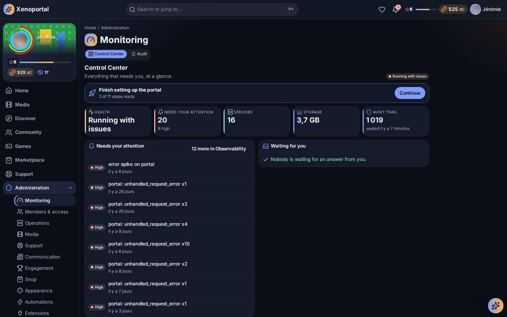

# Running the portal

Back up, monitor, secure and maintain your Portalab, from the administration and from the command line.

This page is for whoever keeps the portal running. It covers the technical side of the administration; the community side (content, play, members, looks) has its own guides, linked at the end.



## The administration at a glance

**Administration** (`/admin`) opens on the **Control Center**: what needs your attention, key figures, and panels for services, health, configuration, the audit trail, storage (database size and largest areas) and support. The pages below are reached from there.

| Page | Path | Covered in |
| --- | --- | --- |
| Setup assistant | `/admin/setup` | [Getting started](../getting-started.md#the-arrival-wizard) |
| Configuration | `/admin/configuration` | [Configuration](../configuration.md#everything-else-is-in-the-administration) |
| Services, Alert rules | `/admin/services`, `/admin/services/alerts` | [Services and integrations](services.md) |
| Backups | `/admin/backups` | [below](#backups-and-restore) |
| Version | `/admin/version` | [below](#version-and-reset) |
| Maintenance | `/admin/maintenance` | [below](#incidents-and-maintenance) |
| Incident console | `/admin/incidents` | [below](#incidents-and-maintenance) |
| Observability, Logs | `/admin/observability`, `/admin/observability/logs` | [below](#observability-and-logs) |
| Audit | `/admin/audit` | [below](#audit-log) |
| Events | `/admin/events` | [below](#events) |
| Security blocks | `/admin/security-blocks` | [below](#security-blocks-and-the-intrusion-guard) |
| Modules | `/admin/modules` | [below](#modules-and-extensions) |
| Roles & permissions | `/admin/roles` | [below](#roles-and-permissions), [Members and roles](members-and-roles.md) |
| Members, Privacy policies, Terms of use | `/admin/members`, `/admin/privacy`, `/admin/terms` | [Members and roles](members-and-roles.md) |
| News desk, Wiki, Announcements, Banners, Newsletters | `/admin/news`, `/admin/wiki`, … | [Content](content.md) |
| Site identity, Theme studio, Visual packs, Widgets, Members' dashboard | `/admin/site`, `/admin/themes`, … | [Customization](customization.md) |
| Gamification, Games, Campaigns, Marketplace, Projects | `/admin/gamification`, … | [Gamification and economy](gamification-and-economy.md) |
| Assistant, Automations | `/admin/ai`, `/admin/automations` | [AI and automations](ai-and-automations.md) |

Every page and action requires the matching permission (see [Roles and permissions](#roles-and-permissions)).

## Backups and restore

### Saving the portal

**Administration › Backups** saves **the whole portal in one archive** encrypted with a passphrase: members, settings, services, content, play, media history and files. The portal keeps answering while it saves, and the progress is shown live.

| Option | When to use it |
| --- | --- |
| **Passphrase** (12 characters at least) | Always. Without it the archive cannot be opened, and nobody can recover it. |
| **With the technical history** | Audit log, metrics, logs, service samples and technical events. Rarely needed, often large. |
| **With the images fetched from the services** | Posters, artwork and the trading cards' images (several GB). Without them the archive stays small; they are fetched and cut out again in the background after an import. |

Archives are kept in the data volume, in `<DATA_DIR>/backups` (`/var/lib/portalab/backups` with the reference Compose file). From the list you can **download** or **delete** each one. Saving is recorded in the audit log.

> **Copy your archives off the server.** A backup on the same disk as the portal does not protect you from losing that disk.

### Restoring into a new installation

Restoring is done by the **arrival wizard** of a new (or reset) portal, from the local network:

1. Choose **Import another Portalab** on the welcome screen.
2. Send the archive from your browser, or copy it beforehand into the server's backups folder.
3. Enter its passphrase. The wizard shows what the archive holds (members, services, visual packs, the portal it came from, its version) before you confirm.
4. **Choose what to bring.** Every part of the portal is ticked: untick what this portal should not take (see below).
5. When the import is complete, **restart** the portal (`docker compose restart portalab worker`) and sign in with your usual account.

#### Choosing what to bring

The archive is offered as parts to tick: site and settings, members, services, e-mail and notifications, media, statistics, automations and workflows, content, gamification, marketplace, look, plugins, AI assistant, service status, and the technical history when it was saved.

- **What a part needs comes with it**, and the wizard says why: the marketplace brings the gamification (its currency), media and automations bring the services, statistics bring the media. Unticking a part unticks what needs it.
- **The settings follow their part**: the e-mail server's settings come with *E-mail and notifications*, the shop's with *Marketplace*, and so on.
- **The Admin's account always comes.** Without *Members*, it is the only account brought: what the other members made (automations, pages, articles, products, decisions) is handed to the Admin, and what was theirs (balances, XP, achievements, purchases, play history, preferences) stays out. Gamification then arrives with its rules, levels, quests and catalog, everyone at zero.
- What is not ticked is left as a new installation has it. Every part ticked brings the whole portal, as before.
- Choosing is only offered for a **new** (or reset) portal: an archive is never merged into a portal in use.

What to know:

- Nothing is written until the import is complete. If it fails, the new portal stays empty.
- Members keep their accounts and passwords; the services' passwords and keys are encrypted again with the new portal's key.
- An archive from an **earlier** Portalab is brought up to the current version while it is imported. An archive from a **later** Portalab is refused: update the new portal first.
- The import needs the portal's PostgreSQL role to be a **superuser** while it runs. The reference Compose file's `portalab` database user is one.

### From the command line

The same encrypted archive can be made and restored with the `portalab archive` command, for example from a scheduled job. Mount a file holding the passphrase into the container:

```bash
docker compose run --rm -v "$PWD/secrets/backup_passphrase:/run/secrets/backup_passphrase:ro" \
  portalab archive create --output /var/lib/portalab/backups/portal.plbackup \
  --passphrase-file /run/secrets/backup_passphrase
```

| Command | Purpose |
| --- | --- |
| `portalab archive create --output <file> --passphrase-file <file> [--history] [--no-media]` | Save the portal (the same archive as *Backups*) |
| `portalab archive restore --input <file> --passphrase-file <file> --yes` | Bring an archive into this portal, then restart `serve` and `worker` |
| `portalab backup --output <folder>` / `portalab restore --input <folder> --yes` | Low-level operator backup: a `pg_dump` of the database plus a tarball of `DATA_DIR`. It needs the PostgreSQL client tools (`pg_dump`, `pg_restore`), which the Portalab image does not include. |

### Configuration export

The API also offers a configuration-only export (`/api/v1/admin/config/export`): a versioned JSON document of the portal's settings, **without** sensitive values or members' preferences. Importing it (`/api/v1/admin/config/import`) lists every value that differs from the current one, and applies them only once you confirm.

## Version and reset

**Administration › Version** shows which Portalab is running: version, revision, database, archive layout, how long it has been running, and the schema of each module (each module's last migration, which is what a backup records).

The same page can **reset the portal**: it erases the members and their accounts, the settings, the services, the content, play, the history and the files, and keeps only the backups. You confirm with your password and by typing the portal's name. The portal then restarts on its arrival wizard, for a new installation or the import of a backup. Save the portal first.

## Incidents and maintenance

### Incidents

Members follow incidents on the **Incidents** page (`/incidents`): what is wrong, the timeline of updates, the affected services and what was fixed in the last 30 days. An ongoing incident can also show a banner across the portal.

Incidents are opened three ways:

- **Automatically**, by the [alert rules](services.md#alert-rules) when a service stays unavailable, and closed again when it comes back if the rule says so.
- **From observability**, when you validate an anomaly as an incident (see below).
- **By hand**, from the **Incident console** (`/admin/incidents`) or a service's status page.

In the console you set the title, the severity (Critical, Major, Minor), what it affects (the whole server or specific services) and a public summary; you post public updates as things progress, then resolve it. *Also announce it with a banner* keeps a banner at the top of the portal while the incident is open.

### Planned maintenance

**Administration › Maintenance** plans the interruptions of a service or of **the whole portal**, so members see them in advance:

- Each window has a title, details for members, a start and an end, and what it concerns.
- Windows start and end on their own at the planned instants, and can be rescheduled or cancelled (cancelling is audited).
- While a window runs, the affected services show *Under maintenance* rather than *Unavailable*.
- Members see upcoming and running maintenance on the status page and in the calendar. *Also announce it with a banner* shows a banner from the day before until the end.

Maintenance windows are announcements: they do not lock members out. When the portal itself is unreachable (during a restart, for example), the interface shows *The portal is unavailable for a moment* and comes back on its own as soon as the server answers.

## Observability and logs

### Observability

**Administration › Observability** shows how the portal is doing: problems first, then each component (database, jobs, events, services, the assistant…), errors, anomalies and trends (failed jobs per day).

- **Errors** are grouped; you can acknowledge or resolve them with a note.
- **Anomalies** come from detectors watching for error spikes, slow synchronisations, latency spikes, stuck event consumers, repeated failures and runaway automations. By default an anomaly waits for you to **Validate (incident)** or **Dismiss** it (`observability.escalation.requireValidation`); you can let critical ones escalate on their own.
- Thresholds, detector parameters and retention are in *Configuration* (Observability). Errors are kept 90 days by default.

### Logs

**Observability › Logs** shows what the server and the worker write, newest first and live:

- Filter by level, source, process (server or worker), period and text; follow every line of one request or job by its correlation id.
- *Show the HTTP traffic* adds one line per request answered and per call to a service (hidden by default).
- Pause, follow live, copy, or export a selection as JSON or text.
- Secrets are never shown: lines are redacted before they are stored.
- The journal keeps 7 days and at most 200,000 lines by default (`observability.logRetentionDays`, `observability.logMaxLines`). Reading it is audited.

The containers also write structured JSON logs to their standard output: `docker compose logs -f portalab worker`. Set `LOG_LEVEL` to change their verbosity (see [Configuration](../configuration.md)).

### Health endpoints and metrics

| Endpoint | Answers |
| --- | --- |
| `/healthz` | The process is alive (used by the image's health check) |
| `/readyz` | The database is reachable and the migrations are current |
| `/metrics` | Prometheus-format metrics. Disabled by default; turn it on in *Configuration* and give your scraper a bearer token (`observability.metricsToken`) |

All three answer only to `HEALTH_NETWORKS`. Block them at your reverse proxy.

## Audit log

**Administration › Audit** lists every sensitive action: when, which action, who did it (a member, the assistant, an automation…), the decision and the outcome. Filter by action prefix, load older entries, or **export** them as NDJSON. Sensitive details are hidden in the viewer, and reading the log is itself audited.

The log is append-only and sealed in a hash chain: the Control Center shows the last seal and whether the chain is verified. You can verify it from the command line:

```bash
docker compose run --rm portalab audit verify
```

Audit entries are kept for `privacy.retention.auditMonths` months.

## Events

Modules talk to each other through an event pipeline stored in PostgreSQL. **Administration › Events** is where you deal with what went wrong in it:

- **Dead letters**: deliveries that failed for good, with their consumer, attempts and last error. Discard them once handled.
- **Quarantine**: payloads set aside; release or discard them.
- **Rebuild a projection**: replay the stored events to rebuild a derived view.

You rarely need this page; Observability tells you when event consumers fall behind.

## Security blocks and the intrusion guard

Portalab watches every API answer for signs of probing:

- A refused request counts; a refused request on the administration counts double; an unknown administration address counts (someone listing what is there); an address shaped like an attack (a path leaving its folder, encoded slashes or null bytes, markup, system paths) counts heavily.
- Past the limit, within a 10-minute window, the **session and the member's account** are blocked for 15 minutes and all of that member's sessions are signed out. Much further, the **address** is blocked for requests without a session (signing in, anonymous probing), never for members already signed in from it.
- Blocks survive restarts and are recorded in the audit log.

**Administration › Security blocks** lists the accounts, sessions and addresses blocked, with the time left. Holders of `security.manage` can **Lift** one or **Lift all**. From the server's console, anyone with shell access can do the same, including lifting the Admin's own block:

```bash
docker compose run --rm portalab security blocks list
docker compose run --rm portalab security blocks lift <id|login|user id|address>
docker compose run --rm portalab security blocks lift --all
```

Rate limits apply alongside the guard: by default 600 requests per minute per address, 300 per signed-in session and 30 sign-in attempts per minute per address (*Configuration*, Security & data). Behind a reverse proxy, set `TRUSTED_PROXIES` or every visitor shares one address. See [Configuration](../configuration.md#trusted-proxies).

## Modules and extensions

**Administration › Modules** lists Portalab's modules and whether they are enabled:

- The kernel's modules are always on.
- Each other module shows what it needs. Disabling one offers to disable the modules that depend on it too.
- Data is never deleted. A module enabled again after being disabled may need a restart, which the portal tells you.
- New modules arrive with Portalab's releases; to add a feature yourself, import a plugin (*Extensions › Plugins*).

The **Extensions** panel on the Configuration page turns a module, plugin, connector, service or automation on or off by name, keeping its data. The arrival wizard's and setup assistant's **Features** step does the same thing in plain terms (the wiki, the news, tickets, incidents, play, the shop…).

## Roles and permissions

Permissions are **deny by default**: nobody can do anything they were not granted.

- Base roles: `user`, `support`, `moderator`, `editor` and `admin`. There is exactly **one Admin**, who holds every enabled permission; transfer the role before that account can be deleted.
- **Roles & permissions** (`/admin/roles`) creates roles and groups and grants them permissions, each with a scope: everywhere, one module, one service, one plugin, own objects only, or own account only.
- An explicit **deny** in scope wins over everything, the Admin included.
- **Sensitive** permissions are audited whether allowed or refused. Some permissions are reserved to the Admin and cannot be granted.
- The assistant, automations and plugins only ever act with the rights of the member they act for.

The full guide is [Members and roles](members-and-roles.md).

## Command-line reference

Run these with `docker compose run --rm portalab <command>` (or `migrate` for migrations).

| Command | Purpose |
| --- | --- |
| `serve` / `worker` | Run the web server / the background worker |
| `migrate` · `migrate --status` | Apply database migrations · only report whether some are pending |
| `doctor` | Check how the deployment stands (user, read-only code, confinement, outbound allow-list, plugins). Changes nothing. |
| `admin bootstrap --login <login>` | Create the sole Admin of a fresh portal |
| `archive create` · `archive restore` | Save the portal into an encrypted archive · bring one in |
| `backup` · `restore` | Low-level database and `DATA_DIR` backup (needs the PostgreSQL client tools) |
| `audit verify` | Verify the audit log's hash-chain checkpoints |
| `economy verify` | Recompute balances from the economy ledger |
| `security blocks list` · `lift` | List or lift the intrusion guard's blocks |
| `demo seed` | Fill a test portal with demo data |

Next: [Services and integrations](services.md) · [Members and roles](members-and-roles.md) · [Configuration](../configuration.md) · [Documentation index](../README.md)
