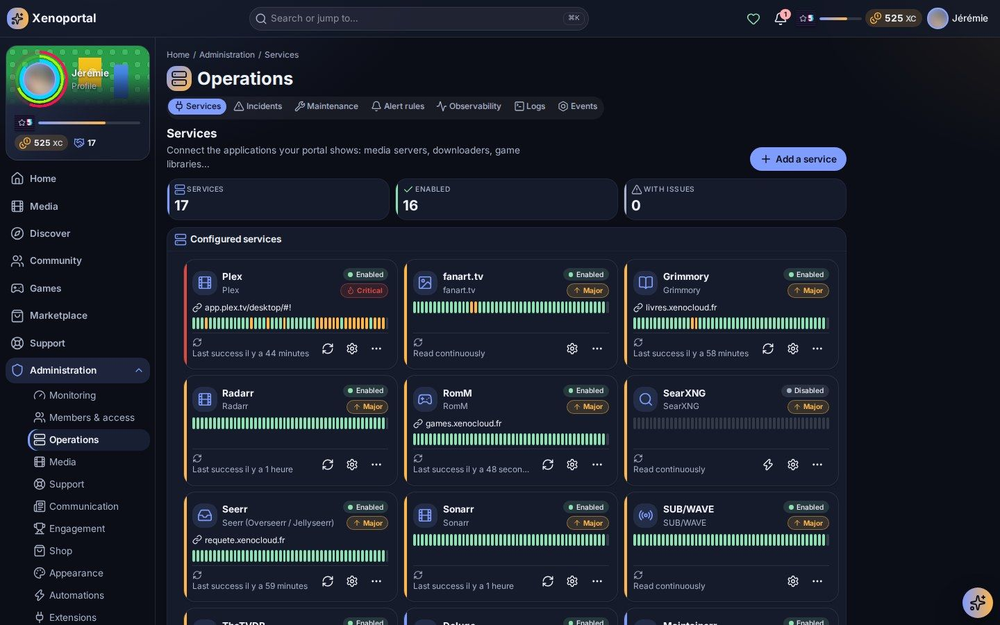
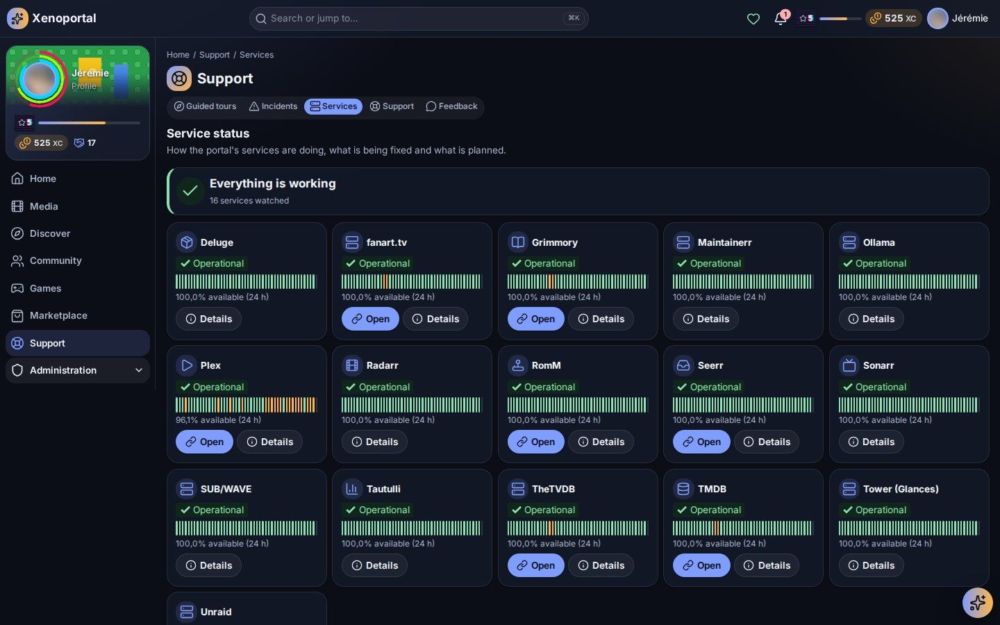

# Services and integrations

Connect your homelab's applications to Portalab, and keep an eye on how each one is doing.

Portalab does not replace your media server, your *arr apps or your request tool: it brings them together. Each kind of application is handled by a **connector**; each application you connect is a **service**. You can connect several services of the same kind (two Plex servers, one Grimmory per reader…).

## Adding a service

Go to **Administration › Services** and select **Add a service**.

1. **Choose a connector.** Connectors are grouped by category: Media server, Requests, Downloads, Games, Books, Metadata, Identity (single sign-on), Artificial intelligence, Infrastructure.
2. **Fill in the form.**
   - **Name**: how members will see it, e.g. "Home media".
   - **Address**: the address you open in your browser, with the port (e.g. `http://192.168.1.10:8096`).
   - **Credentials**: an API key, a token or an account, depending on the connector. The form says where to find them. Credentials are **write-only**: once saved they are never displayed again, and they are stored encrypted.
   - **Check the HTTPS certificate**: untick it for a service with a self-signed certificate.
3. **Test the connection.** Portalab checks the address and the credentials before anything is enabled.
4. **Save, then enable.** *Enable and synchronise now* starts the first synchronisation right away.

### Managing a service

Each row of *Configured services* shows the service's state and its last synchronisation, with these actions:

| Action | What it does |
| --- | --- |
| **Edit** | Change the name, the address, the credentials (leave a secret empty to keep it), the sync interval and the alerting. |
| **Public URL** | Where members open this service: the Quick access and Services widgets, the « Watch on… » buttons and the links on media pages. Left empty, the service's own address is used when it is `https`. |
| **Sync now** | Queue a synchronisation immediately. |
| **Sync history** | Every run, with what it added, changed and removed. |
| **Disable / Enable** | Pause the service without losing anything. |
| **Disconnect** | Stop reading the service for good. Its credentials are erased; what it already brought is kept and shown as historical. To use it again, add it anew. |

**Sync every (minutes)** sets how often a service is read; left empty, it follows the portal's default (one hour, `connectors.defaultSyncIntervalSeconds`).

**Importance** tells Portalab how much an outage matters: *Critical* (members cannot do without it), *Major* (used every day, the default), *Minor* (useful but not essential) or *Internal* (behind the scenes, such as metadata or downloads: members do not see it). It drives the [alert rules](#alert-rules).

### Service states

| State | Meaning |
| --- | --- |
| Configured | Saved, not enabled yet |
| Enabled | Read on schedule; its features are available |
| Syncing | A synchronisation is running |
| Error / Unavailable | The service fails or does not answer. Portalab stops calling it for a moment and serves the last known data. |
| Maintenance | Inside a planned maintenance window |
| Disabled | Paused by an administrator |
| Disconnected (historical) | Removed for good; its data is kept |

### Linking members to their service accounts

Plex, Jellyfin, Tautulli, Seerr, RomM, Grimmory and Authentik can list their user accounts. In the Members administration, the **Service accounts** panel suggests links (same e-mail, same name), lets you apply them in bulk and creates the missing members from their accounts. Once an account is linked, its past plays and requests are attributed to the member. Members can also manage their own links in *Settings › Media accounts*. See [Members and roles](members-and-roles.md).

## Monitoring services

### The service status page

Members with the right permission see **Service status** (`/services`): whether each service answers, its availability over the last 48 hours, ongoing incidents and planned maintenance. Each service opens on its details: availability over 24 hours, recent changes, downtime, recent errors, last synchronisation and related tickets. Administrators can declare an incident or plan a maintenance from there. A health indicator at the top of the portal tells everyone when services are in trouble.

### Health checks

The worker probes every enabled service. The thresholds live in *Administration › Configuration* (Services):

| Health state | When |
| --- | --- |
| Operational | The probe succeeds |
| Degraded | The probe is slower than `health.degradedLatencyMs` (1500 ms), or the service reports a warning (Glances and Unraid warn about an almost full disk, a critical temperature, a stopped array…) |
| Unavailable | `health.unavailableAfterFailures` (3) consecutive probes failed |
| Under maintenance | A maintenance window is in progress |
| Unknown | No probe for `health.staleAfterSeconds` (300 s); never shown as Operational |

Probes run every `health.probeIntervalSeconds` (60 s). Raw samples are kept 14 days, hourly availability 13 months.

### Alert rules

**Administration › Services › Alert rules** (`/admin/services/alerts`) decides what an outage does, per importance:

| Option | Meaning |
| --- | --- |
| Declare an incident | After how many minutes of outage an incident is opened, and whether it closes automatically when the service is back |
| Incident banner | Also show a banner at the top of the portal while the incident is open |
| Notify | Tell members and/or administrators after a delay (0: at once), optionally by e-mail too. The service's return is announced to the same people. |
| Counts in the portal's health | Whether the header's health indicator and the status page report this service |

The defaults:

| Importance | Incident | Told | Other |
| --- | --- | --- | --- |
| Critical | after 5 min | members and admins at once, admins by e-mail | banner |
| Major | after 10 min | members and admins after 5 min | |
| Minor | after 30 min | admins after 15 min | |
| Internal | none | admins after 15 min | does not count in the portal's health |

Each service can override any of these in its own form; *Back to the rule* resets it.

Incidents, maintenance windows and the incident console are described in [Running the portal](operations.md#incidents-and-maintenance).

### Outgoing calls

Every call to a service goes through one HTTP client with timeouts, a response-size cap, bounded retries and redacted errors. If you switch on the **outbound allow-list** (`security.egress.enabled` in Configuration), Portalab only calls known hosts: your configured services, the sign-in provider, pack sources, AI providers, plugins' accepted hosts and any host you list in `security.egress.hosts`.

## The connectors

### Media servers

#### Plex

Your Plex Media Server: films, series, music and what is playing.

- **For members**: the whole library in the unified catalog, what is playing now, links to open a title in Plex, **watching in the browser** (transcoded by Plex) and series' theme music. Their full watch history feeds the statistics.
- **For admins**: Plex user accounts to link to members; still images taken from a film's own file for the trading cards (the image includes `ffmpeg` for this).
- **Credentials**: the server's `X-Plex-Token`. In Plex Web, open any film → ⋯ → *Get Info* → *View XML*, and copy the value after `X-Plex-Token=` in the address bar.
- When Tautulli watches the same server, its richer history wins over Plex's own.

#### Jellyfin / Emby

Your Jellyfin (or Emby, same API) server: films, series, music, books and what is playing.

- **For members**: the library in the unified catalog, live sessions and recently played items, links to open a title in Jellyfin, people's biographies and portraits.
- **For admins**: Jellyfin user accounts to link to members.
- **Credentials**: an API key. In Jellyfin: *Dashboard → API Keys → +*, name it "Portalab".

#### Tautulli

Plex watch statistics: every film, episode, live TV channel and song played, by whom.

- **For members**: richer statistics for Plex: time actually watched, progress reached, player and platform.
- **For admins**: the Plex users Tautulli knows, to link to members.
- **Credentials**: the API key from *Settings → Web Interface → API* (enable the API, then copy the key). Tautulli only accepts it in the query string; Portalab redacts it from every error and log.

### Requests and downloads

#### Seerr (Overseerr / Jellyseerr)

Media requests: members ask for a film or a series, Seerr sends it to Radarr or Sonarr.

- **For members**: request films and series from the portal (seasons of a series, 4K when offered), follow where each request stands, and discover what to ask for: search, trending, popular and upcoming titles, with cast, trailer and seasons.
- **For admins**: each account's **request quotas** (films and series per number of days), set from *Administration › Request quotas*; Seerr's accounts to link to members. A request paid with a unit bought in the shop can bypass the member's quota on Seerr versions that support it.
- **Credentials**: the API key from *Settings → General*.

#### The team (title requests)

Not a connector: Portalab's own **requests** module, a request service for the titles no other one can ask for (a book, an audiobook, a game…). It is switched on or off in **Administration › Modules**, like any module, and needs the media and notification modules.

- **For members**: **Ask for a title** also finds books and games (from Hardcover and IGDB) and opens the form for anything else. Their requests are requests like any other: the same **My requests**, quotas (and units bought in the shop), notifications, rewards (`media.request_created`, `media.request_available`) and figures. The portal refuses a request when the library has the title, by one of its identifiers (whatever the scheme) or by its title, or original title, of the same kind and by the same creator, and when it is already requested.
- **For admins**: the requests are in the queue of **Administration › Requests** (`/admin/media-requests`) with the films' and series': **Approve** or **Decline** (with a reason the member reads). Each one tells what the member said: creators, year, edition, language, note. Every quarter of an hour the team closes the requests the library now answers, with the same matching, and the portal tells the member.
- **Settings** (the **Books, games…: kinds** tab, setting `requests.config`): the kinds of titles the team takes (books, audiobooks and games by default, among the kinds the portal knows).

#### Radarr and Sonarr

The films Radarr follows and the series Sonarr follows, season by season, and what is downloaded.

- **For members**: availability in the catalog (marked available once the files are on disk), upcoming releases in the calendar (Radarr's cinema, digital and physical dates, Sonarr's air dates), and a title's **request journey**: followed, monitored, released, grabbed, imported, with the download queue's progress and expected time.
- **Indexer search**: an on-demand search of the indexers from a title's request journey, offered only to members holding the `media.release_search` permission (it is slow and loads the indexers, so results are kept 30 minutes).
- **Credentials**: the API key from *Settings → General → Security*. Posters are served by the app itself, never fetched from the internet.

#### qBittorrent and Deluge

The torrents behind your downloads: speed, peers and why one does not move.

- **For members**: a title's request journey says *why* a download is stuck (stalled, waiting for metadata, queued, paused, error…), and the downloads widget shows what is coming in.
- **Credentials**:
  - qBittorrent: the Web UI username (default `admin`) and password.
  - Deluge: the Web UI password. Portalab connects the Web UI to its daemon if needed.

#### Maintainerr

The library's cleanup: which titles its rules will delete, and when, and saving one.

- **For members**: a **Leaving soon** shelf, and on each title the day it (or some of its seasons) will be deleted. Members can **save a title** by spending a rescue, which excludes it from every rule for everyone. More rescues can be bought in the shop.
- **Credentials**: none. Maintainerr has no authentication of its own; Portalab only needs its address. Works with Maintainerr 2.x and earlier.

### Libraries

#### RomM

Your retro games library: every game, its platform and its cover.

- **For members**: the games in the catalog with how long each takes to play (main story, main + extras, completionist, all styles, from HowLongToBeat when RomM has it), links to open them in RomM, and the play sessions of the account configured here (RomM only reveals them to the account itself, so the member linked to it gets them). Play sessions count in the statistics and, through your gain rules, in the progression.
- **For admins**: RomM accounts to link to members.
- **Credentials**: a RomM username and password, ideally a dedicated read-only (viewer) account. RomM 3 and 4 are supported.

#### Grimmory

Your books and audiobooks library (Grimmory is a BookLore fork), and the reading and listening sessions.

- **For members**: e-books, comics and audiobooks in the catalog, **reading in the portal** (EPUB, PDF, comic book archives) and **listening to audiobooks** in the portal, plus authors' biographies.
- **Reading history**: Grimmory only reveals the sessions of the signed-in account. Connect one Grimmory service per reader whose reading you want to follow.
- **For admins**: Grimmory users to link to members (needs an administrator account).
- **Credentials**: a Grimmory username and password, exchanged for a short-lived token renewed automatically.

### Radio

#### SUB/WAVE

The homelab's radio: listen live, see what plays, ask its DJ for a song.

- **For members**: a radio player with the track on air, the DJ, the listeners and what comes next; and **Ask the DJ**: a song, an artist or a mood in plain words, within a daily allowance of free requests, with more available in the shop.
- The live stream and covers are relayed by the portal, so they play even when the portal is served over HTTPS and the station over plain HTTP.
- **Credentials**: none. The station's listener endpoints are public on the local network; Portalab only needs its address.

### Metadata and artwork

#### TMDB (The Movie Database)

Rich film and series details: backdrop, cast, saga, budget, box office, genres…

- **For members**: richer title pages: tagline, overview, genres, runtime, certification, collection, seasons and networks, cast and crew with their photos. Text comes in the portal's language, or the one you set in the **Language** field (e.g. `fr-FR`).
- Images are fetched and cached by the portal and served from it: members' browsers never call TMDB.
- **Credentials**: a free key from themoviedb.org → *Settings → API*: the **API Read Access Token** (or the v3 API key). Leave the address at `https://api.themoviedb.org` unless you use a proxy.

#### fanart.tv

Artwork made by its community: HD backgrounds, thumbs, clearart, logos and, for series, characters. Portalab uses it for the trading cards' borderless alternatives.

- **Credentials**: a personal API key (fanart.tv → profile → API keys).

#### TheTVDB

The community database of series and films. Portalab uses it for **each role's own image** (the character in costume, drawn or made up) on the trading cards.

- **Credentials**: a project API key (thetvdb.com → dashboard → API keys). TheTVDB asks for attribution wherever its data is shown.

#### Hardcover

The community book database. Portalab uses it for **an author's books** and **a book series' volumes**.

- **For members**: an author's page lists their books, the most read first, each marked available, not available or **Not here**. A book the library lacks opens its **sheet** from Hardcover, laid out like a library book's page: description, authors, series, readers' genres and moods, rating, and its editions (language, format, publisher, ISBN). The sheet also says where the library has the book, checking every edition's identifiers and titles. No service asks for books: when the team (the requests module) takes books, **Ask for it** (for the book or one edition) asks for it as a film is asked for (see [The team](#the-team-title-requests)). A book series' page lists every volume in order, with the ones the library lacks. Hardcover recognises the library's books from what the library already knows of them: an edition's ISBN, Hardcover's own identifier (some book services store it), or an edition's title by the same author, so a French translation is found under its original. A volume is also found by its number in the series. A book of the library shows its own title. A library book Hardcover lists only as a split part of a longer original is shown too, and the longer original is then not shown as missing. Books are told by their most read edition in the member's language (or, when that language is not among the service's edition languages, the first of them). Books few readers know are left out of an author's list. The first visit to a page asks Hardcover a few questions; the answers are kept for six hours. The films and series they took part in stay listed beside their books.
- Covers are fetched by the portal and served from it: members' browsers never call Hardcover. Its figures (readers, ratings) are Hardcover's.
- **Credentials**: a personal token (hardcover.app → *Settings → Hardcover API → New API Key*). Give it the **`read:catalog`** scope only: the portal reads the public catalog, never anyone's library. The token expires on the date you choose, and Hardcover may reset tokens while its API is in beta. When the token stops working, the service shows a credentials error: create a new one. Pasting it with or without its `Bearer ` prefix both work. Leave the address at `https://api.hardcover.app`. **Edition languages** (for example `fr, en`) keeps a book's sheet to the editions in those languages, in that order; empty shows every language.
- Hardcover's API is rate-limited per day and per minute. The portal keeps a person's profile and a series' volumes for six hours.

#### IGDB

The game database RomM matches the library's games with. Portalab uses it for **a game franchise's games** and **a game's sheet**.

- **For members**: a game franchise's page (from a game of the library) lists every game of the franchise. The library's own games are found by their IGDB id (RomM keeps it), else by their title; the others are marked **Not in the library** and open their sheet. The sheet is laid out like a library game's page: summary, platforms, studios and publisher, release, genres, themes and modes, franchises, rating, trailer, screenshots and artworks. When the library has the game, its library page opens instead. When the team takes games, **Ask for it** asks for it as a film is asked for, for one platform if wanted, with its IGDB id.
- Images (covers, screenshots, artworks) are fetched by the portal and served from it: members' browsers never call IGDB. Its ratings are IGDB's.
- **Credentials**: a Twitch application. On dev.twitch.tv/console, the Twitch account needs two-factor authentication. Choose **Register Your Application**, with any name, the redirect address `http://localhost` and the category *Application Integration*. Put its **Client ID** in the service's settings and its **Client Secret** in the secret field. The portal exchanges them for an access token and renews it when it expires. Leave the address at `https://api.igdb.com`.
- IGDB allows 4 requests a second. The portal keeps a franchise's games and a game's sheet for six hours.

#### SearXNG

Your self-hosted metasearch engine, used to find images on the web, such as an actor's character for the cards.

- **Credentials**: none. Its **JSON format must be enabled** in SearXNG's `settings.yml`.
- Images found anywhere are fetched safely: `http`/`https` only, public addresses only (checked at every redirect), images only, 8 MB at most.

### Identity

#### Authentik

Your single sign-on: the accounts and the groups that open each service.

- **For admins**: Authentik's users to link to members. With a **service access** product in the shop, a member asks for access to a homelab service; when an administrator approves, Portalab finds or creates the member's Authentik account, adds it to the service's group and can produce a one-time link for the member to set their password. Revoking the access removes them from the group.
- **Credentials**: an API token (*Directory → Tokens and App passwords*, intent « API ») of an account allowed to manage users and groups.
- Signing in to Portalab *with* Authentik is separate: it is the OpenID Connect setup described in [Configuration](../configuration.md#going-on-the-internet) and [Members and roles](members-and-roles.md).

### AI

#### Ollama

Language models on your own network, for the AI assistant.

- **For admins**: the models the server holds (family, size, quantization, whether it supports tools or embeddings) and those loaded in memory. The assistant is then pointed at Ollama's OpenAI-compatible address; choose the model in the assistant's settings.
- **Credentials**: none. Ollama has no authentication of its own; give its address, e.g. `http://192.168.1.60:11434`.
- The assistant can also use any other OpenAI-compatible provider. See [AI and automations](ai-and-automations.md).

### Infrastructure

#### Glances

A server's processor, memory, temperatures, disks, network and containers (Glances 4 REST API).

- **For members and admins**: server widgets (processor, memory, hottest sensor, network, uptime, storage, containers) and the server's history. Members see a summary (whether the server is fine, how full its storage is); holders of `infrastructure.read` see the full report.
- **Health**: the service is reported *Degraded* when a file system is almost full or a sensor reaches its critical value.
- **Credentials**: usually none on the LAN. When Glances is started with `--password`, give the username and password.

#### Unraid

The array, disks, space, temperatures, containers and updates of an Unraid server.

- **For members and admins**: server widgets with the array and its parity, each disk and cache pool, processor and memory, Docker containers with available updates, and the server's unread notifications. As with Glances, members see a summary and holders of `infrastructure.read` the full report.
- **Health**: *Degraded* when the array is not started, a disk is not OK or has errors, or the array is almost full.
- **Credentials**: an API key (*Settings → Management Access → API Keys*; read access is enough). Unraid usually serves a self-signed certificate: untick « Check the HTTPS certificate ».

## More connectors

Every integration is a connector, and plugins can add new ones without touching Portalab itself. When no connector fits, *Add a service* points you to *Extensions › Plugins*.

Next: [Running the portal](operations.md) · [Members and roles](members-and-roles.md) · [AI and automations](ai-and-automations.md) · [Media for members](../members/media.md)
