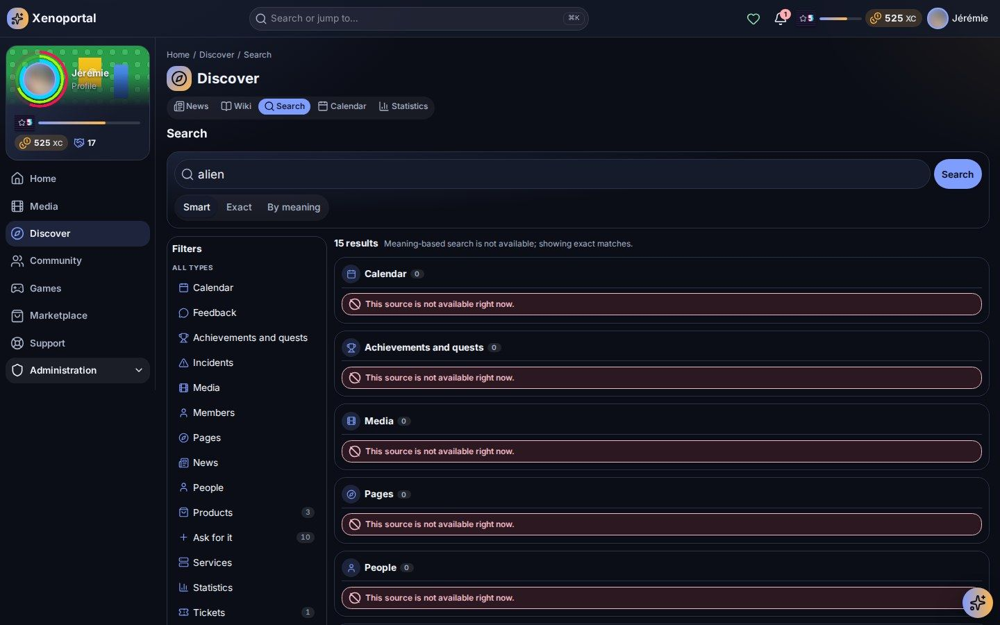

# Assistant and search

Ask the portal's assistant in your own words, and find anything — a title, a page, a ticket, a person — with one search across every part of the portal.

## The assistant

The assistant answers questions about the portal and can look things up for you. It exists only when your administrator has turned it on, and it may carry the name your portal gave it. If it is unavailable, it says so — *The assistant is unavailable right now. Everything else keeps working.*

> **Important** — The assistant only sees and does what **you** can see and do. It never has more rights than you.

### Opening it

- **The floating button** in a corner of every page: **Ask the assistant**.
- **The header search**: type your question, then choose *Ask the assistant: “…”*.
- **The search page**: the **Assistant analysis** block answers your search; **Continue as a conversation** opens the assistant with it.
- **A title's page**: in the request journey or the *Leaving soon* box, **Ask the assistant** asks for you — for example *Where does « … » stand, and why is it not available yet?* (see [media.md](media.md#following-a-request)).
- **A new ticket**: **Ask the assistant** runs a diagnosis before you open it (see [support.md](support.md#the-assistants-diagnosis)).

On a computer the window opens in the middle of the screen; on a phone it takes the whole screen.

### Asking a question

1. Type in **Ask the assistant…**.
2. Press **Enter** or **Send** (**Shift + Enter** for a new line).
3. The answer is written as it comes. While it looks things up you see *Looking it up in the portal…* and *Using …* for each tool it calls.
4. **Stop** interrupts it.

A new conversation starts with ideas to tap, such as *Are all the services working?*, *Where do my support tickets stand?*, *What are the latest announcements?* or *Which of my requests are still on their way?*.

The line **On this page: …** at the top tells the assistant where you asked from, so *this title* or *this ticket* means what you have in front of you. Open the right page before asking.

### What it can look up

Depending on what your portal has switched on, the assistant uses these tools — always with your own rights:

| Area | What it can do |
|---|---|
| Media | **Search the catalog** (films, series, books, games by title, kind, genre or year), **My history**, **Recommendations**, **Where a title stands** (its request journey, and whether it leaves the library) |
| Support | **My tickets**, **A ticket** (its state, fields and last public replies — never internal notes), **Open a ticket** (with your confirmation) |
| Portal status | **Services' state**, **Incidents**, **Maintenance** |
| News and wiki | **Announcements**, **Search the wiki**, **Read a wiki page** (only pages their editors opened to the assistant), **Page help** |
| You | **My progression** (level, XP, Contribution, balance), **Statistics** and **A statistic** you may see |
| Shop | **Shop catalog** (products and prices) |
| Portal | **Search the portal**, **Suggest a page** |

Your administrator can also connect external tool servers (MCP servers, such as a homelab's own); only the tools they allow-list are offered, each mapped to a portal permission, and the portal checks that permission before every call. If a server is down, its tools are simply not offered.

If it cannot find the answer, it says so, and may point you to a wiki page or suggest opening a ticket.

### Actions to confirm

Some actions are never done straight away. When the assistant proposes one — for example **opening a support ticket**, or a sensitive tool from an external server — a **Confirm this action** card appears under its answer:

- it sums up exactly what will be done;
- *The assistant proposed this action. Nothing happens until you confirm.*;
- choose **Confirm** or **Decline**;
- the card expires (*Expires in … seconds*). *Expired — ask the assistant again.* means you simply ask again.

Only you can confirm your own actions, from your session, and a confirmed action runs once. Some actions — managing the assistant itself, roles, security settings — can never be done by the assistant, even for an administrator.

### Reading an answer

- **Sources**: the numbers in the text point to the **Sources** cards under the answer. Each says what it is — **Live data**, **History** or **Knowledge base** — and *as of* when. Click a card to open the matching page.
- **Caveats**: when some data was incomplete, possibly out of date or unavailable, a note says so.
- *Assistant interpretation — not backed by a cited source.* flags an answer to double-check.
- **Suggested pages**: **Open …** buttons lead to the pages that help.

Under each message: **Copy**, **Send again**, **Ask again**, and your verdict — **As expected** or **Not as expected** (with *What did you expect? (optional)*, then **Send my comment** or **Skip**).

> **Note** — The answers you rate, with their question, can be read by the administrators to improve the assistant.

### Your conversations

- **Conversations** lists your past conversations; click one to pick it up.
- **Delete conversation** erases it.
- **New conversation** starts afresh, with the current page as context.

Conversations are yours only — not even an administrator can read them (apart from answers you rate) — and they are deleted after a while, depending on your portal.

### Today's use

The assistant has a daily allowance per member. The gauge at the top of the window shows how much you used; click it for **Today's use**: **Used**, **Day's allowance**, when it **Starts again**, your **Reserve** (top-ups used once the day's allowance is gone) and **Capacities bought**.

Each question and the data the assistant reads to answer it count; long conversations count more, so start a new one when you change subject.

- *You reached today's assistant limit. It resets tomorrow.* — wait for tomorrow, or follow **Get more in the shop.** when offered: **More each day**, top-ups, **Longer memory**, **Stronger model**, **More reflection**, **Extra tools**.
- *You are sending messages too quickly. Wait a moment.* — wait a few seconds.

## Search

One search covers every part of the portal you have access to: media, people, pages, wiki, news, calendar, tickets, incidents, services, statistics, achievements and quests, feedback, members — and titles you could ask for.

### Quick search in the header

Click the search field in the header, or press **Ctrl + K** (**⌘ K** on a Mac) or **/** anywhere. Results come as you type, grouped by kind, with **Pages** of the portal and your **Recent searches**. Choose *Search for “…”* for the full results page, or **Advanced search**, offered as soon as the field is focused, to open the search page with its filters. **Ctrl + Shift + K** opens the command palette (pages and actions); press **?** to see every keyboard shortcut.

### The search page

**Search** (`/search`) is no longer in the menu: open it from the header's field. It shows every result, grouped by kind — **Media**, **People**, **Ask for it**, **Pages**, **Wiki**, **News**, **Calendar**, **Tickets**, **Incidents**, **Services**, **Statistics**, **Achievements and quests**, **Feedback**…

- **Filters**: **All types** or one kind, then the facets that kind understands — **Media type**, **Genre**, **Year**, **Availability**, **Role**, **State**, **Severity**, **Source**, **Tag**… **Clear filters** resets them.
- **Matching**: **Exact**, **Smart** or **By meaning**. Meaning-based search exists only when your portal enables it; otherwise exact matches are shown.
- **More results** loads the next ones in a group.
- **Recent searches**: remove one, or **Clear history**.
- **Assistant analysis** (when the assistant is on): a short answer drawn from the results, with its **Sources** — an interpretation to check — and **Continue as a conversation**.

You only ever see what you are allowed to see: a result you may not open is never shown, not even counted. If one source is slow or down, *This source is not available right now.* shows in its group and the rest of the results are unaffected.

*Nothing matches “…”.* — try other words, remove a filter, or **Browse services**.

---

**Next:** [Media](media.md) · [Support, status and notifications](support.md) · [Personalization](personalization.md) · back to the [index](../README.md)
