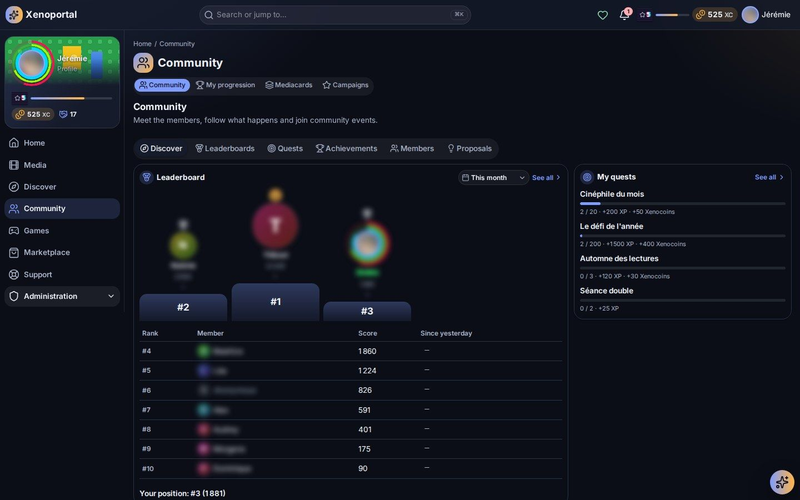
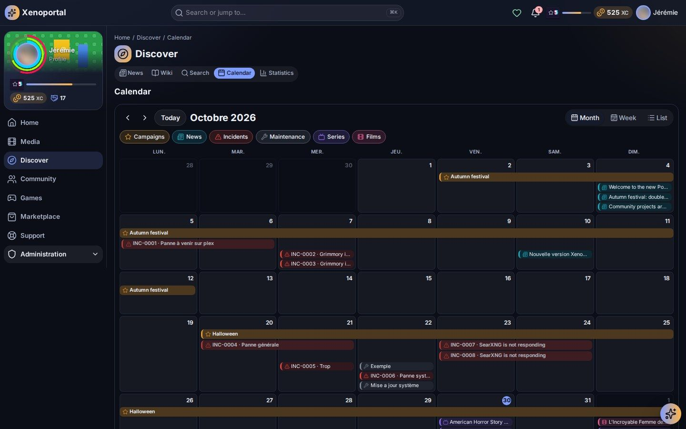
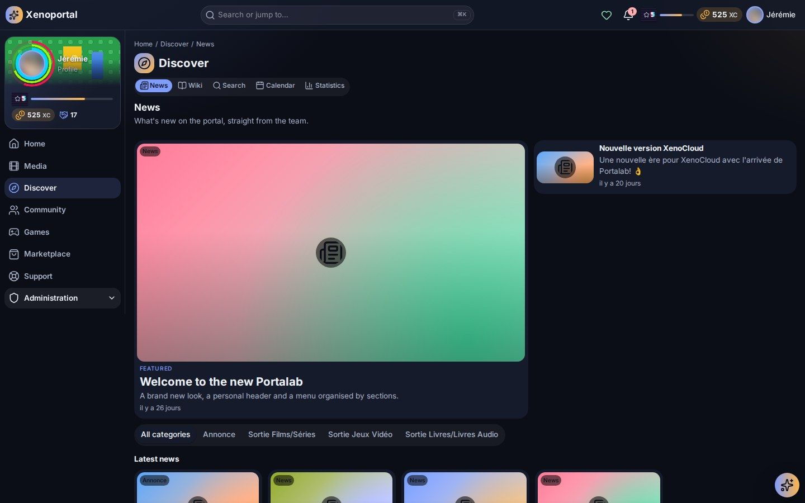

# Community

Members and their profiles, the activity feed, events, proposals and votes, the news, the wiki, the calendar, the terms of use and the portal's announcements.

Portalab's community is deliberately simple: there are no friends, followers, likes, comments, direct messages or chat. Members meet through what they do on the portal (their progress, their achievements, the projects they propose) and through the content the team publishes.

## Finding your way

Open **Community** (`/community`) from the menu. Its tabs are **Discover**, **Leaderboards**, **Quests**, **Achievements**, **Members** and **Proposals**.

**Discover** gives an overview:

- the leaderboard's podium and your place;
- **My quests** and the **Campaigns running**;
- the **Latest activity**;
- shelves such as **New members**, **Proposals needing support**, **Recent achievements** and **Highlights**.

Quests, achievements and leaderboards are explained in [Playing on the portal](gamification.md).

## Members and profiles

1. Open the **Members** tab (`/community/members`).
2. Type a name in **Search members**.
3. Select a member to open their profile.

A profile can show **About**, **Progression**, **Achievements**, **Recent activity** and **Projects**. Each member chooses what they show, so some sections may be missing. A section that cannot load for the moment says so, without breaking the rest of the page.

### Customising your profile

On your own profile, select **Customise**. The **Customise my profile** window has these tabs:

| Tab | What it changes |
|---|---|
| **Banner** | The top of your profile. |
| **Picture frame** | A frame around your profile picture. |
| **Film backdrop** | The backdrop of any film or series of the library as your banner, once unlocked in the shop. |
| **Animated background** | An animated background behind your profile. |
| **Name style** | A font and an effect for your name. |
| **Title** | Shown under your name. |
| **Badge showcase** | Up to three badges shown next to your name. |
| **Level badge** | The look of your level badge. |

Some designs are free; the others come from the shop or from boosters, and **See in the shop** takes you there. An item you won but cannot wear yet shows the level or Contribution it waits for ("Won, and waiting for you: unlocked at level …"). Your frame and name style follow you: other members see them in the leaderboards and the activity feed.

The **About me** text is written in your **Account**.

### Your profile and your presence

In **Account**, **My presence in the community** sets what other members see of you:

- **Public**: the portal's members, and only them, see your name and avatar in the leaderboards, the activity and the directory.
- **Anonymous**: other members see you nowhere, not in the directory, not in the activity. In the leaderboards you still count, with no name and no avatar.

For finer control, the **Privacy center** (`/privacy`) lets you choose who sees each kind of data: **Everyone**, **Portal members**, **Leaderboards only** or **Only me**. An administrator can force a setting for a while; your own choice is kept and comes back afterwards.

## The activity feed

The feed shows what happens, day by day: a level reached, an achievement unlocked, a quest completed, a project proposed. Open it from **Latest activity** on the Discover tab (`/community/feed`), or add the **Community activity** widget to your home page.

A hidden achievement appears as "a secret achievement". A member who chose to be anonymous appears as "An anonymous member", and a member who turns private disappears from the feed at once.

## Community events

**Community events** (`/community/events`) lists the upcoming events meant for you. An event has a title, a description, a start and an end (or **All day**), a reference time zone and an audience: **Everyone**, **Members** or **Selected roles**. A cancelled event stays listed as **Cancelled**.

Events also appear in the calendar, where you can ask for a reminder. Moderators create, edit and cancel them with **New event**.

## Proposals and votes

In the **Proposals** tab (`/community/proposals`):

1. Select **Propose a project or feature**.
2. Choose the **Kind**: **Project** or **Feature**.
3. Give a **Title** and a **Description** (Markdown).
4. Select **Submit the proposal**.

Depending on your portal, the proposal is published at once or waits for a moderator ("Your proposal awaits a moderator's review"). Find yours in **My proposals**, with their status: **Open**, **Awaiting moderation**, **Not accepted** or **Withdrawn**.

On an open proposal:

- **Support** votes for it, free of charge; **Withdraw my support** cancels your vote. Counts are public; who voted is not.
- **Take part** lets you join as **Contributor**, **Helper** or **Tester**.

As the author, you can **Ask for help**, **Withdraw the proposal**, edit it until it opens, and **Recognize this contribution** of a participant. A recognised contribution can earn Contribution points for that participant, depending on your portal.

A **Project** proposal becomes a community project: its progress and funding are shown on the proposal, and funding happens on the project's page (see [Community projects](gamification.md#community-projects)). Voting and funding are independent: supporting a project costs nothing and does not fund it.

## News

**News** (`/news`), in the **Discover** section of the menu, brings "What's new on the portal, straight from the team".

- The **Featured** articles come first, then the **Latest news** as cards with their category and date.
- The category bar filters one subject; **All categories** shows everything again.
- A dot marks an article you have not read yet.
- An article shows its category, date and reading time ("3 min read"). If it is not translated into your language, the portal says so.

### Being told of new articles

- Depending on the team's choice, a new article can reach you as a notification ("New article: …").
- Some news channels are **newsletters**, also sent by e-mail. Choose which ones you receive in **Notification preferences**, under **Newsletters by e-mail**. They stay readable in the news anyway.
- The portal can also write **automatic newsletters** from the media services (new in the library, recent releases, upcoming releases), published in a channel and optionally e-mailed.
- The **E-mail digest** in the same preferences groups your e-mails into a daily or weekly summary, or sends each one.

The **Latest news** and **Featured news** widgets bring articles to your home page.

## The wiki

The **Wiki** (`/wiki`) holds "Guides, how-tos and answers, written by the community". The member guide lives there.

- The wiki home shows the main pages as cards with their sub-pages; **Find a page** filters them by title.
- The header search (Ctrl K) also searches the wiki.
- A page shows the **Browse the wiki** tree, its location, **Contents** (the pages of the same guide) and **On this page** (its headings). **Previous** and **Next** lead to neighbouring pages.
- You only see the pages you are allowed to read. The help button in the header opens the wiki page that explains the screen you are on, when there is one.

### Writing in the wiki

Members read the wiki; writing needs a permission given by an administrator (editors and support staff have it by default). With it:

- **New page** creates a page with a **Title** and its **Page content** (Markdown);
- **Edit** opens a page's editor, **Save** keeps your changes;
- **History** lists a page's versions: **Compare with previous** shows what was added or removed, **Restore this version** brings an older one back.

If someone saved the page while you were editing, the portal shows their changes: merge them into your text, select **I have merged the changes**, then save again. Spotted a mistake without editing rights? Report it through Support or Feedback (see [Support](support.md)).

## The calendar

The **Calendar** (`/calendar`) shows what is coming, day by day. Depending on your portal and your rights, it gathers:

- media releases (films, series, books);
- community events and campaigns;
- maintenance windows and incidents;
- news publications.

Use **Previous**, **Next** and **Today** to move, and choose a view: **Month**, **Week** or **List**. The categories act as filters (select one to hide or show it; **Show all** brings them all back). Times follow your time zone and the first day of the week chosen in **Language & region**. Select an item's title to open its page.

### Reminders

For an upcoming item, choose how long before in **Remind me**, then confirm. The reminder arrives as a notification ("Coming up: …"). If the item moves, the reminder follows and you are told; if it is removed or no longer visible to you, the reminder is cancelled and you are told too. **My reminders** lists yours with their state (scheduled, sent, cancelled…).

If one source does not answer, the calendar says so and still shows the others. The **Calendar** and **Upcoming** widgets bring it to your home page.

## Terms of use

If your portal asks for it, you must accept its **Terms of use** before using the portal and the services it opens.

- At your first sign-in, or when a new version is published ("The terms of use have changed"), a window shows the text and, for a new version, **What changes**.
- **Accept and continue** records your acceptance of that version.
- **Refuse** signs you out: the portal and its services stay closed until you accept.

You can read the version in force again at any time from the **Privacy center**, with the version you accepted and its date. A correction that changes nothing for members (a typo) does not ask you again.

## Announcements and banners

The team can reach everyone with an **announcement**: in your notification centre, by e-mail (unless you turned announcement e-mails off) and/or as a **banner** at the top of every page. Its colour tells its kind:

| Kind | Meaning |
|---|---|
| **Information** (blue) | News to share. |
| **Good news** (green) | Something new, a service back. |
| **Warning** (orange) | Something to watch: a planned outage, a change. |
| **Urgent** (red) | A serious problem; it reaches you even if you muted announcements. |

Some banners can be closed, others stay until their date. Banners are also shown for a planned **maintenance** (from the day before until it ends) and for an **incident** (until it is resolved). See [Support](support.md) for incidents.

---

Next: [Playing on the portal](gamification.md) · [Support](support.md) · [Personalization](personalization.md) · Administrators: [Content and communication](../admin/content.md)
