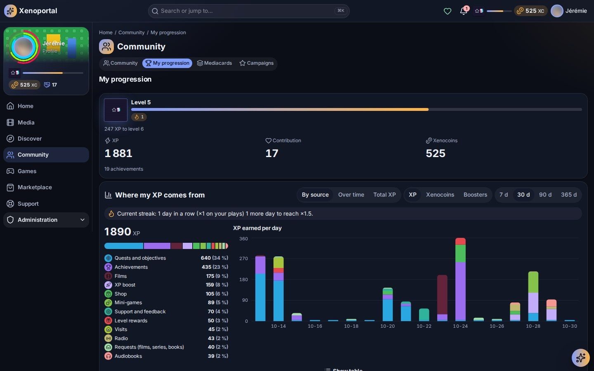
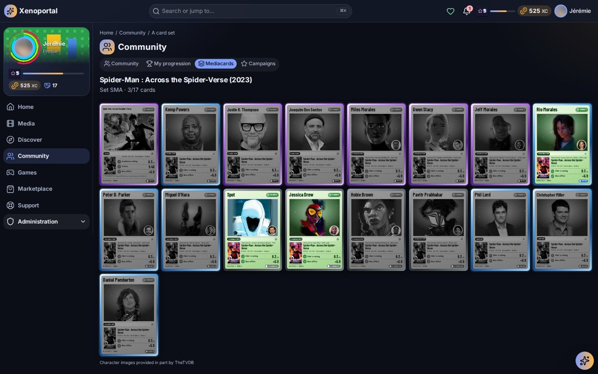
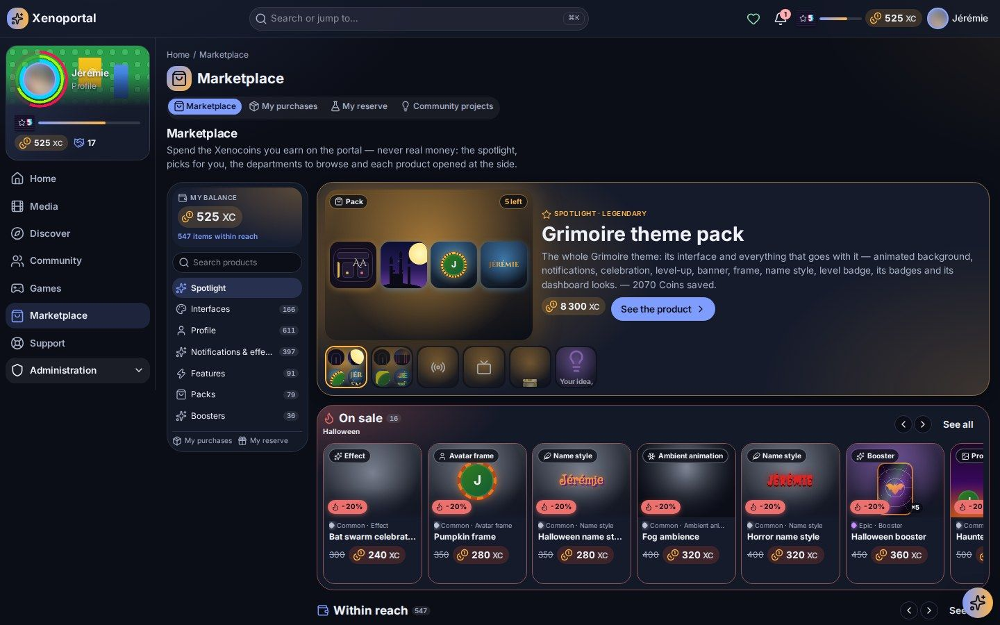

# Playing on the portal

XP, levels, Coins, quests, achievements, leaderboards, campaigns, mini-games, Mediacards and the shop: how the portal's game works, and how to opt out of it.

Everything you do on the portal can make you progress: watching a film, finishing a season, making a request, reading the news, opening a ticket. The game is entirely optional, and what earns how much is set by your portal's administrators, so the amounts below are examples, not promises.

## Choosing to play

The first time you sign in, the welcome asks **"Do you want to play?"**. You can change the answer at any time in **My settings → Play** (`/settings/play`).

| Choice | What you get |
|---|---|
| **Yes, all of it** | Progression, the shop and the Mediacards. Your profile is public, only to the portal's members. |
| **Yes, without the cards** | Progression and the shop, without the Mediacards: they leave the menu, the titles' pages and the shop, and watching no longer gives a Mediacards booster. The looks boosters stay. |
| **No, I am here for the media** | Watching and reading, without the game: your profile is anonymous and the Mediacards are hidden. |

For finer control, the same page links to the privacy centre, where you decide who sees each kind of data (see [Community](community.md#your-profile-and-your-presence)).

## Your three values

**My progression** (`/progression`) shows three separate values. They are never converted into one another, and none of them can be bought with real money.

| Value | What it does |
|---|---|
| **XP** | Raises your **level**. |
| **Coins** | The portal's currency, spent in the shop and on community projects. Your portal may give it another name (for example "Xenocoins"). |
| **Contribution** | Reflects what you bring to the community. Some products ask for a minimum Contribution. |

Your level and Coins also appear in the header, next to your avatar.

### Where your XP comes from

On **My progression**, the **Where my XP comes from** panel charts your gains **By source** or **Over time**, for XP, Coins or Contribution, over the period you choose. Sources include films, episodes, music, books, audiobooks, radio, live TV, requests, quests and objectives, achievements, level rewards, the streak bonus, XP boosts, campaign bonuses, mini-games, the wheel of fortune, titles rescued, support and feedback.

- **My plays by kind** details your sittings and their duration.
- **History** lists every operation of the last days, latest first: reward, manual reward, spent, refund, reserved, reservation used or released, correction. Each line shows your balance right after and, for XP, the level reached.

## How you earn

Depending on your portal's rules, these actions can earn XP, Coins or Contribution:

- finishing a film or an episode, finishing a whole season, listening to the radio, asking a song of the radio DJ;
- making a media request, seeing it become available, or another member watching a title you asked for;
- watching to the end a title that was about to be deleted (a rescue);
- signing in to the portal;
- opening a support ticket, having it resolved, sending feedback or having it accepted;
- funding a community project, buying in the shop;
- playing mini-games, completing the week's challenges;
- completing a quest, unlocking an achievement, reaching a level.

Some actions have a cap per day, or a delay between two gains. Rewards that look unusual (too many in an hour, too many Coins in a day) can be held for an administrator's review before they are credited.

## Levels

- The level bar shows how much XP you still need ("… XP to level …").
- When you level up, a **Level …!** window shows **What you won**. A level can give Coins, Contribution, a little XP or a product (for example a booster waiting in **My reserve**).
- Some shop products need a minimum level. When a level unlocks one, the window says so: "Now in the shop: …".

## Play streaks

If your portal has streaks on, the **streak** counts your consecutive days of activity (by default: finishing a film or an episode).

- The longer the streak, the more the gains of those actions are multiplied. **My progression** shows "Current streak: … days in a row (×…)" and how many days remain to reach the next multiplier.
- One missed day and the streak starts over. Days follow the portal's time zone.
- A **streak freeze** (from the shop or a booster) covers a missed day automatically: the streak and its multiplier go on.

## Boosts

An **XP boost** from the shop multiplies the XP you earn for a while. The running boost shows its factor and its end ("Boost ×… on your … — ends …"). A boost bought while another runs starts when the first one ends. Boosts, streaks and campaign bonuses add up, within a ceiling set by your portal.

## Quests and objectives

Your open quests are on **My progression** and in **Community → Quests** (`/community/quests`):

| Kind | What it is |
|---|---|
| **Daily objective**, **Weekly objective**, **Monthly objective** | Comes back every period. |
| **Quest** | One or more steps to complete. |
| **Challenge** | Time-boxed ("Ends …"): only what you do inside its window counts. |

Each quest shows its steps, your progress and its reward (for example "+25 XP"). Once done it is marked **Completed** and the reward is credited. New members also get **first steps**, discovery missions on the home page, each rewarded once.

## Achievements

An achievement unlocks **once**, when all its conditions are met: watching a number of films, reaching a level, a running total of XP… Find them on **My progression** or in **Community → Achievements** (`/community/achievements`).

- They are grouped into **Unlocked**, **In progress** and **The others**, with your overall count ("… of … unlocked").
- Filter by category (Community, Content, Events, Progression, Purchases, Service usage, Other) and sort by **Rarity**, **Recently unlocked** or **Name**.
- Each one shows **What it gives** (XP, Coins, Contribution, or a product such as a badge or a sealed booster), its rarity and the share of members who have it.
- A **hidden achievement** reveals nothing until you unlock it.

## Leaderboards

**Community → Leaderboards** (`/community/leaderboards`) ranks members.

- **Ranking by**: XP, Level, Contribution, Achievements and, if your portal offers it, Coins.
- **Period**: This week, This month, Last 6 months, This year, Last 3 years, All time. Over a period, only what was earned during it counts; the level is always ranked all time.
- You see the podium, your own position and the places gained or lost **Since yesterday**. Leaderboards are refreshed regularly, not after every gain ("Updated …").

If you chose an anonymous presence, you still count in the leaderboards, with no name and no avatar.

## Campaigns

A **campaign** is a special period (Halloween, Christmas, a themed week…) when some actions earn more. **Campaigns** (`/campaigns`) lists the ones running, with **What it brings you**, when it ends and its **Next periods**. A campaign can bring:

- **boosts**: for example ×2 XP on horror films, or when you finish an episode;
- **shop discounts** on some products or departments (the usual price stays shown);
- special quests and special achievements;
- a themed look for the portal (you can turn campaign themes off in Appearance).

The calendar shows campaigns too, and a notification can tell you when one starts.

## Mini-games

**Games** (`/games`) holds games drawn from the server's own library: alone, every day, or together. Your portal decides which games are open, how many you may start alone each day, and what they reward.

| Game | How it plays |
|---|---|
| **Title of the day** | The day's title to find letter by letter, the same for everyone. Each guess tells you which letters are in place, elsewhere or absent. Share your result when done. |
| **The blurred scene** | A still of a film or series, very blurred then sharper: the sooner you recognise it, the more you score. |
| **The cast** | Three actors, one title: which one? |
| **The hidden synopsis** | A synopsis with its names hidden: pick the right title. |
| **Higher or lower** | Better rated, more recent, longer? Keep going until the first mistake. |
| **Timeline** | Put titles in the order they came out. |
| **Blind test** | A series' theme plays: which series is it? |
| **Memories** | Questions from your own history: which did you watch first, which did you never see? (alone only) |
| **Memory** | Find the pairs among your own Mediacards (or posters when you own too few). |
| **Who watched it?** | Together only: which of the players watched this title? Only among players who agreed in their settings. |

Also on the games page:

- **This week's challenges**: a video game to play, a film to watch through, a book and an audiobook to get on with, for extra XP. Your services and the portal's player report progress on their own; nothing to declare.
- **Boards**: the best scores of each game for the week, the month or all time.
- **The daily wheel**: one spin a day. The segments (Coins, XP, a product…) are set by your administrators; a product won waits in your reserve. The **Wheel of fortune** widget puts it on your home page.

### Playing together

**Play together** (`/games/party`) runs party games: **Open a party**, share its code or link, and each player answers on their phone while the party screen runs on the television. The host can play too or only run the screen (**I play too**).

## Mediacards

Mediacards are collectible trading cards cut from the server's own library. They are part of the game only if you chose **Yes, all of it**.

### Sets and cards

Every film and series on the portal has its own **set**, with a three-letter code and numbered cards:

- the card of the **title** itself;
- the cards of **the people who made it**: director (or creator for a series), writer, composer;
- the cards of the **characters** of the leading roles (up to ten), with the actor who plays them.

When a title arrives on the portal, its set appears. If a title leaves, the cards you hold stay yours.

Each card shows its name, the title's genre (Sci-fi, Action, Fantasy, Family, Drama or Dark, which also gives its colour), its picture, what it is (Film, Series, Director, Character…), the title's figures (Audience rating, Votes, Box office or Seasons), its number in the set and its rarity.

### Rarities and versions

There are four rarities: **Common**, **Rare**, **Epic** and **Legendary**. A card is rarer the better known its title is and the bigger its part in it. Each title is compared with the titles **of its own country**, so every country has its legendaries. Roughly 60 % of cards are common, 28 % rare, 9.5 % epic and 2.5 % legendary; rarities are recomputed when the library changes.

A copy can come in a special version:

- **Foil**: a holographic film that follows your pointer or finger, about one card in eight, at any rarity.
- **Borderless**: the picture covers the whole card; title cards only, never common, more frequent the rarer the card.
- **… edition**: the card in the frame of its title's era, foil or not, more frequent the rarer the card. A legendary may now and then come in its edition's **HD** version, always foil.

| Edition | Titles released |
|---|---|
| Nitrate | up to 1929 |
| Noir | 1930–1949 |
| Drive-in | 1950–1959 |
| Super 8 | 1960–1969 |
| Film reel | 1970–1979 |
| LaserDisc | 1980–1985 |
| VHS | 1986–1992 |
| Zine | 1993–1997 |
| Bubble | 1998–2002 |
| DVD | 2003–2008 |
| Leather & linen | 2009–2012 |
| Tiles | 2013–2016 |
| Streaming | 2017–2021 |
| Liquid glass | since 2022 |

### Getting cards: boosters

Cards come in **boosters**, sealed packs drawn at random by rarity.

- **By watching**: depending on your portal's rules, a film watched to the end or a season finished gives you a booster of that title (three cards, never twice the same while others are left). Each film or season gives one once, and the number of boosters received per day is limited.
- **In the shop**: the **Boosters** department, **Mediacards boosters** shelf, sells boosters by genre, edition, films or series (3 to 10 cards, sometimes with a guaranteed rarity).

Boosters waiting for you are shown at the top of **Mediacards** ("… packs to open") and in **My reserve**.

### Opening a booster

1. Tap the pack: it opens on its own scene.
2. Tap each card to turn it over, or **Turn them all**. The rarest comes last.
3. The summary tells you how many new cards joined your collection; **My collection** takes you there.

A card you already have is not lost: it is one more copy, counted in your duplicates. Cards are not sold back for Coins.

### My Mediacards

**Mediacards** (`/cards`), in the Community section of the menu, gathers your collection.

- **Search** "Find a film, a series, an actor, a character…" finds sets, cards and people.
- Your figures: different cards owned out of all the portal's, sets started, copies.
- Two views: **Sets** (by film and series, with **Started only**) and **Every card** (filter by kind, rarity and country, or **Mine only**).
- Open a set to see its binder: cards you own in colour, the others greyed, with "×2", "×3"… for copies. Open a card to see all its versions. For a person, "All of …'s cards" shows their cards across every title.

On a film or series page, the **Card collection** section fans out its cards, with your progress, your cards by rarity, your copies, duplicates and foils, and **See the whole collection**.

Depending on your portal, achievements reward collectors: a first booster, 25 boosters opened, a legendary pull, a complete collection, several series or ten titles completed.

## The shop

The shop (`/marketplace`) is where you spend Coins, which are earned only on the portal, never with real money. Its home, the **Spotlight**, shows your balance and how many items are **within reach**, the **Featured** products and picks: **On sale**, **Within reach**, **Nearly sold out**, **Looks boosters to open**, **Mediacards boosters** and **Free**.

### Departments

| Department | What it holds |
|---|---|
| **Interfaces** | Themes (colours, layout, animations and sounds), palettes, theme packs. |
| **Profile** | Avatar frames, name styles, profile banners, film backdrop banner, animated profile backgrounds, badges, titles, level badges. |
| **Notifications & effects** | Notification styles and animations, celebrations, level-up effects, ambiences. |
| **Features** | Widgets and widget options, statistics, request quotas, radio requests, XP boosts, streak freezes, rescues, special requests, service access, project launches, assistant capacity. |
| **Packs** | Several products at once, cheaper than one by one. |
| **Boosters** | Looks boosters and Mediacards boosters. |

Inside a department, sort by **Recommended**, price, **Rarity** or **Name**, and filter **Within reach**, **Not mine yet** or **On sale**. Looks have a rarity: Common, Rare, Epic or Legendary.

### Buying

1. Open a product: its sheet shows **What you get**, the price, copies left, minimum level or Contribution, the purchase limit, the refund policy and each **Condition** (met or not met).
2. For an interface, a palette, an ambience, a celebration or a notification style, **Try it** applies it to the portal for free; **Stop trying** removes it.
3. Tap **Buy · … Coins** (or **Get it for free**), check the price and refund, then **Confirm purchase**.

If buying is not possible, the button says why: "Already in your collection", "Sold out: no copy left" or "Conditions not met". To wear a look you own, tap **Equip**. Themes, palettes and effects can also be chosen in **Appearance** (see [Personalization](personalization.md)).

Useful products, depending on your portal:

- **Request quota**: media requests on top of your quota.
- **Radio requests**: songs to ask of the radio DJ.
- **Rescue**: saves a title the library's cleanup was about to delete, with "Save this title" on its page.
- **Streak freeze** and **XP boost** (see above).
- **Special request**: something the administrators handle by hand (for example a film in 4K); you fill in a short form after buying.
- **Service access**: access to a service of the homelab; an administrator approves it and your account is created.
- **Widget**, **Widget option**, **Statistic**: one more widget or setting for your dashboard, one more statistic.
- **Assistant capacity**: more tokens a day, a longer memory, more reflection, a stronger model or extra tools (see [The assistant](assistant.md)).
- **Project launch**: your idea becomes a community project funded by members.

A special request or a service access can be declined: your Coins are then given back. Nothing in the shop can buy priority in the request queue.

### Looks boosters

A looks booster draws visual products at random. Its sheet shows how many cards it holds, the guaranteed rarity and the **Odds per rarity**. **Open — … Coins** pays at opening.

- A **new look** is yours.
- A **duplicate** gives Coins back, according to its rarity (the amount is on the sheet).
- An **item to keep** goes to your reserve.
- A look above your level or Contribution is yours at once, but **Locked** until you reach what it asks.

Some boosters can be opened a limited number of times; seasonal boosters are on sale only during their season. **My latest openings**, at the bottom of the Boosters department, lists your recent draws.

### My reserve

**My reserve** (`/marketplace/reserve`) keeps the items won in boosters. They add up and never expire.

- **Use** an item, then **Use now**: it takes effect as if bought. If it needs a form, the form waits in **My purchases**.
- **Open** an offered booster (a level or achievement reward): it costs nothing.
- **Waiting for their level** lists the looks you won that are still locked. A **level pass** unlocks one of them at once.

### My purchases

**My purchases** (`/marketplace/owned`) gathers what you bought or were given, and your requests.

- **To complete**: products waiting for you, such as a project launch (title and pitch, then **Launch the project**) or a special request (fill in the form, then **Send my request**).
- **My collection**: everything you own, with a search.
- **My requests**: Waiting, Being handled, Done, or "Declined — Coins given back".
- **Refund (until …)** stays available while the product's refund window lasts. Packs, boosters, boosts, streak freezes, rescues, quotas, special requests, service access and project launches are not refundable; the sheet says so before you buy.

## Community projects

**Community projects** (`/projects`) gathers members' ideas, funded together with Coins.

- Filter by stage: **Proposed**, **To fund**, **Being built**, **Released**, **Closed**.
- A project goes through: Idea, Proposal, Open for votes and funding, In validation, In development, In beta, Released (or Rejected, Abandoned).

To fund an open project:

1. Open it and go to **Funding**.
2. Enter the **Coins to reserve**, within the limits shown.
3. Tick "I understand that funding does not guarantee the project will be built."
4. Tap **Reserve Coins**.

Your Coins are **reserved**, not spent at once: they are used when the project is released, or at the milestones the project shows. If it is rejected or abandoned, they are refunded in full. **My fundings** shows, for each project, what you reserved, what was used and what was refunded, and you are notified when a project you fund changes state.

**Launch a project** takes you to the **Project launch** product of the shop; after buying it, finish it in **My purchases**. Your idea opens as a proposal that anyone can support and fund. Voting for a project is free and separate from funding (see [Community](community.md#proposals-and-votes)).

---

Next: [Community](community.md) · [Personalization](personalization.md) · [Statistics](statistics.md) · Administrators: [Gamification and economy](../admin/gamification-and-economy.md)
