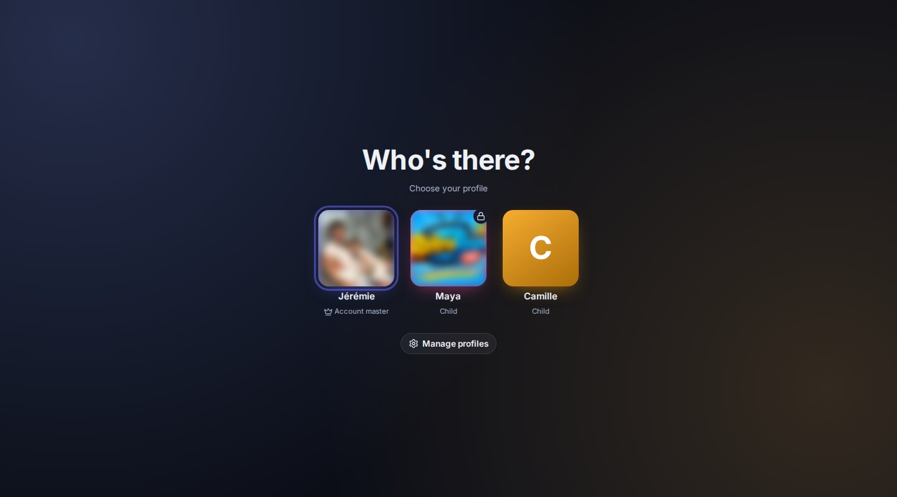
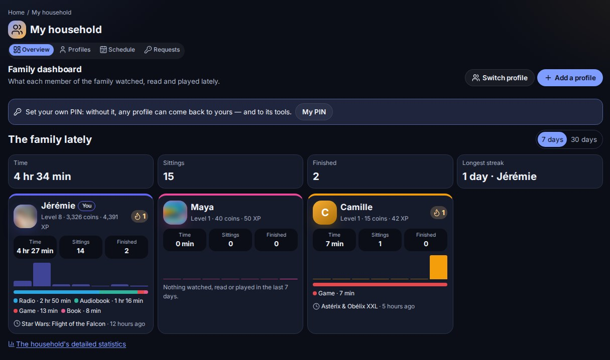
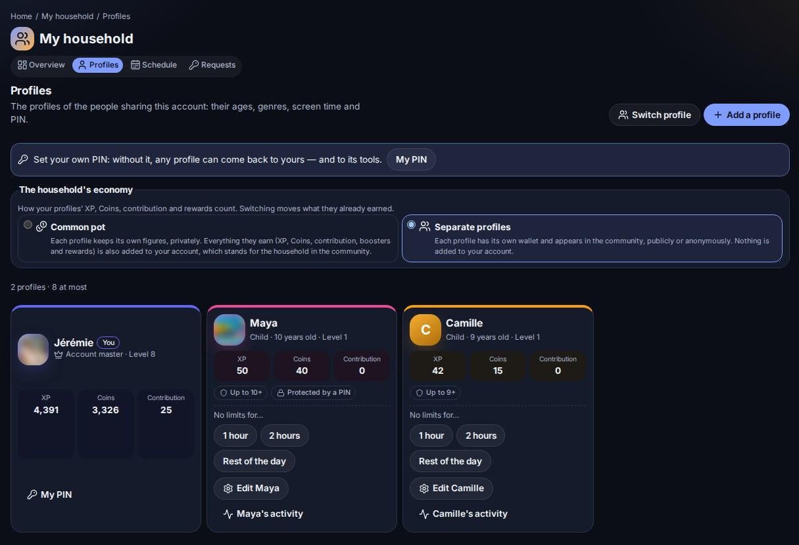
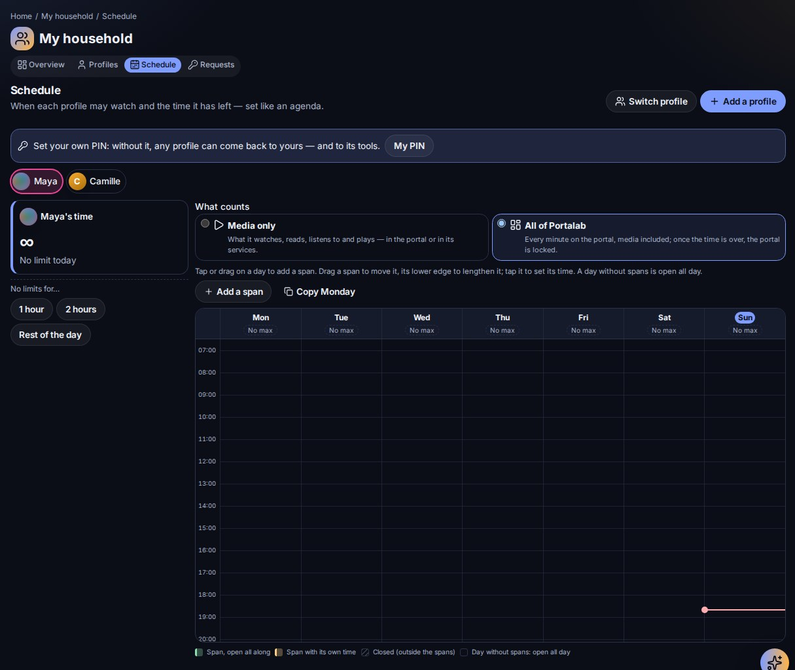

# Households and profiles

Share your account with your family? Give everyone **a profile of their own**: their home, recommendations, quests and progress, without mixing everybody's tastes. Your account stays the **master account**: you make the household, manage the profiles, set their rules and decide how they earn.

## Making a household

A household starts when you want one:

- **In your welcome** — after your profile and your media accounts, the account's holder is asked **« A household? »**. **« Make my household »** then asks how it earns, the first names of your family (each becomes a profile) and each profile's rules. **« No profiles »** skips it: **« Make a household »** on your account page replays just that part later.
- **From your account page** — **« Make a household »**, any time.

Until then, nothing household-related shows: no « Who's there? », no **My household**. Changed your mind before adding anyone? **« I don't want a household »** removes it.

Then **« Add a profile »**: a name, a colour, a kind and an optional PIN.

- **Standard**: no restriction. **Child**: up to 12+, unrated titles hidden, horror kept out, kept out of the shop, requests, the AI assistant and community participation. **Custom**: your choice. A kind only sets the starting point.
- A profile has no login nor password: it is used from your account. Its first visit has **its own welcome** — its languages, its text size and its look, and **its own PIN** if it wants one. A profile is never asked about e-mails: your account holds them.

## « Who's there? »

After signing in, an account with profiles asks **« Who's there? »**. To change later, tap **« Switch profile »**: on the right of your name in the phone's drawer, first in the avatar menu on a computer. The whole portal reloads as the chosen profile.

- Entering a protected profile always asks its PIN, from the master account too.
- Coming back to the master from a profile asks **your** PIN when you have one: **My household** reminds you to set one as soon as you have a profile.
- Too many wrong PINs in a row: wait a little before trying again.
- Account security (password, two-factor authentication, sessions, deletion, export) is reachable from the master account only.

## My household

**My household** has four tabs: **Overview**, **Profiles**, **Schedule** and **Requests**. A profile sees its own **My schedule**.

The **family dashboard** shows the household wallet (in a common pot) and, for the last 7 or 30 days, each member's time, sittings, finished titles, kinds of media, last title and play streak — and the household's detailed statistics are one tap away (**Statistics › My household**).

## The household's economy

In **Profiles**, you choose how your profiles' XP, Coins, contribution and rewards count:

- **Common pot** (the default) — each profile keeps its own figures, **privately**. Everything it earns — XP, Coins, contribution, **boosters and rewards** — is also added to your account, which **stands for the household in the community**. Coins a profile spends leave its balance and the pot: a profile cannot spend what the household no longer has.
- **Separate profiles** — each profile has **its own wallet** and appears in the community, **publicly** (with its name) or **anonymously** (no name nor avatar in the leaderboards), as you choose in its **Edit**. Nothing is added to your account.

**Switching moves what they already earned**: choosing the common pot rebuilds it from the profiles' balances; choosing separate profiles gives each its share back.

Each profile keeps **its own play streak**; in a common pot, a profile's play keeps the pot's streak going too. Whatever the economy, **profiles never take part in community projects** (proposing, voting or funding stays the master's).

## Restrictions

The master sets each profile's policy (a profile cannot change it), in its **« Edit »**:

- **Allowed content** (films, series, books, audiobooks, music, games), **genres kept out** — horror, thriller, crime, war, or **any genre of the catalog** (« Animation », « Science Fiction »…) — and **titles kept out** one by one (from a title's page: **« Household restrictions »**).
- **Allowed features**, including **« Open titles in their services »** (off: no « Watch on Plex », « Read on Grimmory », « Play on RomM »…, only the portal's player and reader, where the screen time and every rule hold; off for a child profile by default).
- A **birth date** (the age limit then follows the profile, one more at each birthday, no limit from 18) or a fixed **maximum age**; titles above it **hidden**, **shown locked** (blurred with a padlock, never opened) or **shown** (their page opens, they do not start); whether it **may ask for access**; **unrated titles** allowed or not.
- Whether it is **shown in the community** (separate profiles only: publicly or anonymously).

### Age ratings

Every title shows its **age rating** — films, series, books, games — and the catalog filters by « what this member may watch ». A title's age is **its rating in the portal's country**, set by the administrator with the portal's system language (*Administration › Site identity*): in France, a film rated « Tous publics » is open to all. **Without a rating for that country, the strictest of the others counts** — the United States', the United Kingdom's, Germany's (from TMDB) and your Plex or Jellyfin server's. Each title's page shows that age and its sources. Books and music carry no rating; a game is held to its age rating (PEGI, ESRB… from IGDB, through RomM) when it has one, and an unrated game stays open: most retro games are older than the rating boards.

## Screen time

**Schedule** sets, for each profile, **when** it may watch and **how long** — like an agenda:

- **What counts**: **Media only** (what it watches, reads, listens to and plays, in the portal or in its services) or **All of Portalab** (every minute on the portal, media included; once the time is over, the portal is locked behind a screen that says when it opens again).
- **Spans**: tap or drag on a day to add one; drag it to move it, its lower edge to lengthen it; tap it to give it **its own time** (« 1 hour in this span ») or leave it open from start to end. Outside the spans, the screen is closed. **A day without spans is open all day.** **« Copy Monday »** copies it to Tuesday–Friday or to the whole week.
- **A maximum per day**, above each day's column.
- **Right now**: the profile's time left, the span it is in or the next one.
- **In a few taps**, on the profile's card or the schedule: **more time today** (+15, +30, +60 or +120 min), **no limits for** 1 hour, 2 hours or the rest of the day, and **« Limits back »**.

Plays on a TV through the Plex or Jellyfin app are not counted. Once the time is spent, a film, a book or a [game played in the portal](retro-games.md) under way stops.

## Access requests

A profile opening a title above its rating sees it **locked**, with **« Ask for access »** and a note for the master. You are notified (in the portal and by e-mail); in **My household › Requests**, **Allow**, **Allow for 1 day** or **Decline** — the profile is told, and the title opens for it alone.

## Plays and statistics

Plays read from a shared Plex or Jellyfin account (the living-room TV) still go to the master account. A profile watches in Portalab with that same account, nothing to link: **whatever a profile watches, reads, listens to or plays in the portal is its own** — its XP, streak, statistics and **Continue**, never the master's. In **Statistics**, **« My household »** shows the household's figures, each profile's included; **« Me »** shows what the profile itself did in the portal.

## Activity and deletion

**« …'s activity »** on a profile's card lists what it earned and spent lately and its requests. **« Delete this profile »** erases its progress, preferences and history, signs out the devices using it, and **leaves no trace**: it disappears from leaderboards, charts and requests, the administration's included. Deleting the master account deletes its profiles too.
