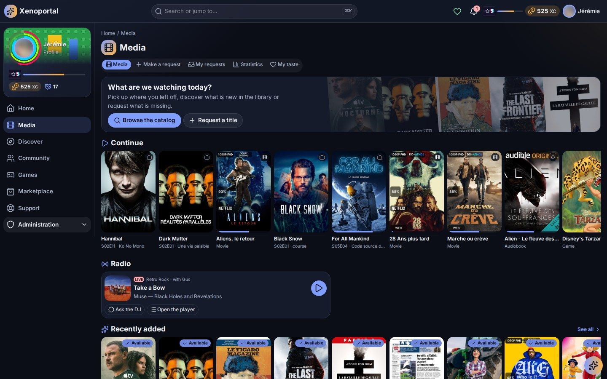
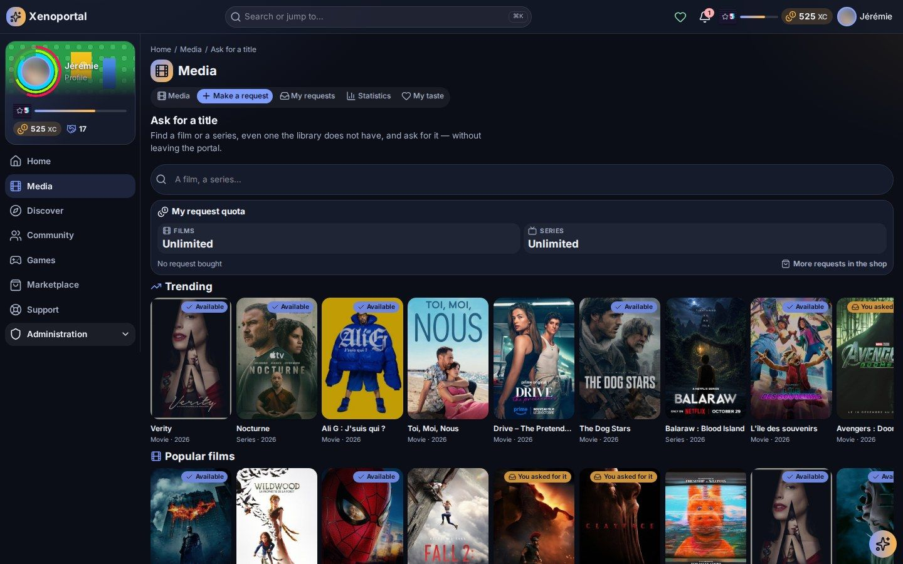
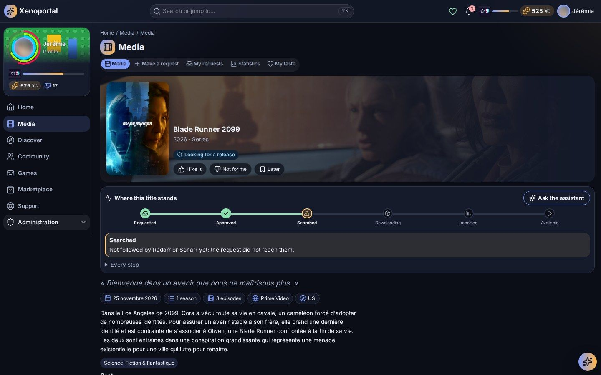

# Media

Find a title, see where it stands, ask for what is missing, follow your request all the way to the library, and watch, read or listen without leaving the portal.

Everything here lives in the **Media** section of the menu: **Library**, **Request a title**, **My requests** and **My taste**. Your figures are in the **Statistics** section (see [Statistics](statistics.md)). What you see depends on the services your portal connects (Plex, Jellyfin, Seerr, Sonarr/Radarr, Grimmory, RomM, a radio…): a feature without its service simply does not appear.

## The library

Open **Library** (`/media`). The page greets you with *What are we watching today?* and gives you:

- **Browse the catalog** to search the whole library;
- **Request a title** to ask for something the library does not have (see [Asking for a title](#asking-for-a-title));
- **Now playing**: what you are playing right now, with its state (playing, paused, loading);
- **My statistics**, a shortcut to your [statistics](statistics.md);
- rows of posters you scroll sideways;
- **Browse by kind**: films, series, books, audiobooks, music, games.

| Row | What it shows |
|---|---|
| **Continue** | What you started and did not finish |
| **Recently added** | What just arrived in the library |
| **Recent releases** | The library's titles that came out most recently |
| **Leaving soon** | Titles the library's cleanup is about to delete (see [Leaving soon](#leaving-soon)) |
| **Recently played** | What you played lately |
| **Trending** | What is popular right now |
| **Recommended for you** | Picks from [your taste](#my-taste) |

A row with nothing to show is hidden. If your portal has a radio, its card appears on this page too (see [The radio](#the-radio)).

## The catalog

Open **Browse the catalog** (`/media/browse`).

1. Type in **Search titles**: a title, an author, an actor…
2. Pick a **Kind**: **Everything**, **Films**, **Series**, **Books**, **Audiobooks**, **Music** or **Games**.
3. Narrow down with **Filters**:
   - **Availability**: available or not available;
   - **Already seen**: **Finished**, **In progress** or **Not yet**;
   - **Genre** and **Year** (**From** … **To**);
   - depending on the kind: **Author**, **Director**, **Narrator**, **Series**, **Publisher**, **Language**, **Platform or console**.
4. Order with **Sort by**: **Recently added**, **Title (A to Z)** or **Newest**.

Active filters are listed above the results: remove one with a click, or use **Clear all**. **Show more** loads the next titles.

## A title's page

Click a poster to open its page. The top of the page shows the artwork (backdrops and posters you can step through), the poster, the year, the kind, the length and the rating, then badges:

| Badge | Meaning |
|---|---|
| **Available** | The title is in the library |
| A request stage, e.g. **Waiting for approval** or **Downloading 40%** | Someone asked for it and it is on its way |
| **Not available** | Not in the library, and nobody asked for it yet |
| **In progress · 35 %** | You started it (for a series, the episode you are on) |
| **Watched**, **Read**, **Listened**, **Played** | You finished it |

Under the title, one bar of small actions:

- the three taste icons — **I like it**, **Not for me**, **Later** (their names show on hover);
- **Give my review**, once you watched, read, listened to or played it: a dialog asks a rating from 1 to 5 stars (each says what it means, from *Didn't like it* to *Loved it!*) and **A word on this title** if you want, then **Post my review**. The button then shows your rating (**My review: 4/5**) and reopens it to **Edit** or **Take my review back**. An episode's review goes to its series;
- **Follow** for a series;
- the flag, **Report a problem**: missing subtitles, the wrong language, a cut file, poor picture? Pick what is wrong (**Subtitles**, **Sound**, **Picture**, **Language**, **File unreadable or cut**, **Something else**), add details if needed, and **Send the report**. It is a support ticket about this title, which you follow in [My tickets](support.md); the team sees the title in it.

A title with open reports shows a small beating warning flag on its poster wherever it appears — the library, the shelves, the home widgets, the search — with how many when more than one. On its page, a beating **N open reports** badge sits in its head; it leads to **Reported problems** at the bottom of the page: yours (open them to follow them) and, when your portal shares them, the other members' — their title and state only, never who reported them — so a known problem is not reported twice. **Show the closed reports too** lists the ones dealt with.

**Members' reviews**, lower on the page, shows the members' average rating and how many reviewed it, then the reviews — yours first, the others signed with their name, or **Anonymous** for a member who keeps to themselves in the community. It shows only once someone reviewed the title.

### Where to watch

The action buttons depend on the title and your portal:

- **Watch** (or **Watch S01E03** for a series) opens the portal's own player — see [Watching in the browser](#watching-in-the-browser);
- **Resume** picks up where you stopped, with **Start over** and **Back to zero** (clears your resume point) next to it;
- **Watch on …**, **Read on …**, **Listen on …** or **Play on …** followed by the service's name (for example *Watch on Plex*) opens the title in that service, in a new tab;
- **Read** and **Listen** open the portal's reader or audiobook player.

The **Sources** section lists every service that holds the title, whether it is still listed there, and when it was last synchronised.

### What else is on the page

Depending on the title:

- **Enriched details** (from the metadata provider, such as TMDB): **Cast**, **Crew**, **Genres**, **Studios**, **Languages**, **Keywords**, **Budget and box office**;
- the title's **collection**, told the same way for a film (**Saga**), a book or an audiobook (**Series**) and a game (**Franchise**, from RomM): its name, the title's place in it (**Volume 2**), how many of its titles the library has and their posters on a rail. **See the saga** (the series, the franchise) opens its page: every title in order, and for a saga the films the library lacks, each with **Ask for it**, and for a book series every volume (when the portal is connected to Hardcover), the ones the library lacks marked **Not here**;
- **About**, **Contents** (a series' seasons and episodes), **Requests** and **External links**;
- for a game, **Time to beat**: how long it takes by play style — **Main story**, **Main + extras**, **Completionist**, **All styles** — with how many players told it (HowLongToBeat, when RomM knows it);
- **My history**: when you played it and how far you went. Once enough members have seen it, the number of plays and members appears too — never their names;
- for a book or an audiobook: **Authors and narrators**, **Publisher**, **Pages** or listening length, **ISBN**…

Click a person in the cast or crew to open their page: **Biography**, **Known for** and **Filmography**. The filters **All**, **Available** and **To ask for** show what the library has of their work and what you could request, with an **Ask for it** button on each missing title. For an author, when the portal is connected to Hardcover, the page also shows their books: the list is then called **Works** (**Bibliography** when they only wrote books), the most read first, each **Available** or **Not here** (books cannot be requested), beside the films and series they took part in.

### Leaving soon

When your portal uses a library cleanup tool (Maintainerr), some titles are scheduled for deletion to free space. A title on that list shows a **Leaving soon** box on its page:

- **when** it leaves: *This title will be deleted from the library in 5 days.* — or, for a series, how many seasons go;
- *This title is on the library's deletion list.* when no date is known yet;
- **why**: *Rule: …*, the cleanup rule that picked it;
- how many **rescues** you have.

**Save this title** spends one rescue: the title leaves the deletion list for good, for everyone, and all its scheduled seasons with it. A spent rescue is not given back. If you have none, **Buy a rescue** opens the shop's **Rescue** products (see [gamification.md](gamification.md)). If the cleanup tool does not answer, you see *The rescue did not go through. Try again later.* and your rescue is not used.

The **Leaving soon** row of the library and the **Leaving soon** widget list every title about to go.

## Asking for a title

Open **Request a title** in the menu, or on the library's page: the **Ask for a title** page (`/media/discover`).

- Type in **Search a film or a series**: you also find titles the library does not have.
- Or browse the rows: **Trending**, **Popular films**, **Popular series**, **Upcoming films**, **Upcoming series**.

Each poster carries a badge: **To ask for**, **Requested**, **You asked for it**, **Already requested**, **In progress**, **Partly available** or **Available**. Click a poster to see the title: synopsis, genres, length, rating, cast, the **Trailer** and, for a series, its seasons. If it is already in the library, **See it in the library** takes you there.

### Making the request

1. On the title, click **Ask for it**.
2. For a series, pick the **Seasons**: **Every missing season** is ticked by default; seasons already there or already requested cannot be ticked.
3. If your portal allows it, tick **In 4K**.
4. Read the quota line under the form.
5. Click **Ask for it**. *Asked! Follow it in « My requests ».* confirms it; **See my requests** and **Follow its request** take you on.

You can also ask from a library title that is not available yet: **Request** replaces **Watch**.

> **Note** — A title another member already asked for cannot be asked for twice: *it will come for everyone*. Follow it on its page. If the request service refuses (for example 4K or that kind of title is not allowed for your account), the portal says so and nothing is counted.

### Your request quota

**My request quota** (on Ask for a title, and at the top of **Statistics → My requests**) shows how many requests you have left:

- when your account on the request service (Seerr) is linked, **its** limits apply: a number of films and a number of series, every so many days. The portal tells you when one comes back (*one comes back on …*);
- otherwise the portal gives you a number of requests for today, this week or this month.

When your quota is used up, **More requests in the shop** sells extra requests, paid in the portal's currency. They are used only once your quota is reached (*Your quota is reached: this request uses one of your bought requests.*) and wait until you need them. A bought request comes back to you if the request is declined, and nothing is used when the request service does not answer.

## Following a request

*"Why is the film I asked for still not on Plex?"* — the title's page answers that. Every requested title shows a **Where this title stands** box: its journey from your request to the library, step by step, with the facts behind each step.

### The seven steps

| Step | What happens | What you may read |
|---|---|---|
| **Requested** | You or a member asked for it | *You requested it*, *Requested by …*, *Requested by a member*, and when |
| **Approved** | An administrator approves the request (on portals that ask for it) | *Waiting for an administrator's approval.* · *The request was approved.* · *The request was declined.* · *The request was cancelled.* · *The request failed on the service.* |
| **Released** | A film must be out for home viewing; a series must have started | *Not in cinemas yet: nothing to download before it comes out.* · *In cinemas for now: it has to wait for its digital release.* · *The series has not started yet.* · *Release date not known yet.* — with the **Cinema**, **Digital** and **Blu-ray/DVD** dates, or a series' **First episode** and **Next episode** |
| **Searched** | The download manager (Radarr for films, Sonarr for series) looks for a release | *Found by Radarr.* · *Radarr is looking for it: no version available for download yet.* · *… will look for it as soon as it is out.* · *… does not monitor this title: it will not look for it.* · *Not followed by Radarr or Sonarr yet: the request did not reach them.* · *Last failure on …* |
| **Downloading** | The file is being downloaded | *Downloading at 42%*, with each transfer's details (below) |
| **Imported** | The file goes into the library | *Importing into the library…* · *Imported.* · *Import blocked: someone has to act manually.* · *The import failed.* |
| **Available** | Ready to watch | *In the library since …*, with the number of episodes for a series |

Each step has a state: **done**, **in progress**, **waiting** (nothing to do but wait — a release date, an approval), **blocked** (someone has to act), **failed** or **to come**. The current step is explained right under the row of steps; open **Every step** to read all of them.

### Reading a download

While a title downloads, each transfer gets its own line: its name (with `S01E03` for an episode), a progress bar and percentage, the release name, and the torrent client's view of it:

| Fact | Meaning |
|---|---|
| State | **downloading**, **queued**, **paused**, **checking**, **fetching metadata**, **stalled: no source**, **client error**, **complete** |
| **Download** / **Upload** | Current speeds |
| **Seeders** / **Leechers** | Connected sources, and the size of the swarm when known (*3 connected of 40*) |
| **Ratio** | What was shared back |
| **Time left** | The client's estimate |
| **Size** | Downloaded so far out of the total |
| **Client** | The download client handling it |

The box refreshes on its own every 15 seconds while something downloads. The download manager's own messages, when it has any, appear under the transfer.

### Typical answers

- **"Waiting for an administrator's approval"** — your portal approves requests by hand; nothing moves until then.
- **"In cinemas for now"** — the film is not released for home viewing yet; it will be searched automatically once it is.
- **"No version available for download yet"** — the download manager is searching but has found nothing acceptable; it keeps trying.
- **"stalled: no source"** — the download started but nobody shares the file right now.
- **"Import blocked: someone has to act manually"** — the file arrived but needs an administrator; open a [support ticket](support.md) if it lasts.

### Going further

- **Ask the assistant** (when your portal has one) asks for you: *Where does « … » stand, and why is it not available yet?* — see [assistant.md](assistant.md).
- **See the indexers' results** (when you have unlocked it, for example in the shop) shows the releases the indexers offer right now: name, quality, seeds, and the manager's verdict, **Accepted** or **Rejected**. The search can take a minute; its result is kept 30 minutes.

Once the title has arrived, the box folds into one line — *Available · since … · you requested it* — with **See the journey** to reopen it.

## My requests

Open **My requests** (`/media/requests`). The page has two tabs:

- **List**: every request, with **Search a request** and the filters **Pending**, **In progress**, **Available** and **Declined**. Each line shows its stage: *Waiting for approval*, *Out on …*, *Looking for a release*, *Downloading 60%*, *Importing*, *Import blocked*, *Available*…
- **Coming soon**: what is downloading, importing or has a release date.

Your requests in figures are in the **Statistics** section, under **My requests** (`/media/requests/stats`), with a **Period**: your quota, **My requests' status**, **What became of them**, **My rank as a requester** (anonymous), **Requests over time**, **Time to availability**, **Most watched among requested**, **Genres requested and watched**, and **The audience of your requests** (how many other members watched them — a number, never who). Some cards unlock in the shop, depending on your portal.

**Cancel** a request while it is still pending, from the list or with **Cancel the request** on the title's page. If an administrator declines it, a notification tells you, with their reason when they gave one.

Your request notifications are set in the categories **My media requests** and **Requested media available** — see [personalization.md](personalization.md#notification-preferences). On your home page, the widgets **My requests**, **My requests coming soon**, **Downloads in progress** and **Next releases** follow them too.

## Watching in the browser

On an available film or episode, **Watch** opens the portal's player full screen. If the title has a resume point, the player asks *Pick up where you left off?* — **Resume at …** or **From the beginning**.

**Playback settings** lets you choose:

- **Quality**: **Original** streams the file as it is when your browser can play it; a lower quality is converted by the media server;
- **Version** and **Audio** track;
- **Subtitles** and **Subtitle size**, with **Burn subtitles into the picture** (image subtitles are always burnt in);
- **Audio boost** (**None**, **Small**, **Large**, **Huge**) and **Speed**;
- **Chapters**;
- **Play the next episode automatically**.

**Skip intro** and **Skip credits** appear when the media server knows them. A film or an episode stopped in the last two minutes before its end credits counts as watched to the end. At the end of an episode, **Up next** offers **Play next episode** — or **Watch the credits**. **Playback info** tells you whether the stream is direct or converted.

### Casting and devices

- **Cast to a device** sends the video to a Chromecast (in Chrome and Edge); the TV fetches the stream itself and the player's controls drive it. **Stop casting** brings it back.
- **AirPlay** sends it to an Apple TV from Safari.
- **Picture in picture** keeps the video in a small window while you browse.

### Keyboard shortcuts

| Key | Action |
|---|---|
| Space or K | Play / pause |
| ← / → (or J / L) | Back / forward 10 seconds |
| ↑ / ↓ | Volume |
| M | Mute |
| F | Full screen |
| C | Subtitles on / off |
| Esc | Close the menu, then leave the player |

> **Note** — Your portal may require your media server account to be linked before you can watch here. The player tells you (*Link your media server account to watch here*) and **Link my account** takes you to [your media accounts](personalization.md#media-accounts). *Your account on the media server cannot play this title.* means the media server itself refuses it.

## Reading books and comics

On a book, **Read** opens the reader full screen; once started, the button becomes **Resume reading (42 %)**. The reader opens **EPUB**, **PDF** and **comics**.

- **Contents**, **Bookmarks** (**Bookmark this page**) and **Search the book**;
- **Reading settings**: **Font** (the publisher's, serif, sans serif or **Easy reading**), **Text size**, **Line spacing**, **Margins**, **Colours** (**Light**, **Sepia**, **Dark**, **Follow the theme**), **Continuous scrolling**, **Two pages side by side**, and **Right to left (manga)** for comics;
- zoom and **Fit to width** for PDF and comics;
- an estimate of the minutes left;
- **Back to the title**.

**Read on …** also opens the book in your library service.

## Listening to audiobooks

On an audiobook, **Listen** (or **Resume**) starts playback in a bar at the bottom of the screen. It keeps playing while you move around the portal.

**Expand the player** shows the cover and more controls: skip back and forward, **Chapters** with previous and next chapter, **Speed**, a **Sleep timer** (a number of minutes or **End of the chapter**) and **Bookmarks** (**Add a bookmark**).

> **Note** — Your position is always kept in the portal. If the library service does not know it, the player says so: link your account to keep both in sync.

## The radio

When your portal has a radio (SUB/WAVE), it shows on the library's page and in the **Radio** widget.

- **Listen** tunes in live; **Stop** ends it. The card shows the track on air, its cover, the host (*with …*) and the number of listeners.
- **Open the radio player** shows **Coming up** and **Played recently**.
- **Ask the DJ**: describe a song, an artist or a mood — even *more like this* — then **Ask**. *The DJ is looking…*, then *Your request is in the queue.* or *Coming up: « … »*. Requests show *asked by …* in the queue.

You get a number of free requests to the DJ each day (*2 free requests left today*). Once they are used, requests use **credits**: **Buy requests in the shop** sells more. One request at a time: wait a few seconds between two.

## My taste

Open **My taste** (`/media/taste`). What you watch, listen to, read and play — and what you say about it — makes your recommendations.

- **Tell what you like**: one title at a time. Swipe right for **I like it**, left for **Not for me**, or choose **Later** or **Skip**. **Undo** takes back the last verdict; **More titles** deals new ones.
- **What you like**: the **Genres**, **People**, **Sagas** and **Themes** your verdicts and history point to.
- **For you**: titles from the library, each with its reason (*Directed by …*, *With …*, *You like: …*, *Like …*).
- **Something different**: well-rated titles off your usual paths.
- **My lists**: **Liked**, **Not for me** and **For later**.
- **Use my history**: unticked, only your verdicts count.
- **Forget my verdicts** erases them (your history stays).

The **For you** and **Like it or not** widgets bring the same on your home page.

---

**Next:** [Statistics](statistics.md) · [Personalization](personalization.md) · [Assistant and search](assistant.md) · [Gamification](gamification.md) · back to the [index](../README.md)
