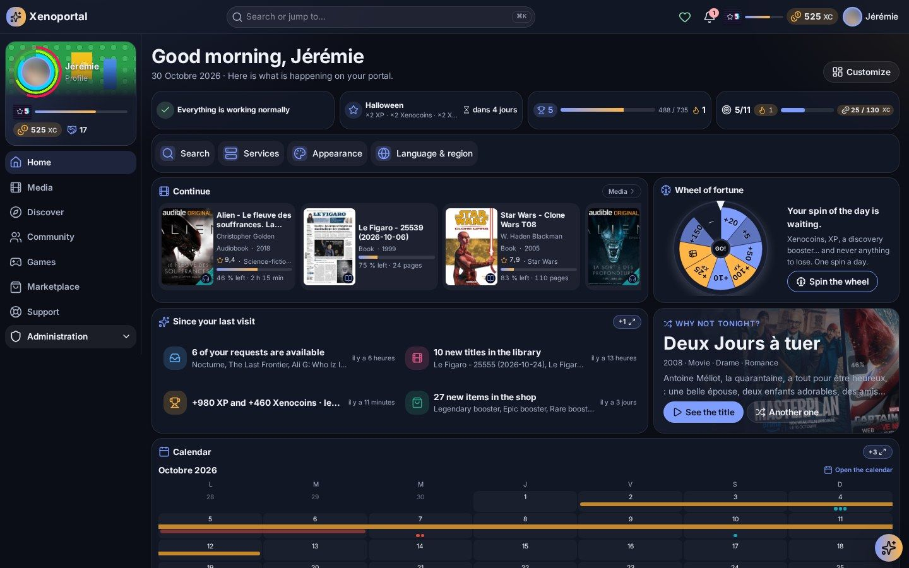
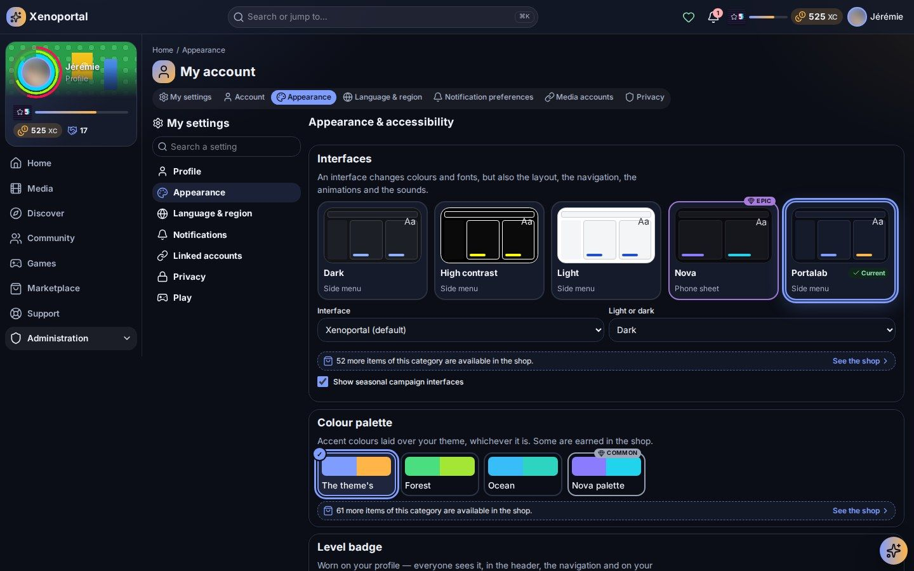
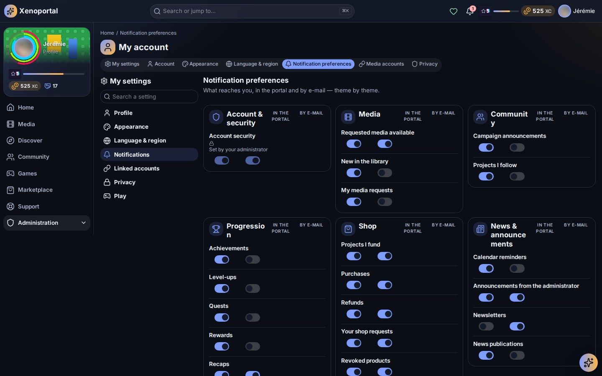

# Personalization

Make the portal yours: arrange your home dashboard, pick an interface and its looks, set up your profile, language, notifications and privacy, link your media accounts and choose whether you want to play.

All your settings are gathered in **My settings** (`/settings`), in the **Me** menu under your avatar (with **My progression** and **Achievements**). The page is organised by intent — **Profile**, **Appearance**, **Language & region**, **Notifications**, **Linked accounts**, **Privacy** and **Play** — and **Search a setting** finds one by name or by a related word (*password*, *dark*, *time zone*, *e-mail*…). On a computer the list of pages stays on the left; on a phone the list is the page.

## Your dashboard

Your home page greets you by name (*Good morning*, *Good afternoon*, *Good evening*) and shows your **dashboard**: blocks called **widgets**, each showing one thing — what you are watching, what just arrived, your progress, the next releases…

> **Note** — Your first dashboard is the one your administrator prepared. You can change it as you like, except the widgets they imposed.

### Arrange and resize

1. On the home page, click **Customize**.
2. Move and resize:
   - drag a widget by its **handle** to put it anywhere;
   - pull its **corner** or edges to make it bigger or smaller;
   - with the keyboard: **Enter** grabs the widget, the **arrow keys** move it, **Shift + arrows** resize it, **Enter** drops it.
3. **Save** keeps your changes; **Cancel** forgets them.

While customising:

- **Auto fit** fills the gaps between widgets;
- **Default** goes back to the starting dashboard (you are asked to confirm, since your widgets and their arrangement are replaced);
- **One layout per screen** lets you arrange **Computer**, **Tablet** and **Phone** separately. Off, tablet and phone follow the computer's layout.

If your dashboard changed on another device while you were arranging it, the portal reloads it and tells you.

### Add a widget

1. In **Customize**, click **Add a widget**.
2. The **Widget catalog** opens; **Search a widget** filters it. Widgets are split into **To add** and **Already on your dashboard**.
3. Each widget shows a preview, what it does, its possible sizes, and what it reads of your data (*Reads: your progression*).
4. Click **Add** (**Add again** for widgets you can place several times), then **Done**, then **Save**.

The catalog also says how many more widgets are available in the shop.

### The widgets

The catalog only lists the widgets you may use, and only those whose service your portal connects.

| Area | Widgets |
|---|---|
| Media | **Continue**, **Now playing**, **Recently added**, **New in the library**, **Recent releases**, **Upcoming releases**, **Next releases**, **Top of the week**, **Playing on the server**, **Downloads in progress**, **Leaving soon**, **Shuffle**, **Poster wall**, **Living wall**, **A year ago**, **Radio** |
| Requests | **My requests**, **My requests coming soon**, **Recently requested** |
| Taste and statistics | **For you**, **Like it or not**, **My statistics**, **Statistic** |
| Progression | **My progression**, **Daily objectives**, **Wheel of fortune**, **Progress bar**, **Progress column**, **Value** |
| Community | **Community activity**, **Leaderboard**, **Community projects**, **Active campaigns** |
| News and dates | **Latest news**, **Featured news**, **My feed**, **Calendar**, **Upcoming** |
| Shop | **Marketplace** |
| Services | **Services**, **Services (compact)**, **Service status**, **Quick access**, **Open incidents**, **Storage**, **Chart**, **Server**, **Containers** |
| Help | **My tickets**, **Since your last visit**, **Welcome** |
| Practical | **Clock**, **Note**, **Countdown**, **Shortcut**, **Separator** |

**My feed** shows the latest items of your sources — articles, videos, podcasts — each in its source's colour; a YouTube video plays in the widget itself, and **All my feed** opens the page (see [Community](community.md#my-feed)).

**Quick access** opens the portal's services in one click, each tile in its state's colour (border, tint, icon and word). In its settings, **Services shown, in their order** lists every service: tick the ones to show and move them by their grip (or the arrows). With no choice, every service shows in the usual order, those added later too. The widget adapts to its size: tiles in a wide block, the icon beside the name in a low one, rows in a narrow column, pills on a single row; the state's word shows only where there is room.

Some server widgets (**Server**, **Containers**, and some **Chart** series) are sold in the shop with a Contribution minimum. Visual packs can also bring widgets of their own.

### Widget settings

In **Customize**, each widget has **Settings** (the gear) and **Remove** (the bin). Settings depend on the widget — period, kind of media, **Whose** (**Mine** or **Everyone’s**), a note's text, a countdown's date… — and every widget has a **Display** part:

- **Hide the title**: the content alone, without its heading;
- **Without its box**: no background nor border;
- **Hide when there is nothing to show**: the block disappears while empty and comes back when it has content;
- **Pack look**: a frame brought by a visual pack you own, for this widget only.

Many widgets can also change their **Visual** without changing their content — for example **Classic**, **Carousel**, **Card deck**, **Flip board**, **Counting figures**, **Odometer**, **Analog face** or **Liquid gauges**. A visual marked *in the shop* is not yours yet.

### Imposed widgets

| Label | Meaning |
|---|---|
| **Pinned** | Placed here by your administrator: cannot be moved or removed |
| **Required by your administrator** | Always there, but you can move it |
| **Locked by your administrator** | Its place, size and settings are fixed |

*A source did not answer — this may be incomplete* means one service is briefly unreachable; the rest of your dashboard works normally.

## Appearance

**Appearance** (`/settings/appearance`) changes only how the portal looks — never your data.

### Interfaces

The **Interfaces** gallery previews each interface. An interface changes colours and fonts, but also the layout, the navigation (**Side menu**, **Top bar**, **Dock**, **Bottom bar**, **Icon rail**…), the animations and the sounds. Click one to apply it at once, then choose **Light or dark**: **Light**, **Dark** or **Follow my device**.

Only the interfaces you own are offered; the others are in the shop. **Show seasonal campaign interfaces** lets campaigns dress the portal for the season.

### Looks

- **Colour palette**: accent colours laid over your interface, whichever it is.
- **Level badge**: how the badge everyone sees next to your name looks. **Classic** changes with your level.
- **Level-up**: how a new level is celebrated — **Try it** shows it.
- **Ambience and celebrations**: the **Ambient animation** behind the portal (snow, falling code, fireflies, live weather…) and the **Reward celebration**. **Follow the theme** keeps your interface's own; **Preview** and **Try it** show them first. The *Live weather* ambience follows the real sky over a place you choose.
- **Notifications**: the **Style** and **Animation** of on-screen notifications.
- Plugins can add their own block (*Brought by …: choose the look it wears.*).

Some looks are earned or bought in the shop; *Won, and waiting for you* means one unlocks at a given level or Contribution. Visual packs installed by your administrator bring interfaces, palettes, ambiences and frames you can pick here once you own them.

### Display and comfort

The **Display** block sets how the portal reads for you:

- **Density**: **Compact**, **Comfortable** or **Spacious**;
- **Text size**;
- **High contrast**;
- **Reduce motion**: **On**, **Off** or **Follow my device**;
- **Decorative animations**: **All**, **Discreet (saves battery)** or **None (still images)**;
- **Play sounds**;
- **Notification position**: top or bottom, start or end of the screen.

A greyed-out setting was fixed by your administrator; your own choice is kept and comes back when it is released.

### Safe mode

If the display misbehaves, **Use safe mode** shows Portalab's own interface, without anything brought by a pack, in this browser until you leave it. You can also add `?safe=1` to any address. A banner reminds you; **Leave safe mode** returns to normal.

## Your profile

**Account** (`/account`) shows your profile as others see it.

- **Change my picture** on your avatar: PNG, JPEG, WebP or GIF, up to 2 MiB. **Remove my picture** takes it off.
- **Profile**: your **Display name**, **About me**, and **Who can see “About me”** — **Everyone**, **Portal members**, **Leaderboards only** or **Only me**. Click **Save**.
- **Password**: change it with your current one; your other devices are signed out. If you sign in through single sign-on, the password is changed with that provider.

### Customise my profile

On your profile, **Customise** opens **Customise my profile**:

| Tab | What it sets |
|---|---|
| **Banner** | The image at the top of your profile |
| **Film backdrop** | A film or series backdrop from the library as your banner |
| **Animated background** | A moving background |
| **Picture frame** | The frame around your avatar |
| **Name style** | How your name is drawn |
| **Title** | A title shown with your name |
| **Badge showcase** | Up to three badges next to your name |
| **Level badge** | Your level badge's look |

Only what you own is offered; **See in the shop** shows the rest. See [community.md](community.md) and [gamification.md](gamification.md).

### My presence in the community

- **Public**: the portal's members, and only them, see your name and avatar in the leaderboards, the activity and the directory.
- **Anonymous**: other members see you nowhere. In the leaderboards you still count, with no name, avatar or link.

**Finer settings** opens the privacy centre. *An administrator set this.* means you cannot change it.

## Language & region

On **Language & region** (`/settings/language`) each choice saves at once:

- **Interface language**;
- **Formats (dates, numbers)**;
- **Time zone**;
- **Clock**: **12-hour** or **24-hour**;
- **First day of the week**.

**Automatic** lets your browser decide. The *Preview: …* line shows the result. If your language is switched off by the administrator, your choice is kept and applies again when it comes back.

## Notification preferences

Open **Notification preferences** (`/settings/notifications`) from your account menu, from the bell's panel, or from My settings.

Notifications are grouped by theme, one card each: **Account & security**, **Media**, **Community**, **Progression**, **Shop**, **News & announcements**, **Support & services**, **Other**. Each line has two switches:

- **In the portal**: it arrives in the bell;
- **By e-mail**: you also get it by e-mail.

Changes save at once (*Preferences saved.*). A line marked **Required** or *Set by your administrator* cannot be switched off — for example your account's security alerts.

- **E-mail digest**: **Send each e-mail**, **Daily digest** or **Weekly digest** (your notification e-mails only, not the newsletters).
- **Newsletters by e-mail** (when your portal sends some): "Choose the channels you receive by e-mail. They stay readable in the news anyway." You are subscribed to each one until you switch it off, one by one:
  - **Automatic newsletters**: each newsletter that writes itself, named by its latest letter, with when it goes out (*Every Monday at 8:00*);
  - **Channels**: the news channels sent by e-mail. Switching a channel off also stops the automatic newsletters published in it (*Off with its channel « … »*).

  Every newsletter e-mail ends with **Unsubscribe from this newsletter**, which leads to this card.

How to read and manage the notifications themselves is in [support.md](support.md#notifications).

## Privacy

The **Privacy center** (`/privacy`) shows what the portal holds about you, who can see it and how long it is kept.

- **Who sees what** sums up your data by visibility.
- Data is grouped by area (**Profile**, **Community**, **Media**, **Activity**, **Progression**, **Statistics**, **Shop**, **Support**), each with its kind and **Kept for** (a number of days, or *While your account exists*).
- Where allowed, choose who sees each item: **Everyone**, **Portal members**, **Leaderboards only** or **Only me**. A padlock means the administrator set it for now; your choice is kept and comes back afterwards.

**Your data**:

- **Terms of use**: the version you accepted;
- **My data**: **Request a copy of my data**, **Check again** while it is prepared, then **Download my data**;
- **Delete my account**: **Confirm with your password**. Deletion happens after a grace period; signing in again during that period cancels it (*Deletion scheduled. You can cancel until …*).

## Media accounts

**Media accounts** (`/settings/media-accounts`) links your accounts on the media services so your activity — what you watch, read and listen to — is yours in the portal: history, resume points, statistics, recommendations and, on some portals, the player.

1. In **Link an account**, pick the **Service**.
2. Type your **Account on that service** (your name or number there).
3. Click **Link account**.

The link appears under **Linked accounts** as **Waiting for verification**. **Nothing is attributed to you until the link is verified.** If the service gave you a **Verification code**, type it and click **Verify**; otherwise an administrator confirms it. Your accounts may already be linked for you. **Remove** deletes a link.

## Guided tours

**Guided tours** (`/guide`, **Guide** in the Help section) shows every feature on the real pages. Start with *New here? Start here* — **The portal in one minute** — then pick any tour: **Arrange your dashboard**, **Watch and read**, **Ask for a title**, **Follow a request**, **Read your statistics**, **Your profile and your look**, **Your progression**, **The shop**, **Mediacards**, **The news**, **Games and quests**, **My reserve**, **Community projects**, **The community**, **The calendar**, **The assistant**, **Ask the support**, **Service status**…

Each tour shows its number of steps; **Start**, **Next**, **Back**, **Skip** or **Leave the tour**. Tours you finished are marked **Seen** and can be replayed with **See again**.

## Play

**Play** (`/settings/play`) asks again the welcome screen's *Do you want to play?* — change your mind whenever you like:

| Choice | What you get |
|---|---|
| **Yes, all of it** | Progression, the shop and the Mediacards. Your profile is public, only to the portal's members. |
| **Yes, without the cards** | Progression and the shop, without the Mediacards: they leave the menu, the titles' pages and the shop, and watching no longer gives a Mediacards booster. The looks boosters stay. |
| **No, I am here for the media** | Your profile is anonymous and the Mediacards are hidden. |

The choice saves at once. **Set who sees what more finely, in privacy** opens the privacy centre. See [gamification.md](gamification.md) for what playing brings.

---

**Next:** [Media](media.md) · [Support, status and notifications](support.md) · [Gamification](gamification.md) · [Community](community.md) · [Customization (admin)](../admin/customization.md) · back to the [index](../README.md)
