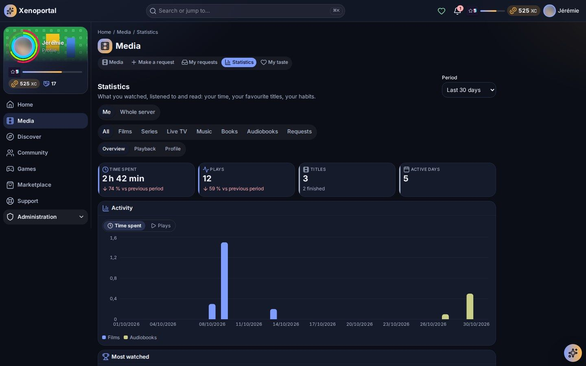
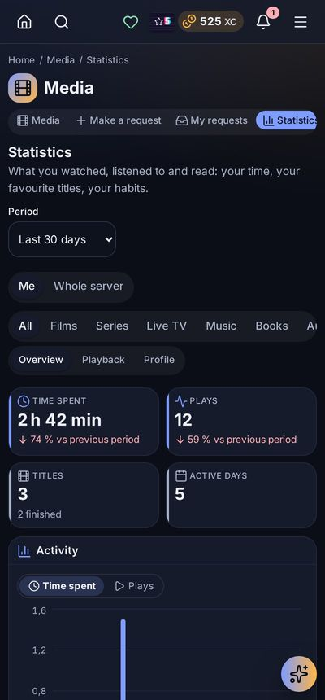

# Statistics

What you watched, listened to, read and played — your time, your favourite titles, your habits — and the recap that sums up a period.

The portal has two pages called **Statistics** in the menu:

| Page | Where | What it holds |
|---|---|---|
| **Media statistics** (`/media/insights`) | Media section, or **My statistics** on the Media page | Your plays, time and habits, or the whole server's |
| **Portal statistics** (`/statistics`) | Discover section | Statistics your administrator chose for you, and your **recap** |

## Media statistics

### Choosing what you look at

1. **Me** or **Whole server**: your own figures, or the whole community's activity. The server view is anonymous for members: nobody is named.
2. **Period**: **Last 7 days**, **Last 30 days**, **Last 3 months**, **This year**, **Last 12 months**, **All time**, or one of the last few years.
3. **Category**: **All**, **Films**, **Series**, **Live TV**, **Music**, **Books**, **Audiobooks**, **Radio**, **Games** or **Requests**.
4. The **tabs** of that category: **Overview**, then **Casting**, **Production**, **Playback** or **Profile** where they apply.

> **Note** — A category appears only when a service your portal connects feeds it: a library or a play history of that kind (Plex, Jellyfin, Tautulli, Grimmory, RomM…), a connected radio for **Radio**, a request service (Seerr) for **Requests**. A portal without books has no **Books** tab.

### The tabs of each category

| Category | Tabs |
|---|---|
| All | Overview · Playback · Profile |
| Films, Series | Overview · Casting · Production · Playback · Profile |
| Live TV | Overview · Playback · Profile |
| Music, Books, Audiobooks | Overview · Profile |
| Radio, Games | Overview |
| Requests | Your request figures (the same as the Overview of [My requests](media.md#my-requests)) |

### Overview

- Four key figures — **Time spent**, **Plays**, **Titles** and **Active days** (**Active members** on the server view) — each compared with the previous period.
- **Activity**: a curve over time, by type. **Show** switches between **Time spent** and **Plays**.
- **When**: your days and hours, as a heat map.
- **Most watched**, with posters.
- **Genres**, **Actors and artists**, **Decades**.
- **Records**: **Busiest day**, **Longest session**, **Best streak**, **Titles finished**.
- **Box office**: the combined budgets and revenue of the films watched (from TMDB).
- **Devices** and **Latest plays**.

### Playback

How titles were played: **Stream type** (**Direct play**, **Direct stream**, **Transcode**) against the previous period, the share played directly without transcoding, **Viewing quality** (4K, 1080p, 720p, SD) and **Viewing support** — the **Players** and **Platforms** used most. These come from the history service (Tautulli tells how a title was played).

### Profile

Your viewer profile over time: **Activity** over the period against the previous one, the **Genre profile** (every genre, this period against the previous), **Genres by period**, the genres that are **New**, **Rising**, **Always there** or **Gone**, and your **Viewing footprint** (hours of the day and days of the week).

### Casting (films and series)

The people you met most often: **Top directors**, **Top actors** and **Top creators**, shown as a personnel registry.

### Production (films and series)

Where the titles come from and what they cost: **Financial record** (**Most expensive**, **Least expensive**, **Most profitable**), **Films by budget**, **Top financial successes** and **Financial flops** (revenue against budget), **By release year** and **Production countries**.

> **Tip** — Nothing shows? Your statistics appear as soon as a service reports plays **and** your accounts are linked. Check your [media accounts](personalization.md#media-accounts).

## Statistics sold in the shop

Depending on your portal, some statistics are unlocked in the shop with the portal's currency:

- the **Whole server** view (*The whole server's statistics*);
- the long periods — **This year**, **All time** and past years — marked *· in the shop* in the period list;
- the **Casting**, **Production**, **Playback** and **Profile** tabs (*Casting in depth*, *Production in depth*, *Playback in depth*, *Your viewer profile*);
- single cards of the overview: *When you watch*, *Your favourite genres*, *Actors and directors*, *By decade*, *Your records*, *Your films' box office*, *Your platforms*;
- several request cards: *Your rank among requesters*, *What became of your requests*, *How long your requests take to arrive*, *The requesters' podiums*, *The audience in depth*…

A locked tab or card shows a padlock, *This statistic unlocks in the shop.* and **See in the shop**. See [gamification.md](gamification.md) for the shop.

## Portal statistics

Open **Statistics** in the Discover section (`/statistics`). It shows the statistics your administrator set up for you — for example **My sign-ins**, **Days I came by**, **My activity**, **What I finished**, **Requests made** or **Active members**. They vary from one portal to another.

- Choose the **Period**: **Last 7 days**, **Last 30 days**, **This week**, **This month** or **This year**.
- Each card shows a chart, its value in words, and its trend against the previous period (*Up 12 (8 %) versus the previous period*).
- **Show the data table** shows the figures as a table.
- **Hide** removes a card you do not care about; it moves to **Hidden statistics**, where **Show** brings it back.

A card can be locked; it tells you how to unlock it: earn an achievement, reach a higher level, own a Marketplace item, or wait for a campaign.

> **Note** — *Not enough participants yet to show this statistic privately.* A community statistic appears only once enough people take part, so nobody can guess what one member does.

## Your recap

The recap sums up a finished period, one statistic at a time.

1. When it is ready, a notification tells you: *Your recap … is ready*.
2. Open it: the recap page (**Statistics → Recap**, `/statistics/wrapped`) shows *Your recap: [start] – [end]*.
3. Move with **Previous** and **Next**. Nothing advances on its own: you go at your own pace.

Your recap is personal: only you see it. *No recap yet.* means none has been generated for you so far. Recap notifications are set in the **Recaps** category of your [notification preferences](personalization.md#notification-preferences).

## Statistics on your home page

- **My statistics** widget: time spent, plays and top titles, with the period, category, measure, scope (**Me** or **Whole server**) and display (**Curve over time**, **Bars over time**, **Ring by type**, **Figures only**, **Top titles**) of your choice.
- **Statistic** widget: one portal statistic.

See [personalization.md](personalization.md#your-dashboard).

---

**Next:** [Media](media.md) · [Personalization](personalization.md) · [Gamification](gamification.md) · back to the [index](../README.md)
