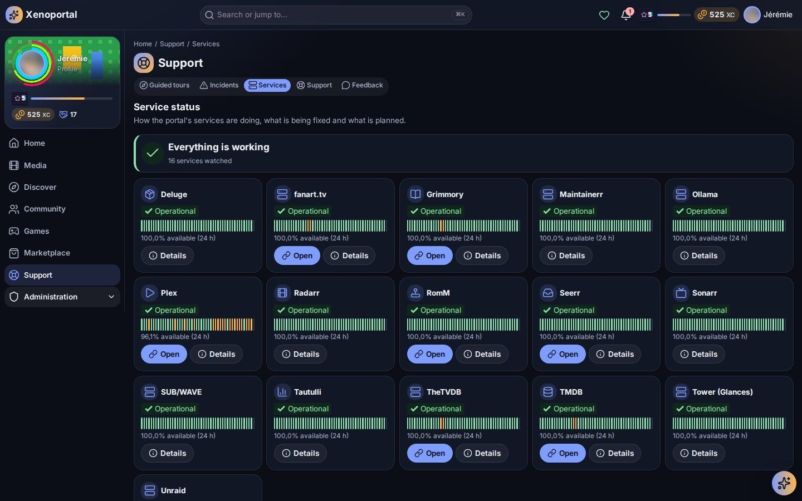
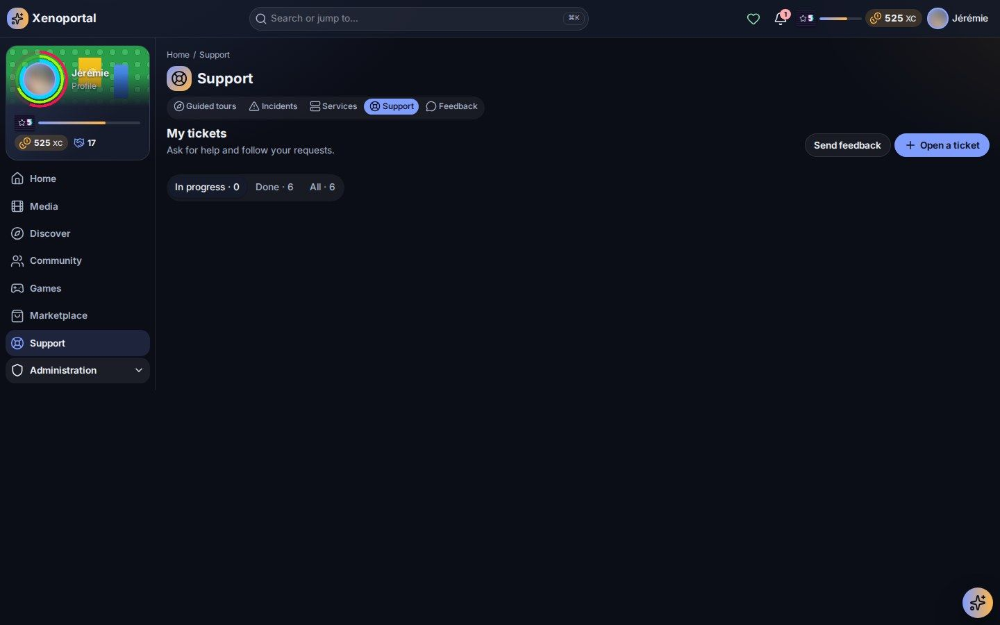

# Support, status and notifications

Ask the team for help with a ticket, tell them what you think, check whether a problem is already known, and keep up with your notifications.

The **Help** section of the menu holds **Guide** (the guided tours), **Wiki**, **Support** (your tickets), **Feedback**, **Service status** and **Incidents**.

## Is it already known?

Before opening a ticket, check whether the team already knows about the problem.

### The control center

In the header, next to the bell, a small icon sums up the portal's state; it changes with what is going on (an incident, a maintenance, services in trouble, an announcement), with a count. Click it to open the **Control center**:

- **Incidents**: each open incident, its severity, its stage and since when;
- **Maintenance**: in progress (with the time left) or coming up;
- **Announcements**: those running now, even if you closed their banner;
- **Services**: *All services are working*, or how many are in trouble.

Links at the bottom lead to **Service status** and **All incidents**. A banner (*Ongoing incident*, *Planned maintenance*, *Maintenance in progress*) may also show at the top of every page; **Hide this notice** closes it on this device.

### Incidents

**Incidents** (`/incidents`) tells you what is wrong, where things stand and what was fixed.

- The summary: *Everything is working normally*, or the number of incidents in progress, and how many were resolved in the last 30 days.
- **Show**: **Ongoing**, **Resolved** or **All**.
- Each incident card shows its **severity** (**Minor**, **Major**, **Critical**), its **stage**, **since when** it lasts (*for 3 h*) or how long it lasted (*lasted 2 h*), the **Affected services** and its latest update.
- Open an incident to read its **Timeline**, from its declaration to its resolution.

An incident goes through **Investigating**, **Identified**, **Monitoring**, then **Resolved**. **Planned maintenance** at the bottom lists what is coming: when, how long, and what it affects. **See the services' state** opens the status page.

### Service status

**Service status** (`/services`) shows how each service of the portal is doing.

- The summary: *Everything is working*, or how many services are in trouble, incidents being handled, or services under maintenance — then the **Incidents in progress** and **Planned maintenance**.
- One card per service: its state (**Operational**, **Degraded**, **Under maintenance**, **Unavailable**, **Unknown**), a bar of its **Last 48 hours** (one mark per hour) and its availability over 24 hours.
- **Open** goes to the service when it has a public address; **Details** opens its page: **Availability (24 h)**, **Downtime**, since when it is in its current state, **Recent changes** and the incidents and maintenance that concern it. Some parts may be hidden depending on your rights.

> **Tip** — A service does not work and nothing is reported? Open a ticket and pick that service in **Service (optional)**.

## Support tickets

Open **Support** (`/support`) — *My tickets* — then **Open a ticket** (`/support/new`).

1. Fill in the **Title**.
2. Pick the **Kind of request**. The kinds depend on your portal (a problem, a question, an access request…); answer the questions that come with it — the required ones must be filled.
3. If it concerns one service, choose it in **Service (optional)**.
4. Write in **Describe the problem**.
5. Optionally, **Check first** or **Ask the assistant** (below).
6. Click **Open the ticket**.

If something is missing, the form says *Fill in: …*.

### Check first

After describing the problem, **Check first** shows:

- **Known incidents** that may match. If yours is one of them, tick **My problem is this incident**: your ticket is attached to it;
- **These pages may help**: wiki pages that may already answer you.

### The assistant's diagnosis

When the assistant is on, **Ask the assistant** runs an **Assistant diagnosis**: who you are, the open incidents, the service's state, the wiki pages, then a suggestion. Each step says whether it is **Real data** or an **Assistant interpretation**. It can prefill the form — *The assistant prefilled the form; check it before sending.* Nothing is sent without you. See [assistant.md](assistant.md).

> **Tip** — The **My tickets** widget on your home page also has **New ticket**.

A problem with one title (subtitles, language, a cut file…)? Use **Report a problem** on its page instead: the ticket is tied to the title, and its page shows it.

### Following your tickets

**My tickets** shows one card per ticket: its number (T-…), title, state, priority and last update. Filter with **In progress**, **Done** or **All**.

| State | Meaning |
|---|---|
| **Open** | Your ticket arrived; the team has not picked it up yet |
| **In progress** | The team is on it |
| **Waiting for you** | The team needs an answer from you |
| **Resolved** | The team considers it fixed |
| **Closed** | The ticket is over |
| **Cancelled** | The ticket was dropped |

Your portal may use other states.

### A ticket's page

- **At the top**: the number, the state, the **Priority** (**Low**, **Normal**, **High**, **Urgent**) and the linked incident, if any.
- **Details**: your description and your answers.
- **Conversation**: messages between **You** and the **Support team**. Write in **Your message**, then **Send**.
- **Attachments**: **Attach a file** adds a screenshot or a document. Accepted types and sizes depend on your portal; a refused file shows *This file was refused (type, size or check).*
- **History**: everything that happened (creation, state changes, replies…).
- **Ticket actions**: what you may do in the current state — reply when the team waits for you, cancel, close a resolved ticket, or reopen it if the problem comes back (for a limited time after resolution).

You get a notification when the team answers (*New reply on ticket T-…*) or when the state changes.

## Feedback

**Feedback** (`/feedback`) — *Your feedback* — is where you tell the team what you like, what is missing or what goes wrong. **Send feedback** on My tickets leads there too.

### Your opinion is asked

When the team asks every member some questions, **Your opinion is asked** shows at the top, with the number of questions and a deadline (*until …*). Click **Answer**, reply (text, choices, a star rating…) and **Send**. You can answer each request once (*You already answered this request.*).

### Give my opinion

Under **Give my opinion**, pick **What is it about?** — by default a general opinion (*An impression, a compliment, a remark.*), a bug (*Something does not work as expected.*) or an idea (*An idea to improve the portal.*). Your portal may offer others. Fill in the short form and **Send**: *Thank you — the team will read it.*

> **Tip** — A bug that blocks you is better as a ticket: you follow its state and the team answers there.

### My feedback

**My feedback** lists what you sent, with where it stands: **Sent**, **Read** (possibly **Taken up** — turned into a ticket or a proposal — or **Closed**), then **Reply**, with **The team's reply** under your message. Filter with **All**, **Waiting** or **Answered**. A notification tells you *The team answered your feedback*; a feedback that really helped may even earn you a reward.

## Notifications

The **bell** in the header shows your unread count (up to *99+*). Click it to open the **Notifications** panel (full screen on a phone). Notifications are listed newest first, grouped **Today**, **Yesterday**, **This week**, **Earlier**; click one to open what it is about — it is then marked read.

| Tab | What it shows |
|---|---|
| **All** | Every notification except archived ones |
| **Unread** | Only those you have not read |
| **Alerts** | Outages, security and important messages |
| **Archived** | Those you put away |

On each notification: **Mark as read**, **Archive** (**Unarchive** in Archived) and **Delete**. At the top: **Mark all as read**, **Select** (then **Select all**, act on several at once, **Done**), **Notification preferences** and **Close**. **More** loads older ones. Some notifications carry an **Alert** badge or show what they earned you (XP, Coins…).

When a notification arrives while you are on the portal, a short message also pops up on screen; a critical alert stays until you click **Acknowledge**. Its position, style, animation and sound are set in [Appearance](personalization.md#appearance); what you receive, and by e-mail, in [Notification preferences](personalization.md#notification-preferences).

---

**Next:** [Assistant and search](assistant.md) · [Personalization](personalization.md) · [Services (admin)](../admin/services.md) · back to the [index](../README.md)
