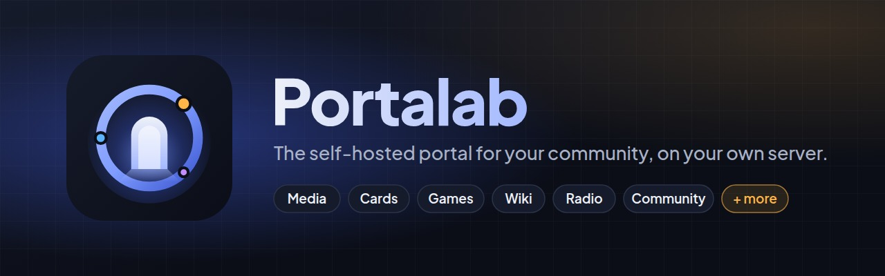

<p align="center">
  
</p>

**Portalab** is the self-hosted portal for your community: one place for what is on your media server and
what is coming, trading cards cut from your own library, games, a wiki, news, a radio, profiles and
progression — on your own server.

Source, documentation and release notes: **https://github.com/sharkhunterr/portalab**

## Tags

| Tag | |
| --- | --- |
| `latest` | the latest release |
| `vX.Y.Z` / `X.Y.Z` | one release |

## Run it

One image, three entrypoints — `serve` (default), `worker`, `migrate` — next to PostgreSQL 16. Secrets are
files mounted as Docker secrets (`DATABASE_URL_FILE`, `SECRET_KEY_FILE`).

```yaml
x-portalab: &portalab
  image: sharkhunterr/portalab:latest
  environment:
    DATABASE_URL_FILE: /run/secrets/database_url
    SECRET_KEY_FILE: /run/secrets/secret_key
    DATA_DIR: /var/lib/portalab
    TRUSTED_PROXIES: 172.18.0.0/16   # your reverse proxy's address or network
  secrets: [database_url, secret_key]
  volumes: [portalab-data:/var/lib/portalab]
  read_only: true
  tmpfs: [/tmp]
  security_opt: [no-new-privileges:true]
  cap_drop: [ALL]
  restart: unless-stopped

services:
  postgres:
    image: postgres:16-alpine
    environment:
      POSTGRES_DB: portalab
      POSTGRES_USER: portalab
      POSTGRES_PASSWORD_FILE: /run/secrets/db_password
    secrets: [db_password]
    volumes: [postgres-data:/var/lib/postgresql/data]
  migrate:
    <<: *portalab
    command: ["migrate"]
    restart: "no"
  portalab:
    <<: *portalab
    command: ["serve"]
    ports: ["8080:8080"]
  worker:
    <<: *portalab
    command: ["worker"]

secrets:
  db_password: { file: ./secrets/db_password }
  database_url: { file: ./secrets/database_url }
  secret_key: { file: ./secrets/secret_key }

volumes:
  postgres-data:
  portalab-data:
```

```bash
docker compose up -d postgres && docker compose run --rm migrate && docker compose up -d portalab worker
```

Then open `http://<server>:8080` from your local network: the arrival wizard creates the administrator.
Behind a reverse proxy and on the internet, follow the checklist in the repository
(`portalab/docs/internet-exposure.md`).
